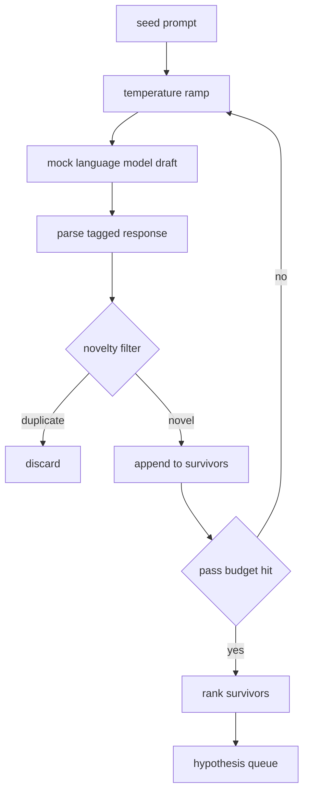

# Hypothesis Generator

> Agen riset yang menanyakan pertanyaan yang sama dua kali sedang membakar token. Triknya adalah memaksa setiap draf mendarat di tempat yang baru.

**Type:** Build
**Languages:** Python
**Prerequisites:** Phase 19 Track A lessons 20-29
**Time:** ~90 minutes

## Tujuan Pembelajaran
- Menggerakkan sampler dari seed prompt dan mengubah output-nya menjadi record hipotesis bertipe.
- Menaikkan temperature sampler di setiap pass sehingga draf berikutnya makin jauh dari yang sebelumnya.
- Menyaring dekat-duplikat dengan model embedding kecil dan threshold jarak cosine.
- Memeringkat para penyintas dengan fungsi scoring yang memadukan novelty, specificity, dan testability.
- Menjaga setiap langkah deterministik sehingga seed yang sama selalu menghasilkan antrean yang sama.

## Mengapa menghasilkan dulu, lalu menyaring

Perencana yang bertanya ke satu model satu kali mendapat satu hipotesis. Itu wajar untuk contoh yang dikerjakan. Untuk loop riset itu bentuk yang salah. Loop menginginkan antrean berperingkat yang dalam, jadi saat hipotesis pertama gagal, runner sudah punya hipotesis berikutnya siap tanpa membayar untuk satu pass sampling penuh lagi.

Dua ide digabungkan untuk menghasilkan antrean itu. Ide pertama adalah temperature ramping: setiap pass melalui sampler menaikkan temperature satu tak, sehingga draf-draf belakangan didorong untuk menjelajah. Ide kedua adalah novelty filtering: setiap kali draf selesai, generator mengukur jarak embedding dari setiap penyintas sebelumnya dan menolak apa pun yang berada di dalam cluster.

Pelajaran ini mengirimkan mock language model yang mengembalikan sekuens token ter-script untuk prompt tetap. Mock itu cukup untuk menjalankan seluruh jalur: seed prompt masuk, temperature ramp diterapkan, kandidat diparse, novelty filter dijalankan, antrean berperingkat keluar.

## Bentuk Hypothesis

```text
Hypothesis
  id             : int           (monotonic within a run)
  text           : str           (the claim)
  variables      : list[str]     (what changes between conditions)
  metric         : str           (what the runner will measure)
  baseline_ref   : str | None    (which paper or run the comparison cites)
  draft_pass     : int           (which sampler pass produced this)
  temperature    : float         (the sampler setting at draft time)
  novelty_score  : float         (distance from prior survivors, 0..1)
  rank_score     : float         (weighted sum used for ordering)
```

`variables` dan `metric` bukan teks bebas. Parser menariknya dari response bertag. Runner di pelajaran lima puluh dua membaca field-field ini secara langsung saat membangun config eksperimen.

`baseline_ref` opsional tapi disarankan. Evaluator di pelajaran lima tiga butuh baseline untuk dibandingkan. Jika hipotesis tidak menyertakannya, evaluator jatuh ke run sebelumnya pada metrik yang sama.

```figure
cg-novelty-ramp
```

## Arsitektur



Loop-nya lurus ke depan. Bagian menariknya adalah setiap kotak punya kontrak yang keras.

## Temperature ramp

Mulai di `t_min`, berakhir di `t_max`, step `(t_max - t_min) / (n_passes - 1)`. Setiap pass memanggil sampler pada temperature saat ini, menghasilkan `n_passes` nilai berjarak sama dari `GeneratorConfig.schedule()`. Model mock menghormati temperature dengan beralih di antara set kecil response ter-script yang di-key pada `(prompt, temp_bucket)`. Bucket-nya adalah interval terbuka sehingga perubahan kecil pada temperature memilih bucket berbeda dan menghasilkan draf berbeda. Di produksi, sampler akan berupa model nyata dengan `temperature=t` diteruskan.

Jadwal default adalah enam pass dari `0.2` ke `1.2`. Enam sudah cukup untuk mengisi antrean tanpa membayar untuk sampel yang novelty filter akan tolak anyway. Di bawah `0.2` model hanya mengulang seed. Di atas `1.2` response cenderung menyimpang dari topik dan gagal di parser.

## Novelty filter

Setelah setiap draf diparse, generator men-embed teksnya dan membandingkan terhadap setiap hipotesis yang diterima. Embedding-nya adalah hashed bag of word tokens kecil, dinormalisasi ke panjang satuan. Jarak cosine antara dua vektor satuan adalah `1 - dot(a, b)`. Sebuah draf lulus jika jarak minimum-nya ke penyintas sebelumnya di atas `novelty_threshold`. Default `0.25`.

Hashed embedding itu bukan yang canggih. Ia deterministik, punya nol dependensi, dan cukup untuk menangkap kasus yang jelas: dua draf yang berbagi kebanyakan noun-nya. Deployment produksi akan menukarnya dengan sentence model kecil. Antarmukanya tetap sama.

## Rank score

```text
rank_score = w_novelty * novelty_score
           + w_specificity * specificity_score
           + w_testability * testability_score
```

Tiga sub skor. `novelty_score` adalah jarak embedding minimum dari penyintas sebelumnya. `specificity_score` adalah jumlah variabel konkret dalam hipotesis dibagi target count. `testability_score` satu jika hipotesis menentukan baik metrik maupun baseline, setengah jika hanya punya metrik, nol selain itu.

Bobot default `0.4`, `0.3`, `0.3`. Bobot-bobot itu hidup di config generator sehingga pelajaran downstream bisa menggesernya tanpa fork kode.

## Mock language model

```python
class MockLLM:
    def sample(self, prompt: str, temperature: float, seed: int) -> str:
        ...
```

Sampler deterministik diberikan triple `(prompt, temperature, seed)`. Mock menyimpan tabel response ter-script yang di-key pada `(prompt_signature, temperature_bucket)`. Jika tabel tidak punya entry untuk sebuah key, sampler mengembalikan fallback yang gagal di parser. Jalur fallback dijalankan oleh salah satu test.

Seed dicampur ke dalam response sehingga pasangan `(prompt, temperature)` yang sama dengan seed berbeda menghasilkan draf berbeda. Di test kami pin seed-nya untuk menjaga hasil dapat direproduksi. Di deployment nyata, seed akan datang dari system clock atau counter.

## Antrean output

Output adalah daftar record `Hypothesis` yang diurutkan menurut `rank_score` menurun. Runner di pelajaran lima puluh dua mem-pop head-nya, menjalankan eksperimen, dan evaluator di pelajaran lima tiga menulis verdict kembali. Jika verdict menyatakan hipotesis itu salah, runner mem-pop berikutnya.

Antrean itu finit. Saat kosong, orkestrator bisa melebarkan seed prompt dan menjalankan generator lagi, atau berhenti dan melaporkan anggaran habis.

## Cara membaca kodenya

`code/main.py` mendefinisikan `Hypothesis`, `MockLLM`, `HypothesisGenerator`, dan demo deterministik. Generator mengekspos satu metode `run(seed_prompt)` yang mengembalikan antrean terurut; jumlah pass dibaca dari `GeneratorConfig.n_passes` bukan diteruskan sebagai argumen. Embedding-nya adalah hashed bag of tokens. Novelty filter-nya satu fungsi. Rank score-nya satu fungsi. Tidak ada yang bergantung pada `numpy`; matematika embedding-nya pure stdlib sehingga pelajaran tetap portabel.

`code/tests/test_generator.py` mencakup jalur linear, jalur penolakan duplikat, jalur kegagalan parser, batas-batas temperature ramp, dan urutan ranking.

## Bagaimana ini menyatu dengan sisa Track D

Pelajaran lima puluh menghasilkan antrean. Pelajaran lima puluh satu mengambil head antrean dan menjalankan pencarian literatur untuk mengonfirmasi atau membantahnya. Pelajaran lima puluh dua mengambil head yang sama dan menjalankan eksperimen nyata. Pelajaran lima tiga membaca kedua output dan menulis verdict. Empat pelajaran ini menyatu menjadi loop riset tanpa manusia di dalamnya; manusia bisa masuk di batas mana pun.
