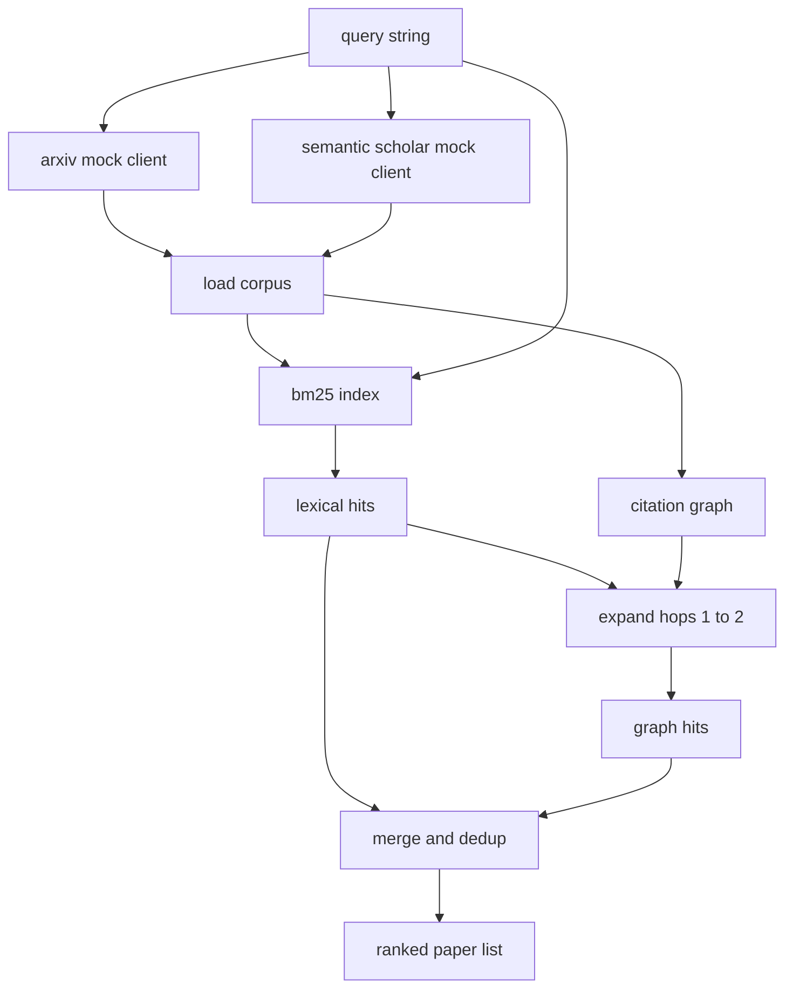

# Literature Retrieval

> Sebuah hipotesis itu murah. Yang mahal adalah mengetahui apakah seseorang sudah membuktikannya. Bangun lapisan retrieval yang menjawab pertanyaan itu sebelum runner memutar sandbox.

**Type:** Build
**Languages:** Python
**Prerequisites:** Phase 19 Track A lessons 20-29
**Time:** ~90 minutes

## Tujuan Pembelajaran
- Memodelkan record paper kecil dengan field yang akan dibaca loop secara downstream.
- Membangun indeks BM25 di atas abstract hanya dengan data structure stdlib.
- Menjelajahi citation graph untuk memunculkan paper yang dilewati pencarian leksikal.
- Menghilangkan duplikat hit di antara pass leksikal dan graph dengan paper id yang stabil.
- Membungkus dua mock API eksternal di balik satu klien sehingga call site hulu tetap sama saat endpoint nyata datang.

## Mengapa dua pass retrieval

Pencarian kata kunci di atas abstract mengembalikan paper yang berbagi vocabulary dengan query. Itu mencakup sebagian besar permukaannya. Ia melewatkan dua kasus. Kasus pertama adalah saat paper fundamental menggunakan vocabulary berbeda; misalnya query untuk "sparse attention" melewatkan paper berjudul "block selection in transformer routing." Kasus kedua adalah saat paper yang relevan adalah follow-up yang mengutip anchor yang dikenal; lebih efisien menemukan anchor dan berjalan ke depan daripada brute force di kolam abstract.

Pelajaran ini membangun kedua pass. BM25 di atas abstract menangkap hit leksikal. Traversal citation graph mengembangkan seed set ke depan dan ke belakang satu atau dua hop. Union-nya di-dedup berdasarkan paper id dan diperingkat dengan skor gabungan kecil.

## Bentuk Paper

```text
Paper
  id          : str           (stable identifier, "p001" for the mock corpus)
  title       : str
  abstract    : str
  year        : int
  authors     : list[str]
  references  : list[str]     (paper ids this paper cites)
  citations   : list[str]     (paper ids that cite this paper)
  source      : str           (which mock api supplied it, "arxiv" or "s2")
```

Field references dan citations membentuk citation graph berarah. Dua mock API mengembalikan field yang tumpang-tindih tapi tidak identik, jadi corpus loader mengunion-kan mereka pada `id`.

```figure
cg-citation-hops
```

## Arsitektur



Klien retrieval memiliki kedua pass dan merge-nya. Pemanggil menyerahkan query dan menerima kembali daftar berperingkat di mana setiap entri membawa field skor per paper (`bm25_score`, `graph_distance`, `recency_score`, `final_score`) yang menjelaskan ranking-nya.

## BM25 dari nol

Implementasinya adalah Okapi BM25 standar dengan parameter default `k1=1.5`, `b=0.75`. Indeksnya dua dictionary: `term -> doc_frequency` dan `term -> list of (doc_id, term_count)`. Panjang dokumen adalah jumlah token abstract. Panjang dokumen rata-rata dihitung sekali saat build indeks. Scoring sebuah query adalah jumlahan di atas query terms dari `idf * tf_norm` di mana `tf_norm` adalah term frequency ter-normalisasi panjang BM25 standar.

Tokenisernya `lower` lalu split di non-alphanumeric. Ia tidak di-stem. Sistem produksi akan menukarnya dengan stemmer kecil. Antarmukanya tetap sama.

```text
idf(t)      = log((N - df + 0.5) / (df + 0.5) + 1.0)
tf_norm(t)  = (f * (k1 + 1)) / (f + k1 * (1 - b + b * dl / avgdl))
score(d, q) = sum over t in q of idf(t) * tf_norm(t)
```

## Traversal citation graph

Graph dibangun sekali dari corpus. Edge maju berjalan dari paper ke references-nya. Edge mundur berjalan dari paper ke citations-nya. Traversal-nya adalah breadth first search yang di-seed oleh top hit BM25, dibatasi dua hop.

Dua hop adalah ceiling yang disengaja. Satu hop terlalu dangkal; agen sering menginginkan ancestor atau descendant langsung. Tiga hop meledakkan ukuran hasil pada graph yang terhubung dan cenderung menyimpang dari topik. Pelajaran mengekspos batas hop sebagai config knob sehingga loop downstream bisa mengencangkannya.

## Dedup dan ranking

Kedua pass mengembalikan set yang tumpang-tindih. Merge-nya di-key pada paper id. Untuk setiap paper, skor akhir adalah campuran berbobot.

```text
final_score = w_bm25 * bm25_score_norm
            + w_graph * graph_score
            + w_recency * recency_score
```

`bm25_score_norm` adalah skor BM25 dibagi skor BM25 maksimum di set hasil gabungan (jadi field-nya hidup di nol sampai satu). `graph_score` satu untuk hit leksikal langsung, lalu `0.6` untuk satu hop, `0.3` untuk dua hop, nol selain itu. `recency_score` adalah ramp linier dari nol di tahun minimum corpus ke satu di maksimumnya.

Bobot default `0.5`, `0.3`, `0.2`. Bobot adalah config; topik yang stagnan mungkin menurunkan recency sementara topik yang cepat bergerak menaikkannya.

## Mock corpus

Corpus-nya seratus paper, dihasilkan oleh `build_corpus()`. Setiap paper punya title dan abstract yang ditulis tangan di salah satu dari lima topik: attention sparsity, retrieval augmentation, low rank adapters, dataset distillation, dan evaluation harnesses. References dan citations di-wire sehingga setiap topik membentuk sub-graph terhubung dengan beberapa edge lintas-topik.

Dua mock klien API (`ArxivMockClient`, `SemanticScholarMockClient`) membaca dari corpus yang sama tapi mengekspos field yang berbeda. Arxiv mengembalikan title, abstract, year, authors. Semantic Scholar menambah references dan citations. Klien retrieval mengunion-kan pada id; penanganan ketidakselarasan field lintas-klien ditunda ke pelajaran berikutnya.

## Apa yang dibaca pelajaran 52 dan 53

Runner di pelajaran lima puluh dua membaca `paper.id`, `paper.title`, dan tiga kalimat pertama abstract sebagai konteks untuk eksperimen. Evaluator di pelajaran lima tiga membaca `paper.year` dan `paper.references` untuk mengatribusikan baseline ke paper tertentu.

Klien retrieval mengembalikan `RetrievalResult` dengan baik daftar berperingkat maupun metrik per query: hit count, average score, top score, total wall time. Runner mencatat ini sehingga pass observability downstream bisa memplot kualitas dari waktu ke waktu.

## Cara membaca kodenya

`code/main.py` mendefinisikan `Paper`, `ArxivMockClient`, `SemanticScholarMockClient`, `BM25Index`, `CitationGraph`, `RetrievalClient`, dan demo deterministik. Mock klien dan corpus berada di file yang sama sehingga pelajaran tetap portabel. Implementasi BM25 adalah satu kelas, enam puluh baris. Traversal graph-nya satu metode.

`code/tests/test_retrieval.py` mencakup jalur leksikal, jalur graph, merge, dedup, dan query kosong.

## Bagaimana ini menyatu dengan sisa Track D

Pelajaran lima puluh menghasilkan hipotesis. Pelajaran lima puluh satu menelusuri literatur untuk melihat apakah hipotesis itu sudah diselesaikan. Pelajaran lima puluh dua menjalankan eksperimen jika belum. Pelajaran lima tiga membaca baik hasil retrieval maupun metrik eksperimen untuk menulis verdict. Klien retrieval adalah yang termurah di antara empat tahap dan berjalan pertama di orkestrator.
