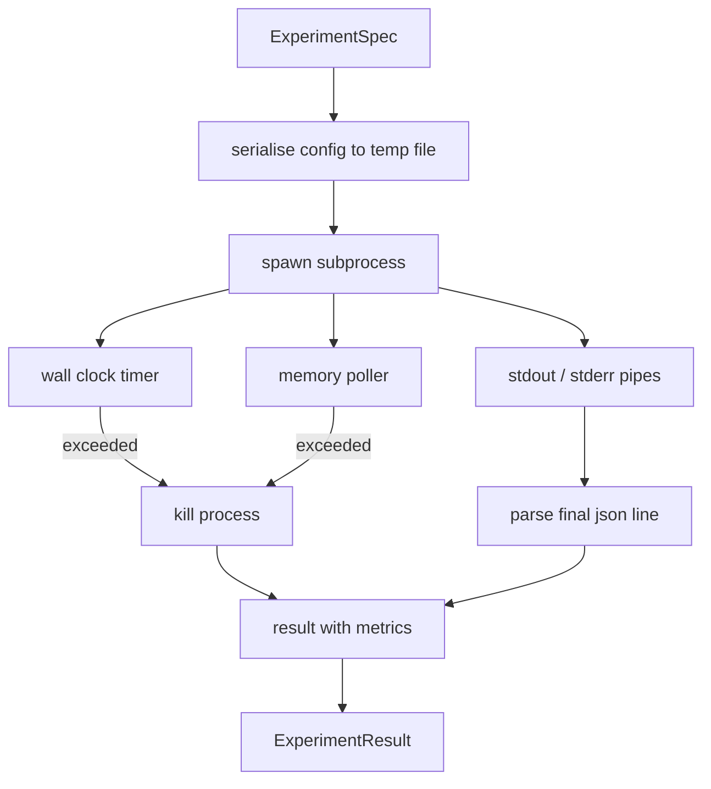

# Experiment Runner

> Loop hanya sejujur pengukurannya. Bangun runner yang mengambil spec, mengeksekusinya di subprocess ber-sandbox, dan memancarkan blob metrik json yang bisa dipercaya evaluator.

**Type:** Build
**Languages:** Python
**Prerequisites:** Phase 19 Track A lessons 20-29
**Time:** ~90 minutes

## Tujuan Pembelajaran
- Meng-encode eksperimen sebagai spec bertipe yang bisa diserialisasi runner ke subprocess.
- Meluncurkan subprocess dengan wall clock timeout keras dan memory cap lembut, dan memunculkan keduanya sebagai kondisi terminal.
- Menangkap stdout, stderr, dan blob metrik terstruktur ke dalam satu record hasil.
- Membangun tabel ablation yang menyapu satu config knob dalam satu waktu di atas base spec tetap.
- Menjaga setiap hasil deterministik diberikan seed sehingga evaluator melihat angka yang sama di seluruh run.

## Mengapa subprocess

Loop riset menjalankan kode yang tidak tepercaya. Hipotesis datang dari sampler, skrip eksperimen datang dari jalur yang sama; memperlakukan keduanya sebagai aman in-process meminta crash yang menjatuhkan orkestrator. Subprocess adalah isolasi paling sederhana yang dikirim bahasa: proses terpisah, address space independen, handle sinyal di sisi parent.

Runner di sini tidak mengimplementasikan sandboxing penuh. Tidak ada cgroup, tidak ada seccomp filter, tidak ada namespace remapping. Yang dimilikinya adalah wall clock timeout, polling loop untuk pertumbuhan memori, dan jalur kill yang mengakhiri proses pada batas mana pun. Itulah kontrak runtime yang diperluas setiap sandbox yang lebih rumit. Pelajaran menjaga kontrak tetap kecil cukup untuk dibaca dalam satu duduk.

## Bentuk ExperimentSpec

```text
ExperimentSpec
  spec_id        : str            (stable id, "exp_001")
  hypothesis_id  : int            (link back to the queue from lesson 50)
  script_path    : str            (path to the python script to run)
  config         : dict           (passed to the script as one json arg)
  seed           : int            (deterministic seed for the experiment)
  wall_timeout_s : float          (hard timeout, killed on exceed)
  memory_cap_mb  : int            (soft cap, polled; killed on exceed)
  metric_keys    : list[str]      (which fields the evaluator will read)
```

Skrip hidup di disk; runner menulis config ke path file temp yang dibaca skrip. Skrip diharapkan mencetak satu baris json di stdout yang key-nya supersets dari `metric_keys`. Apa pun lain di stdout ditangkap tapi diabaikan oleh parser metrik.

```figure
cg-runner-limits
```

## Arsitektur



Runner adalah satu kelas dengan satu metode utama. Poller adalah thread kecil yang bangun sekali setiap interval poll dan membaca padanan `psutil` subprocess dari proc filesystem saat tersedia, jatuh ke no-op saat platform tidak mengeksposnya.

## Mengapa memory cap lembut

Memory cap keras membutuhkan `resource.setrlimit` dan hanya bekerja di POSIX. Pelajaran mengirimkan pendekatan portabel: poll resident set size dari platform dan bunuh subprocess jika melebihi cap. Cap itu lembut karena poller punya interval non-nol; sebuah proses bisa melonjak di atas cap di antara poll lalu turun kembali. Runner mencatat RSS maksimum yang diamati sehingga evaluator bisa melihat seberapa dekat run mendekati batas.

Di sistem tanpa dukungan inspeksi proses, poller mencatat satu warning sekali dan menonaktifkan dirinya. Wall clock timeout tetap berlaku. Test pelajaran mencakup kedua jalur.

## Menangkap stdout dan stderr

Runner membaca kedua pipe yang terkuras saat selesai. Stdout dipindai baris demi baris; baris terakhir yang parse sebagai json dengan semua `metric_keys` yang diperlukan diambil sebagai blob metrik. Baris json lebih awal disimpan di hasil sebagai `intermediate_metrics`; evaluator bisa menggunakan ini untuk learning curves.

Stderr ditangkap verbatim ke dalam hasil. Runner tidak pernah raise pada exit code non-nol; sebaliknya ia mencatat kode-nya di hasil. Exit non-nol apa pun dilabeli `"crash"` bahkan saat skrip mencetak metrik, jadi evaluator memperlakukan run parsial sebagai kegagalan secara default.

## Tabel ablation

```python
def ablate(base: ExperimentSpec, knob: str, values: list[Any]) -> list[ExperimentSpec]:
    ...
```

Diberikan base spec dan nama knob, helper mengembalikan satu spec per nilai dengan `config[knob]` override. Setiap spec mendapat `spec_id` turunan (`f"{base.spec_id}_{knob}_{value}"`). Runner mengirimkan `AblationRunner` yang menjalankannya berurutan dan mengembalikan `AblationTable` yang di-key berdasarkan nilai knob.

Mengapa satu knob dalam satu waktu. Sapuan faktorial penuh meledak secara eksponensial dan menghasilkan hasil yang tidak bisa diinterpretasi evaluator. Satu knob dalam satu waktu menghasilkan sumbu bersih yang bisa diplot evaluator. Pelajaran mendukung sapuan multi-knob hanya sebagai ablation single-knob berulang, dikomposisikan oleh pemanggil.

## Determinisme

Setiap spec membawa seed. Runner meneruskan seed ke skrip via config dict (`config["__seed"] = spec.seed`). Skrip eksperimen mock di `code/experiments/` menghormati seed dan menghasilkan metrik yang identik di seluruh run. Evaluator di pelajaran lima tiga bergantung pada ini; tanpa determinisme, sebuah "regression" mungkin merupakan inisialisasi acak yang berbeda.

## Skrip eksperimen mock

Pelajaran mengirimkan satu skrip eksperimen: `code/experiments/sparsity_experiment.py`. Itu skrip nyata yang membaca config file-nya, mensimulasikan small training run dengan numpy random pass, dan mencetak blob metrik json. Skrip menghormati knob `sleep_s` untuk menguji timeout dan knob `allocate_mb` untuk menguji memory poller.

Simulasinya tidak melatih apa pun yang nyata. Ia adalah komputasi numerik yang meniru bentuk training loop: kurva loss, perplexity akhir, wall time. Inti pelajaran adalah runner-nya, bukan simulasinya. Skrip eksperimen nyata akan meng-import model.

## Bentuk hasil

```text
ExperimentResult
  spec_id              : str
  hypothesis_id        : int
  exit_code            : int
  terminal             : "ok" | "timeout" | "oom" | "crash"
  wall_time_s          : float
  peak_rss_mb          : float | None
  metrics              : dict
  intermediate_metrics : list[dict]
  stdout_tail          : str
  stderr_tail          : str
```

Evaluator membaca `metrics` dan `terminal` lebih dulu. Jika terminal apa pun selain `"ok"`, eksperimen dihitung sebagai run gagal dan verdict evaluator otomatis. Selain itu, metrik diteruskan melalui significance test.

## Cara membaca kodenya

`code/main.py` mendefinisikan `ExperimentSpec`, `ExperimentResult`, `ExperimentRunner`, `AblationRunner`, dan demo deterministik. Manajemen subprocess adalah satu kelas. Memory poller adalah thread kecil. Helper ablation adalah satu fungsi.

`code/experiments/sparsity_experiment.py` adalah eksperimen mock yang digunakan di test. Ia membaca path config file-nya dari argv dan menulis satu baris metrik json saat selesai.

`code/tests/test_runner.py` mencakup jalur sukses, jalur timeout, jalur crash, tabel ablation, dan pemeriksaan determinisme di seluruh dua run.

## Bagaimana ini menyatu dengan sisa Track D

Pelajaran lima puluh menghasilkan hipotesis. Pelajaran lima puluh satu menyaring apa pun yang literatur sudah selesaikan. Pelajaran lima puluh dua menjalankan eksperimen untuk sisa yang tersisa. Pelajaran lima tiga membaca hasil, menjalankan significance test, dan menulis verdict yang disimpan orkestrator terhadap hypothesis id.
