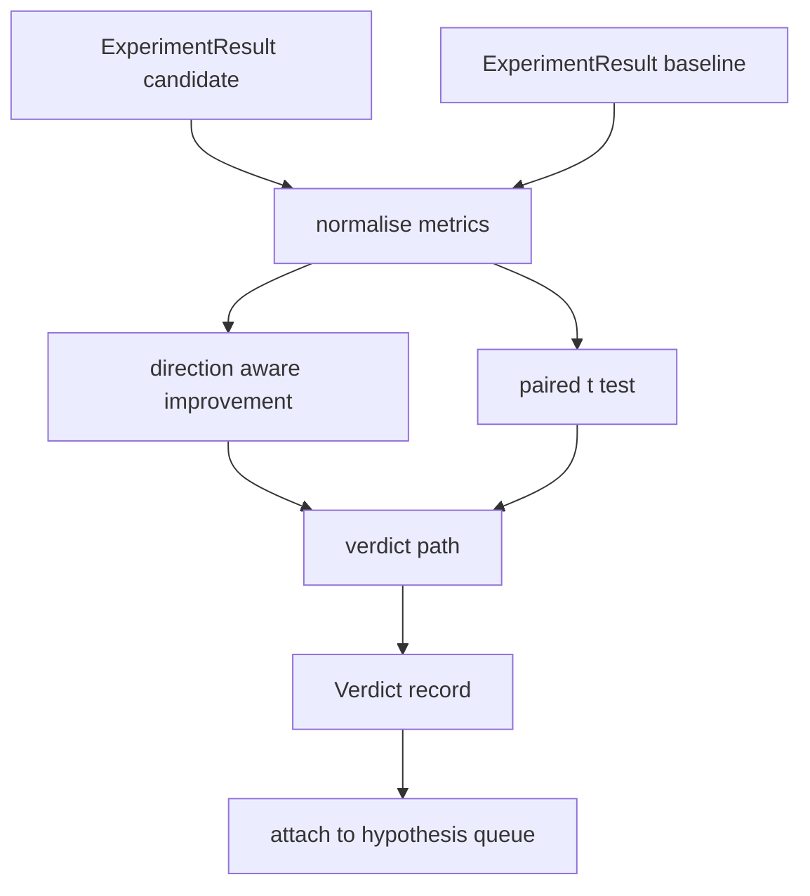

# Result Evaluator

> Runner menghasilkan angka. Evaluator memutuskan apakah angka-angka itu peningkatan, regresi, atau noise. Bangun jalur verdict yang mengubah metrik menjadi kesimpulan satu baris.

**Type:** Build
**Languages:** Python
**Prerequisites:** Phase 19 Track A lessons 20-29
**Time:** ~90 minutes

## Tujuan Pembelajaran
- Membandingkan run kandidat terhadap baseline menggunakan direction aware improvement dan threshold tetap.
- Menjalankan paired t test dari nol di atas metrik per seed dan membaca p value yang dihasilkan.
- Menormalisasi metrik berskala log sehingga laporan downstream bisa mencampurnya dengan metrik linier.
- Memancarkan verdict per hipotesis yang bisa orkestrator lampirkan ke antrean dari pelajaran lima puluh.
- Menjaga setiap langkah murni sehingga input yang sama selalu menghasilkan verdict yang sama.

## Mengapa test berpasangan

Satu angka dari runner tidak mengatakan apakah perubahan itu nyata. Konfigurasi yang sama dengan seed berbeda memberikan perplexity berbeda. Perubahan itu mungkin noise. Perbandingan yang tepat adalah berpasangan: seed yang sama dengan data yang sama, dijalankan sekali dengan kandidat dan sekali dengan baseline. Setiap seed memberikan satu selisih. Rata-rata selisih-selisih itu adalah efek. Standard error selisih-selisih itu adalah noise floor.

Pelajaran mengimplementasikan test dari nol. Tidak ada `scipy.stats`. Matematikanya kecil cukup untuk dibaca dalam satu layar.

```text
diffs    = [a_i - b_i for i in seeds]
mean     = sum(diffs) / n
variance = sum((d - mean) ** 2 for d in diffs) / (n - 1)
t_stat   = mean / sqrt(variance / n)
df       = n - 1
p_value  = two_sided_p(t_stat, df)
```

P dua sisi menggunakan fungsi beta tak lengkap terregularisasi. Pelajaran mengirimkan implementasi kecil yang menggunakan pecahan lanjut Lentz. Seluruhnya enam puluh baris matematika stdlib.

## Direction aware improvement

Beberapa metrik membaik saat naik (accuracy, throughput). Yang lain membaik saat turun (loss, perplexity, wall time). Evaluator membawa field `direction` di setiap metrik.

```text
if direction == "higher_is_better":
    improvement = (candidate - baseline) / abs(baseline)
elif direction == "lower_is_better":
    improvement = (baseline - candidate) / abs(baseline)
```

Improvement bertanda. Improvement negatif pada metrik higher-is-better berarti kandidat lebih buruk. Jalur verdict membaca tanda dan magnitudo bersama.

Threshold datar (`improvement_threshold=0.02`, dua persen) memutuskan apakah perubahan cukup besar untuk dipanggil. Di bawah itu verdict adalah "noise" terlepas dari p value; loop tidak tertarik pada perubahan yang tidak bisa diukur pengguna.

```figure
cg-paired-verdict
```

## Arsitektur



Evaluator menjalankan tiga komputasi independen dan menggabungkannya di jalur verdict. Setiap komputasi adalah fungsi murni tanpa state bersama.

## Normalisasi log

Perplexity eksponensial terhadap loss. Penurunan loss 0.1 adalah penurunan perplexity yang jauh lebih besar. Membandingkan perplexity secara langsung di antara dua konfigurasi tidak apa-apa, tapi mencampurnya dengan metrik linier dalam satu laporan membutuhkan normalisasi.

Pelajaran menormalisasi metrik apa pun yang field `scale`-nya `"log"` dengan mengambil natural log sebelum menghitung improvement. Threshold kemudian diterapkan di ruang log. Penurunan perplexity dari 32 ke 28 adalah `log(28) - log(32) = -0.133` pada metrik lower-is-better, yang jauh di atas threshold dua persen.

```text
if scale == "log":
    a = log(candidate)
    b = log(baseline)
else:
    a = candidate
    b = baseline
```

Metrik dengan `scale="linear"` (default) melewati transform. Jalur kode yang sama menangani keduanya.

## Paired test per seed

Runner dari pelajaran lima puluh dua memancarkan satu blob metrik akhir per run. Untuk test berpasangan, evaluator membutuhkan satu blob per seed untuk kandidat dan satu per seed untuk baseline. Orkestrator menjalankan eksperimen yang sama di bawah kedua konfigurasi di seluruh daftar seed dan menyerahkan evaluator dua daftar record `ExperimentResult`.

Evaluator memasangkannya berdasarkan seed (seed hidup di `result.metrics["seed"]`) dan menelusuri metrik yang diminta. Jika seed tidak cocok di seluruh dua daftar, evaluator raise `PairingError`. Orkestrator sebaiknya menjalankan ulang.

## Bentuk Verdict

```text
Verdict
  hypothesis_id          : int
  metric                 : str
  direction              : "higher_is_better" | "lower_is_better"
  scale                  : "linear" | "log"
  candidate_mean         : float
  baseline_mean          : float
  improvement            : float       (signed, fraction; see direction rules)
  p_value                : float | None  (None if n < 2)
  significance_threshold : float
  improvement_threshold  : float
  verdict                : "improved" | "regressed" | "noise" | "failed"
  rationale              : str
```

Jalur verdict adalah decision table kecil:

```text
1. If any candidate result has terminal != "ok": verdict = "failed"
2. else if |improvement| < improvement_threshold:  verdict = "noise"
3. else if p_value is None or p_value > significance: verdict = "noise"
4. else if improvement > 0:                          verdict = "improved"
5. else:                                             verdict = "regressed"
```

Rationale adalah kalimat terbaca manusia satu baris yang bisa orkestrator catat terhadap hypothesis id.

## Cara membaca kodenya

`code/main.py` mendefinisikan `MetricSpec`, `Verdict`, `Evaluator`, helper statistik t dan beta tak lengkap, dan demo deterministik. T test diimplementasikan dalam matematika stdlib murni; numpy hanya digunakan untuk membaca daftar metrik dan menghitung mean serta varian.

`code/tests/test_evaluator.py` mencakup jalur improved, jalur regressed, jalur noise (improvement kecil), jalur noise (n rendah), jalur terminal gagal, jalur ternormalisasi log, t test terhadap nilai referensi yang diketahui, dan error pairing.

## Bagaimana ini menyatu dengan sisa Track D

Pelajaran lima puluh menghasilkan antrean hipotesis. Pelajaran lima puluh satu menyaring apa pun yang literatur selesaikan. Pelajaran lima puluh dua menjalankan eksperimen di bawah konfigurasi kandidat dan baseline di seluruh seed. Pelajaran lima tiga membaca run-run itu dan menulis verdict-nya. Orkestrator menyatukan keempatnya:

```text
for hypothesis in queue:
    literature = retrieval.search(hypothesis.text)
    if literature_settles(hypothesis, literature):
        attach(hypothesis, verdict="settled")
        continue
    candidates = runner.run_all(specs_for(hypothesis))
    baselines  = runner.run_all(baseline_specs_for(hypothesis))
    metric_spec = MetricSpec("perplexity", direction=LOWER, scale=LOG)
    verdict = evaluator.evaluate(hypothesis.id, metric_spec, candidates, baselines)
    attach(hypothesis, verdict)
```

Orkestrator itu tidak ada di pelajaran ini; keempat pelajaran menyatu ke dalamnya tanpa glue selain dataclasses yang masing-masing mereka definisikan.
