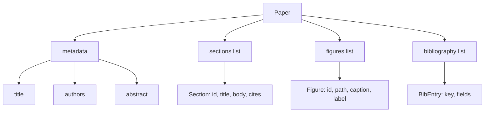
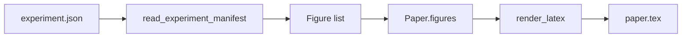
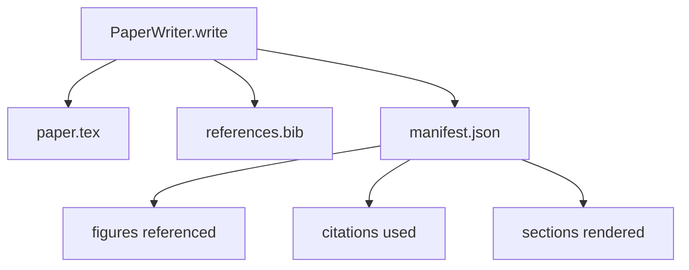

# Paper Writer

> Skeleton LaTeX adalah kontrak antara peneliti dan typesetter. Jika kontraknya rusak, dokumen tidak compile, dan kegagalannya nyaring. Bangun skeleton-nya lebih dulu, lalu isi.

**Type:** Build
**Languages:** Python
**Prerequisites:** Phase 19 lessons 50-53
**Time:** ~90 minutes

## Tujuan Pembelajaran

- Memperlakukan makalah penelitian sebagai artifact terstruktur dengan graph section yang diketahui, bukan dokumen bebas bentuk.
- Menghasilkan skeleton LaTeX yang mendeklarasikan abstract-nya, section-sectionnya, slot figure, dan bibliography keys sebelum prosa apa pun ditulis.
- Menyuntik figure dari output eksperimen (path dan caption) ke dalam skeleton melalui mekanisme slot deterministik.
- Men-wire generator prosa mock yang mengisi setiap section dari outline terstruktur sehingga harness dapat diuji tanpa model.
- Memancarkan satu `paper.tex` plus `references.bib` plus manifest yang mencantumkan setiap figure yang dirujuk dan setiap sitasi yang digunakan.

```figure
ch-paper-skeleton
```

## Mengapa skeleton lebih dulu

Draf yang dimulai sebagai prosa mengakumulasi hutang struktural. Pendahuluan tumbuh tiga paragraf yang seharusnya ada di related work. Sebuah figure dirujuk sebelum didefinisikan. Bibliography berakhir dengan tiga key untuk paper yang sama. Pada saat penulis menyadarinya, biaya menulis ulang lebih mahal daripada biaya menulis.

Skeleton membalikkannya. Struktur dideklarasikan di muka sebagai data. Section adalah slot dengan nama dan urutan. Figure adalah slot dengan id dan caption. Bibliography keys dideklarasikan di atas dengan entry yang mereka tunjuk. Prosa dihasilkan ke dalam slot-slot itu satu per satu. Harness dapat memvalidasi, sebelum prosa apa pun ditulis, bahwa setiap figure punya slot, setiap sitasi punya entry, dan setiap section muncul di table of contents.

Ini adalah disiplin yang sama yang pelajaran-pelajaran lebih awal terapkan pada plan, panggilan tool, dan trace. Struktur adalah kontraknya.

## Bentuk Paper



Setiap field adalah data Python polos. Renderer adalah fungsi murni dari `Paper` ke string LaTeX. Harness dapat mengintrospeksi paper sebelum rendering: menghitung section, mendaftar file figure yang hilang, memeriksa bahwa setiap `\cite{key}` punya `BibEntry` yang cocok.

## Kontrak render

Renderer menjamin tiga properti. Pertama, setiap slot figure di skeleton memancarkan blok `\begin{figure}` dengan label stabil berbentuk `fig:<id>`. Kedua, setiap section memancarkan `\section{}` dengan label stabil berbentuk `sec:<id>` sehingga cross-references bekerja. Ketiga, bibliography memancarkan blok `\bibliography` yang `references.bib`-nya berisi persis entry yang dideklarasikan di paper, tidak lebih dan tidak kurang.

Melanggar salah satunya adalah render error, bukan peringatan. Skeleton adalah kontraknya; render yang diam-diam menjatuhkan sebuah figure adalah pelanggaran kontrak.

## Penyuntikan figure dari eksperimen

Pelajaran-pelajaran lebih awal di track ini menghasilkan output eksperimen sebagai manifest JSON. Setiap manifest membawa daftar artifact dengan path dan caption singkat. Paper writer membaca manifest itu dan menghasilkan record `Figure`.



Penyuntikannya deterministik. Figure id diturunkan dari nama eksperimen plus counter monoton. Caption datang dari manifest. Path dinormalisasi relatif terhadap output directory paper sehingga LaTeX compile bahkan saat output eksperimen duduk di tempat lain di disk.

## Generator prosa mock

Pelajaran tidak memanggil model. `MockProseGenerator` membaca bentuk outline dan memancarkan prosa secara deterministik. Bentuk outline adalah satu string pendek per section. Generator mengembangkan string itu menjadi dua paragraf pendek dengan judul section dirajut masuk. Prosa yang dihasilkan menyebut figure dan sitasi persis saat outline mendeklarasikannya.

Ini cukup untuk menguji setiap perilaku writer. Implementasi nyata akan menukar generator dengan panggilan model. Harness di sekitarnya tidak berubah. Itulah nilai mendeklarasikan generator prosa sebagai callable: test mensubstitusikan yang deterministik, produksi mensubstitusikan yang model, sisa pipeline-nya identik.

## Output manifest

Writer memancarkan tiga file ke output directory.



Manifest adalah yang dibaca evaluator downstream atau critic loop. Ia tidak parse LaTeX; ia membaca manifest. Pelajaran berikutnya, critic loop, mengambil manifest ini sebagai input dan menghasilkan daftar feedback. Itulah mengapa manifest bagian dari kontrak dan LaTeX bukan.

## Gate validasi

Writer menjalankan empat gate sebelum menulis file apa pun.

1. Setiap figure id unik dalam paper.
2. Setiap field `cites` section merujuk bibliography key yang dideklarasikan di paper.
3. Abstract tidak kosong.
4. Title tidak kosong.

Gate yang gagal raise `PaperValidationError` dengan alasan yang tepat. Harness memunculkan alasan itu sebagai failure mode. Tidak ada penulisan parsial: ketiga file dipancarkan, atau tidak sama sekali.

## Cara membaca kodenya

`code/main.py` mendefinisikan `Paper`, `Section`, `Figure`, `BibEntry`, `PaperValidationError`, `MockProseGenerator`, `PaperWriter`, dan fungsi `render_latex`. Metode `write` mengambil output directory dan memancarkan `paper.tex`, `references.bib`, dan `manifest.json`. Helper `read_experiment_manifest` mengonversi daftar manifest eksperimen menjadi record `Figure`.

`code/tests/test_paper_writer.py` mencakup: render skeleton tanpa section, render penuh dengan dua section dan dua figure, gate sitasi yang hilang, gate duplikat figure id, isi manifest, dan kontrak string LaTeX (setiap section memancarkan `\section{}`, setiap figure memancarkan `\begin{figure}`).

## Melangkah lebih jauh

Dua ekstensi yang akan diinginkan implementasi nyata. Pertama, render multi-format: bentuk `Paper` yang sama compile ke Markdown untuk posting blog dan HTML untuk preview. Renderer menjadi strategi pada `Paper`. Kedua, enrichment sitasi: writer mengambil entry BibTeX dari citation key, diberikan cache lokal DOIs. Keduanya menambah nilai, keduanya bisa ditambahkan tanpa menyentuh kontrak skeleton.

Skeleton adalah taruhannya. Section, figure, dan sitasi dideklarasikan sebagai data, prosa dihasilkan ke dalam slot, manifest dipancarkan di samping LaTeX. Setiap peningkatan lain menyatu di atasnya.
