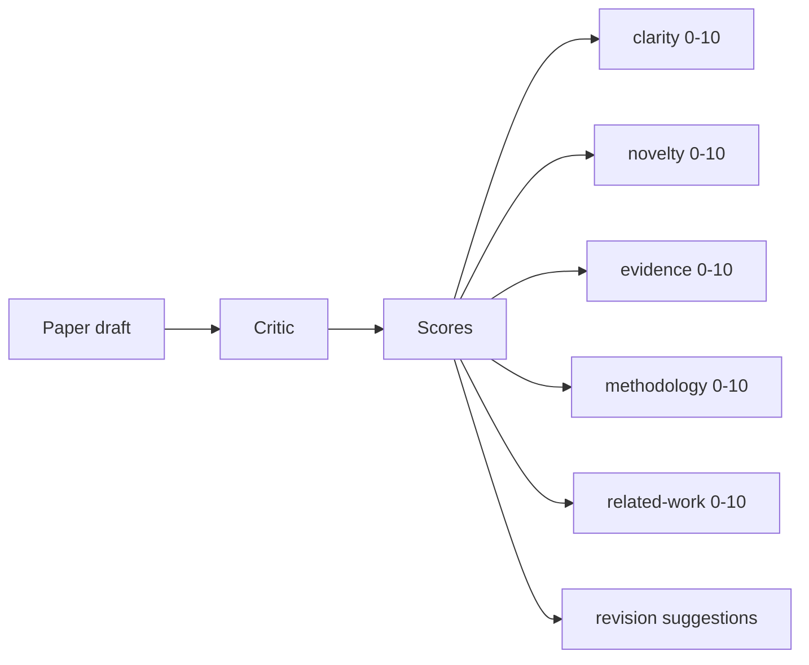
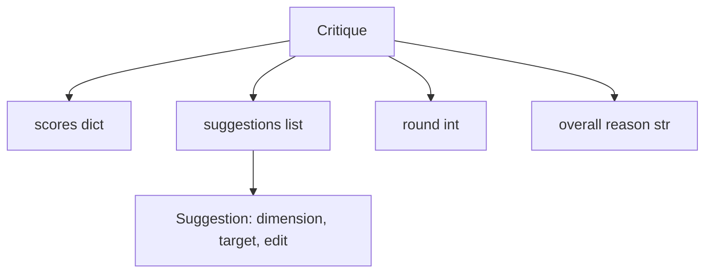
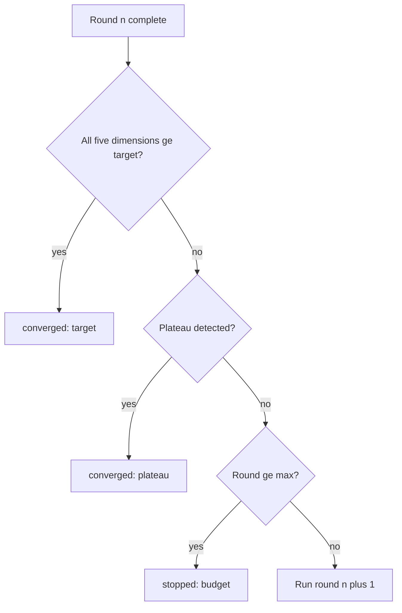
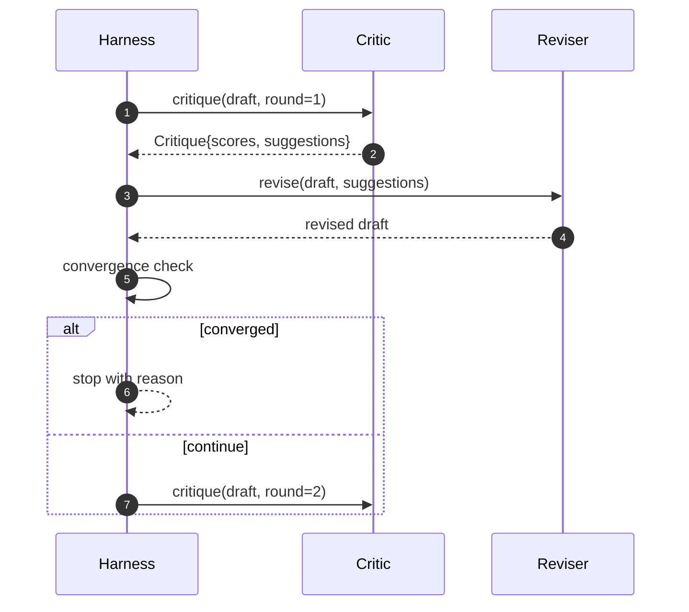

# Critic Loop

> Kritikus yang mengembalikan "looks good" pada percobaan pertama itu rusak. Kritikus yang selalu mengembalikan "needs work" itu rusak. Kritikus yang menarik adalah yang konvergen, dan kamu harus merekayasa konvergensi itu.

**Type:** Build
**Languages:** Python
**Prerequisites:** Phase 19 lessons 50-53
**Time:** ~90 minutes

## Tujuan Pembelajaran

- Menilai draf makalah di lima dimensi tetap: clarity, novelty, evidence, methodology, related-work.
- Menerapkan kritik setiap ronde sebagai revision diff terstruktur, bukan rewrite bebas bentuk.
- Mendeteksi konvergensi dengan membandingkan skor di seluruh ronde; berhenti pada plateau, target tercapai, atau anggaran habis.
- Membatasi ronde dengan anggaran max-iteration sehingga kritikus yang tidak konvergen tidak berjalan selamanya.
- Memancarkan trace per ronde sehingga dashboard atau tahap berikutnya bisa merender trajektori skor.

```figure
ch-critic-converge
```

## Mengapa lima dimensi tetap

Kritikus bebas bentuk adalah model yang mengembalikan paragraf saran. Ronde revisi berikutnya memperlakukan paragraf itu sebagai konteks ambient. Apakah rewrite membahas kritik itu tidak dapat diverifikasi karena kritiknya tidak pernah punya struktur.

Lima dimensi memberi harness sebuah kontrak.



Skor adalah vektor. Harness mengawasi setiap dimensi di seluruh ronde. Revisi yang menaikkan clarity tapi menjatuhkan evidence adalah regresi pada evidence, dan pemeriksaan konvergensi melihatnya. Kritikus model-saja tidak bisa menawarkan jaminan itu.

## Bentuk Critique



Setiap saran membawa dimensi yang ia perbaiki, section yang ia tuju, dan instruksi `edit` yang bisa diterapkan reviser. Reviser juga merupakan callable. Pelajaran mengirimkan reviser deterministik yang menginterpretasi instruksi edit sebagai operasi append-to-section. Reviser yang digerakkan model akan menginterpretasi field yang sama sebagai prompt. Kontraknya tidak berubah.

## Aturan konvergensi, berurutan

Critic loop berakhir saat salah satu dari tiga kondisi menyala.



Target adalah kasus paling ketat: setiap satu dari lima dimensi (clarity, novelty, evidence, methodology, related_work) harus mencapai `>= target_score` (default `8.0`) sebelum loop mengembalikan sukses. Mean yang tinggi dengan satu dimensi lemah tidak cukup. Deteksi plateau membandingkan mean ronde saat ini dengan mean ronde sebelumnya. Jika improvement di bawah `plateau_epsilon` (default `0.1`) selama dua ronde berturut-turut, loop keluar dengan `plateau`. Anggaran adalah batas keras atas ronde (default `5`) dan keluar dengan `budget`.

Urutannya penting. Target menang atas plateau menang atas anggaran. Jika ronde tiga mencapai target pada iterasi yang sama yang juga akan memicu plateau, hasilnya `target`, bukan `plateau`.

## Mengapa deteksi plateau berjalan di atas dua ronde

Plateau satu ronde adalah noise. Kritikus yang nyata mengembalikan skor sedikit berbeda setiap iterasi bahkan pada draf tetap, karena scoring deterministik tetap bergantung pada saran mana yang diterapkan dan dalam urutan apa. Mensyaratkan dua ronde plateau berturut-turut memfilter noise itu. Jika harness melaporkan plateau, draf memang benar-benar berhenti membaik.

## Kritikus deterministik di pelajaran ini

Pelajaran tidak memanggil model. Kritikus yang dikirim adalah callable yang menilai draf berdasarkan tiga sinyal: panjang body section rata-rata (clarity), jumlah figure dan jumlah sitasi (evidence), dan field `originality_tag` pada metadata paper (novelty). Reviser tahu cara mendorong setiap skor ke atas.

```text
clarity      grows when the average section body length increases
novelty      grows when originality_tag is set to "high"
evidence     grows when a section's figure_refs is non-empty
methodology  grows when a section titled "Method" exists with body
related-work grows when a section titled "Related Work" exists with body
```

Reviser menginterpretasi setiap saran sebagai append bertarget. Setelah ronde satu, harness dapat mengamati skor naik. Test menggunakan properti ini untuk meng-assert loop mengurangi gap.

## Kontrak loop penuh



Harness memiliki counter ronde, trace, dan pemeriksaan konvergensi. Kritikus memiliki skor. Reviser memiliki diff. Tidak satu pun dari ketiganya menyentuh state pihak lain.

## Output Trace

Setiap ronde memancarkan satu event trace dengan nomor ronde, vektor skor, jumlah saran, dan verdict konvergensi. Trace lengkap dikembalikan di samping draf akhir. Dashboard downstream bisa merender bagan skor-per-ronde. Pelajaran berikutnya, iteration scheduler, membaca trace untuk memutuskan apakah branch-nya layak dipertahankan.

## Anggaran yang melindungi dari kritikus buruk

Kritikus yang menghasilkan saran yang tidak pernah memperbaiki skor akan mengunci loop ke ceiling max-iteration. Trace membuatnya terlihat: lima ronde, skor datar, verdict `budget`. Pengguna membaca itu sebagai bug kritikus, bukan bug draf. Alternatifnya, hanya memunculkan draf akhir, menyembunyikan diagnosanya. Desain trace-first memunculkannya.

## Cara membaca kodenya

`code/main.py` mendefinisikan `Critique`, `Suggestion`, protokol `Critic`, protokol `Reviser`, `CriticLoop`, dan factory `make_deterministic_critic_pair` yang mengembalikan kritikus deterministik dan reviser yang cocok. Bentuk `Paper` minimal disertakan sehingga pelajaran berdiri sendiri.

`code/tests/test_critic_loop.py` mencakup: improvement monoton setelah ronde satu, konvergensi target pada draf yang di-tune, deteksi plateau setelah dua ronde datar, penghabisan anggaran saat tidak ada saran yang memperbaiki, penerapan saran oleh reviser, dan bentuk trace.

## Melangkah lebih jauh

Dua ekstensi yang akan diinginkan implementasi nyata. Pertama, bobot dimensi: makalah untuk workshop menimbang novelty lebih tinggi daripada methodology; jurnal menimbang kebalikannya. Pemeriksaan konvergensi menjadi mean berbobot. Kedua, kritikus berpasangan: satu kritikus menilai, kritikus kedua mengadili saran sebelum reviser melihatnya. Keduanya menambah nilai, keduanya menyatu pada bentuk `Critique` yang sama.

Taruhan itu adalah vektor skor. Sekali kritiknya terstruktur, setiap peningkatan lain, aturan konvergensi, dashboard, kritikus berpasangan, drop-in tanpa mengubah loop-nya.
