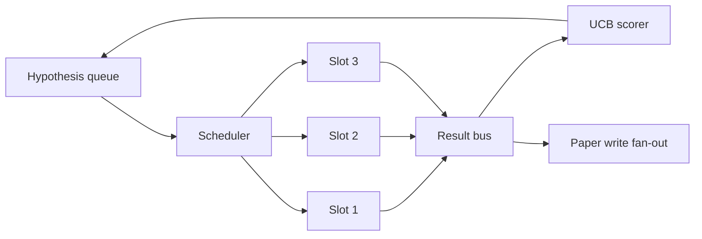
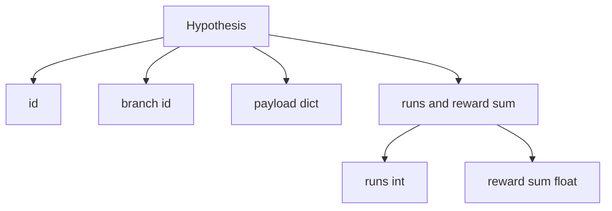
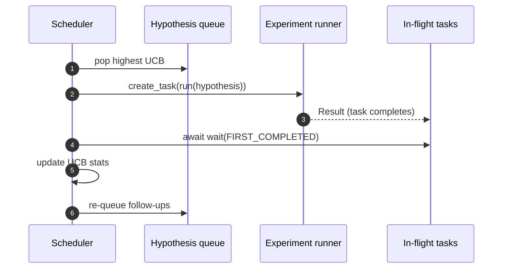

# Iteration Scheduler

> Loop riset tanpa scheduler adalah antrean yang penuh delusi. Scheduler adalah tempat loop memutuskan apa yang berhenti dijelajahi, dan keputusan itu adalah seluruh permainannya.

**Type:** Build
**Languages:** Python
**Prerequisites:** Phase 19 lessons 50-53
**Time:** ~90 minutes

## Tujuan Pembelajaran

- Memodelkan alur kerja riset sebagai antrean hipotesis yang memberi makan slot eksperimen paralel yang hasilnya berbalik masuk.
- Menjalankan beberapa eksperimen secara bersamaan dengan asyncio sehingga scheduler bisa menjaga semua slot sibuk.
- Menilai setiap branch hipotesis dengan UCB sehingga scheduler bisa memangkas branch ber-yield rendah tanpa meninggalkan eksplorasi.
- Men-fan-out hasil yang selesai ke tahap paper-write dan tahap re-queue sehingga branch ber-yield tinggi melahirkan hipotesis lanjutan.
- Memunculkan trace per-iterasi dengan skor branch, okupansi slot, dan keputusan pruning.

```figure
ch-ucb-scheduler
```

## Mengapa scheduler, bukan worklist

Worklist datar menjalankan job berdasarkan urutan pengiriman. Itu wajar saat setiap job independen. Riset tidak independen: temuan dari eksperimen tiga mengubah prioritas eksperimen empat dan lima. Scheduler yang membaca fan-in hasil dan mengurutkan ulang antrean menyelesaikan lebih banyak kerja berguna per satuan komputasi.

Pilihan desain yang menarik adalah scoring rule. Scorer rakus selalu memilih pemimpin saat ini dan tidak pernah menjelajah. Scorer seragam tidak pernah mengeksploitasi. UCB (upper confidence bound) adalah jalan tengah: eksploitasi pemimpin sambil menyimpan kapasitas untuk branch yang lebih jarang dicoba.

## Bentuk sistem



Antrean menampung hipotesis. Scheduler memilih hipotesis UCB tertinggi saat sebuah slot bebas. Setiap slot menjalankan eksperimen secara asinkron. Eksperimen yang selesai men-fan hasilnya ke bus. Bus memperbarui statistik UCB pada branch asal dan men-fan-out ke tahap paper-write saat yield sebuah branch melintasi threshold.

## Bentuk Hypothesis



`branch` adalah kunci untuk statistik UCB. Beberapa hipotesis mungkin berbagi branch (branch adalah arah riset; hipotesis adalah satu percobaan di dalamnya). `runs` adalah jumlah eksperimen yang selesai untuk branch itu, `reward_sum` adalah reward kumulatif. UCB membaca keduanya.

## Skoring UCB

Formula UCB yang digunakan di pelajaran ini adalah UCB1 klasik.

```text
ucb(branch) = mean_reward(branch) + c * sqrt( ln(total_runs) / runs(branch) )
```

`total_runs` adalah jumlah semua eksperimen yang selesai di seluruh semua branch. `c` adalah bobot eksplorasi; pelajaran default ke `sqrt(2)`. Branch dengan nol run mendapat `+inf` sehingga branch yang belum dicoba selalu dijadwalkan pertama. Branch dengan mean reward tinggi mempertahankan skor tinggi sampai branch lain menyusul; branch yang berjalan banyak kali tanpa banyak reward ter-eclipse oleh alternatif yang lebih sedikit run-nya.

Gate pruning terpisah dari pemilih. Pruning menghapus branch dari penjadwalan masa depan saat mean reward-nya jatuh di bawah floor absolut (default `0.2`) setelah setidaknya `prune_after_runs` percobaan (default `3`). Ini menjaga antrean tetap terbatas.

## Slot paralel dengan asyncio

Scheduler menggerakkan eksperimen dengan `asyncio.create_task`. Setiap task menjalankan experiment runner (callable `async def`) yang mengembalikan `Result`. Loop utama menunggu set task in-flight dengan `asyncio.wait(..., return_when=asyncio.FIRST_COMPLETED)` dan men-fire pembaruan scoring di setiap penyelesaian.



Tiga slot berjalan secara bersamaan. Loop utama tidak pernah memblokir pada satu eksperimen. Scheduler terus memulai task baru segera setelah sebuah slot bebas, sampai antrean kosong dan tidak ada task yang in-flight.

## Fan-out: pemicu paper

Saat mean reward sebuah branch melintasi `paper_threshold` (default `0.7`) dan branch itu belum menghasilkan paper, scheduler men-fan event `paper.trigger` ke daftar output. Downstream, paper writer dari pelajaran lima puluh empat akan mengambil ini. Di pelajaran ini pemicu ditangkap sebagai daftar sehingga test bisa meng-assert-nya.

## Fan-out: hipotesis lanjutan

Saat hasil ber-yield tinggi mendarat, scheduler bisa memanggil `expander` yang disediakan pengguna untuk menghasilkan satu atau lebih hipotesis lanjutan pada branch yang sama. Expander adalah fungsi murni dari `Result` ke `list[Hypothesis]`. Pelajaran mengirimkan expander deterministik yang menghasilkan dua follow-up untuk hasil apa pun yang reward-nya melampaui threshold paper.

## Anggaran

Dua anggaran melindungi scheduler dari loop yang liar.

```text
max_experiments    : total count of experiments run across all branches
max_seconds        : wall-clock cap (asyncio time)
```

Saat salah satu menyala, scheduler berhenti menjadwalkan task baru, menunggu yang in-flight, dan mengembalikan trace akhir. Trace menyertakan `stop_reason`.

## Trace dan laporan akhir

Setiap keputusan penjadwalan (pick, dispatch, result, prune, fan-out) memancarkan satu event. Laporan akhir meringkas statistik per-branch, total run, total wall-clock, dan pemicu paper yang menyala. Pelajaran berikutnya, demo end-to-end, membaca laporan ini untuk menggerakkan paper writer.

## Cara membaca kodenya

`code/main.py` mendefinisikan `Hypothesis`, `Result`, `BranchStats`, `IterationScheduler`, dan factory `make_deterministic_runner` yang mengembalikan experiment runner asyncio dengan reward yang dapat diprediksi. Runner tidur selama `delay_ms` tetap (default `5ms`) sehingga konkurensi dapat diamati.

`code/tests/test_scheduler.py` mencakup: UCB memilih branch yang belum dicoba lebih dulu, okupansi slot paralel, pemicu paper saat threshold dilintasi, pruning branch setelah percobaan ber-yield rendah, hipotesis lanjutan fan-out, dan exit anggaran (baik jumlah eksperimen maupun wall clock).

## Melangkah lebih jauh

Tiga ekstensi yang akan diinginkan implementasi nyata. Pertama, statistik UCB persisten di seluruh sesi: statistik saat ini hidup di memori; scheduler nyata akan checkpoint-nya sehingga restart mempertahankan anggaran eksplorasi yang sudah dibelanjakan. Kedua, scoring multi-objektif: alih-alih reward skalar, setiap hasil memancarkan vektor dan UCB menjadi pemilih ala Pareto. Ketiga, contextual bandits: pemilih memberi kondisi pada fitur hipotesis (panjang, kompleksitas) sehingga hipotesis serupa berbagi eksplorasi.

Scheduler adalah tempat di mana riset menjadi lebih dari sekadar worklist. Sekali UCB di-wire dan slot-slot berjalan paralel, setiap peningkatan lain menyatu di atasnya.
