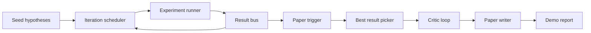
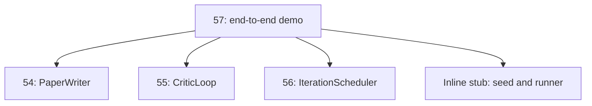
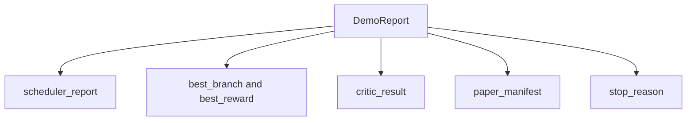

# Demo Riset End-to-End

> Demo adalah tempat di mana setiap kontrak yang kamu tulis sebelumnya harus menyatu. Jika ada satu pun yang bocor, demo adalah pelajaran yang menangkapnya.

**Type:** Build
**Languages:** Python
**Prerequisites:** Phase 19 lessons 50-53
**Time:** ~90 minutes

## Tujuan Pembelajaran

- Men-wire loop auto-research end to end: seed hipotesis, experiment runner, scheduler, critic loop, paper writer.
- Mengkomposisikan primitive dari empat pelajaran Track D sebelumnya melalui import Python biasa, bukan framework.
- Menjalankan loop sampai berakhir self-terminating dan memancarkan satu laporan demo yang mencantumkan output setiap tahap.
- Menjaga demo deterministik sehingga suite test bisa meng-assert bentuk akhir.
- Memunculkan failure mode yang jelas saat kontrak sebuah tahap rusak, sehingga tahap berikutnya tidak berjalan dengan input yang rusak.

```figure
ch-research-pipeline
```

## Apa yang menyatu di sini



Lima tahap. Seed adalah daftar tiga hipotesis. Scheduler menjalankan enam eksperimen di atasnya dengan tiga slot paralel. Bus melaporkan satu atau lebih pemicu paper. Picker memilih hasil terbaik tunggal. Critic loop mengiterasi draf yang dibangun dari hasil itu. Paper writer memancarkan LaTeX, BibTeX, dan manifest akhir.

## Mengapa import, bukan salin

Setiap pelajaran sebelumnya mengirimkan `main.py` dengan dataclasses dan fungsi publik. Demo meng-import-nya dengan menyesuaikan `sys.path` ke parent directory setiap pelajaran. Ini bukan wiring framework; ini import yang sama yang file test di pelajaran sebelumnya sudah gunakan.



Inline stub berdiri sebagai pengganti pelajaran lima puluh sampai lima tiga: generator kecil seed hipotesis dan fungsi reward sinkron. Pengguna dapat menukar inline stub dengan primitive nyata dari pelajaran-pelajaran itu dengan menyesuaikan dua import.

## Jaminan determinisme

Demo deterministik by construction. Experiment runner-nya numpy ber-seed. Reviser critic loop menelusuri dimensi tetap dalam urutan tetap. Generator prosa paper writer adalah yang mock dari pelajaran lima puluh empat. Pemilih UCB scheduler memecah tie berdasarkan urutan iterasi, bukan pilihan acak.

Diberikan seed yang sama, demo memancarkan laporan yang sama. Test meng-assert properti ini dengan menjalankan demo dua kali dan membandingkan manifest.

## Bentuk laporan demo



Setiap field datang verbatim dari tahap hulu. Demo tidak mentransformasi output apa pun; ia mengkomposisikannya. Itulah test yang dijalani demo.

## Penanganan failure mode

Setiap tahap berhasil atau raise error bertipe.

```text
Scheduler ........ returns SchedulerReport with stop_reason
                   in {queue_empty, max_experiments, deadline}
Best-result pick . raises NoTriggerError if no paper trigger fired
Critic loop ...... returns LoopResult with status converged or stopped
Paper writer ..... raises PaperValidationError on contract break
```

Kegagalan di tahap mana pun mem-short-circuit demo dengan exception bertipe. Test men-pin kontrak ini: `test_no_triggers_raises_typed_error` dan `test_best_picker_raises_when_no_triggers` meng-assert picker raise `NoTriggerError` / `BestResultError` saat tidak ada branch yang menyalakan pemicu, dan writer tidak pernah dipanggil.

## Pemilih hasil-terbaik

Scheduler memancarkan pemicu paper per branch. Picker memilih branch dengan mean reward tertinggi di seluruh semua pemicu. Tie dipecah secara alfabetis berdasarkan branch id sehingga demo deterministik. Picker adalah fungsi murni kecil; test men-pin-nya pada laporan scheduler tetap.

## Men-wire critic loop

Critic loop di pelajaran lima puluh lima beroperasi pada `MiniPaper`. Demo membangun `MiniPaper` dari branch terpilih dengan mengisi abstract dengan branch id, men-seed dua section (Introduction dan Results), dan menyet `originality_tag` dari mean reward branch (high jika `>= 0.8`, medium jika `>= 0.6`, low selain itu).

Reviser kemudian mengiterasi draf sampai konvergen. Output masuk ke paper writer.

## Men-wire paper writer

Paper writer di pelajaran lima puluh empat beroperasi pada bentuk `Paper` penuh dengan figure dan bibliography. Demo meng-upgrade `MiniPaper` yang konvergen via `mini_to_full_paper`, yang melampirkan satu figure untuk branch terpilih dan bibliography sintetis kecil yang dibangun dari union cite keys yang disarankan kritikus. Setiap cite yang ditambahkan demo juga ditambahkan ke daftar bibliography, jadi validasi lulus.

## Cara membaca kodenya

`code/main.py` mendefinisikan `BestResultError`, `NoTriggerError`, `DemoReport`, `pick_best_branch`, `build_mini_paper`, `mini_to_full_paper`, dan `run_demo`. Import di atas menyesuaikan `sys.path` sekali dan menarik `PaperWriter`, `CriticLoop`, dan `IterationScheduler` dari pelajaran masing-masing.

`code/tests/test_e2e.py` mencakup: demo berjalan end to end dan memancarkan laporan dengan kelima field terisi, determinisme di seluruh dua run, NoTriggerError saat tidak ada branch yang melintasi threshold, PaperValidationError saat kontrak writer rusak, manifest paper berisi figure branch terpilih, dan stop reason scheduler adalah salah satu dari nilai yang diharapkan.

## Melangkah lebih jauh

Tiga ekstensi yang layak di-wire setelah demo hijau. Pertama, state persisten: hasil setiap tahap menulis ke JSON store kecil sehingga restart bisa resume tanpa menjalankan ulang tahap-tahap murah. Kedua, dashboard: event trace dari scheduler dan critic loop dirender sebagai satu timeline. Ketiga, panggilan model nyata: tukar generator prosa mock dan kritikus deterministik dengan yang digerakkan model; wiring-nya tidak berubah.

Pekerjaan demo adalah membuktikan bahwa komposisi adalah arsitekturnya. Lima pelajaran, empat import, satu laporan. Lain kali kamu menambah tahap, wiring-nya tumbuh persis satu baris.
