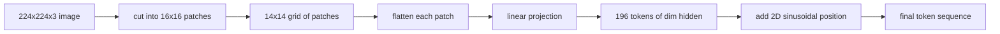

# Patch pada Vision Encoder

> Model visi yang membaca pixel membutuhkan tokenizer untuk pixel. Patch embedding adalah tokenizer itu. Potong gambar menjadi grid kotak, flatten tiap kotak, proyeksikan melalui satu linear layer, lalu tambahkan sinyal posisi 2D supaya transformer tahu di mana tiap kotak duduk di gambar aslinya.

**Type:** Build
**Languages:** Python
**Prerequisites:** Phase 19 lessons 30-37 (Track B foundations)
**Time:** ~90 minutes

## Tujuan Pembelajaran

- Tokenisasi sebuah gambar menjadi sekuens patch embedding berpanjang tetap.
- Implementasikan patch projection berbasis `Conv2d` yang cocok dengan matematika unfold-then-linear.
- Bangun position embedding sinusoidal 2D deterministik sehingga urutan token merepresentasikan posisi spasial.
- Verifikasi jumlah patch, bentuk embedding, dan ekuivalensi `Conv2d`/unfold pada fixture sintetis.

## Masalahnya

Transformer mengonsumsi sekuens vektor. Sebuah gambar adalah grid tiga kanal. Membaca setiap pixel sebagai token membuat panjang sekuens meledak: gambar RGB 224x224 berisi 150.528 token, yang tak mampu ditangani transformer 12 layer dalam attention. Membaca gambar sebagai satu vektor datar raksasa membuang locality, yang tak bisa dipulihkan oleh attention layer. Tugas front end encoder adalah mengompres grid pixel menjadi beberapa ratus token yang masing-masing merangkum satu wilayah persegi.

Patch embedding menyelesaikannya dengan satu linear projection. Gambar 224x224 yang dipotong menjadi patch 16x16 menghasilkan grid 14x14 berisi 196 patch. Tiap patch di-flatten dari `(3, 16, 16) = 768` nilai pixel menjadi satu vektor, lalu sebuah linear layer memetakannya ke dimensi hidden model. Transformer melihat 196 token berdimensi `hidden` (biasanya 768) plus satu CLS token. Itulah sekuens yang bisa diolah oleh sisa jaringan.

## Konsepnya



### Kenapa patch, bukan pixel

Attention bersifat kuadratik terhadap panjang sekuens. Sekuens 196 token menghabiskan `196 * 196 = 38,416` skor attention per kepala per layer; sekuens 150.528 token menghabiskan `150,528 * 150,528 = 22.6 billion`. Patch membeli pengurangan komputasi attention sebesar 590.000 kali, dan satu wilayah 16x16 sudah membawa sinyal yang cukup untuk tugas visi level tinggi. Harganya adalah hilangnya detail spasial granular di dalam satu patch, itulah sebabnya tumpukan multimodal berikutnya sering menjalankan cabang resolusi tinggi kedua ketika lokalisasi presisi penting.

### Kenapa linear projection sudah cukup

Tiap patch diperlakukan sebagai vektor yang independen. Projection mempelajari sebuah basis: detektor tepi, filter warna, tekstur sederhana. Satu linear layer berukuran kecil (`768 * 768 = 589,824` parameter untuk ViT-Base) dan cepat dilatih. Ada stem konvolusi yang lebih dalam (ViT "hybrid"), tetapi linear projection datar adalah standarnya, dan sebagian besar encoder open-weight modern dirilis dengan bentuk persis ini.

### Trik `Conv2d`

Sebuah `Conv2d(in_channels=3, out_channels=hidden, kernel_size=patch_size, stride=patch_size)` tanpa padding memberikan hasil numerik yang sama dengan unfold-then-linear, karena setiap posisi output menghitung dot product pixel patch terhadap satu filter. Konvolusi itulah patch projection, dan sebagian besar basis kode produksi merilisnya begitu karena lebih cepat di GPU dan menghemat satu reshape.

### Position embedding

Token tidak membawa urutan keluar dari projection. Embedding sinusoidal 2D memberi tiap token sinyal tetap yang meng-encode posisi `(row, col)`-nya. Setengah dimensi encoding meng-encode posisi baris dengan sin/cos pada berbagai frekuensi; separuhnya lagi meng-encode posisi kolom. Encoding-nya deterministik sehingga kamu bisa menukar resolusi tanpa training ulang, dan ia menginterpolasi dengan bersih ke grid yang tidak pernah dilihat model saat training.

| Component | Shape | Parameters |
|-----------|-------|------------|
| Patch projection (`Conv2d`) | `(hidden, 3, patch, patch)` | `3 * P * P * hidden + hidden` |
| Position embedding (fixed) | `(num_patches, hidden)` | 0 (computed, not learned) |
| CLS token (learned) | `(1, hidden)` | `hidden` |

Untuk ViT-Base/16 pada resolusi 224: 590.592 parameter di projection, 768 di CLS token, dan nol untuk posisi sinusoidal. Pelajaran berikutnya (59) menumpuk transformer 12 layer di atas front end ini.

### Ekuivalensi sebagai sanity check

Langkah patch punya dua ejaan: sebuah proyeksi `Conv2d` dan unfold-then-linear eksplisit. Keduanya harus menghasilkan output yang sama untuk bobot yang sama. Jika tidak, matematika unfold-nya salah, dan sisa encoder dibangun di atas pasir. Tes di pelajaran ini menguji ekuivalensi itu.

```figure
ch-patch-tokenizer
```

## Bangun Sendiri

`code/main.py` mengimplementasikan:

- `PatchEmbed`, sebuah `nn.Module` yang membungkus `Conv2d` untuk patch projection.
- `sinusoidal_2d(grid_h, grid_w, dim)`, fungsi tanpa state yang membangun tabel posisi 2D.
- `VisionFrontEnd`, yang menggabungkan patch embedding, prepend CLS, dan penambahan posisi dalam satu forward pass.
- Helper `synthesize_image(seed)` yang membangun fixture deterministik 224x224x3 dari `numpy.random`.
- Sebuah demo yang menjalankan satu gambar fixture melalui front end dan mencetak bentuk output, norm CLS token, dan satu baris position embedding.

Jalankan:

```bash
python3 code/main.py
```

Output: fixture 224x224 ditokenisasi menjadi sekuens berbentuk `(1, 197, 768)`. Token pertama adalah CLS; 196 berikutnya adalah patch token. Norm position embedding seragam dalam satu baris, itulah tanda tangan sinusoidal.

## Gunakan

Front end patch yang sama muncul di setiap model vision-language modern: CLIP ViT-L/14, SigLIP, DINOv2, keluarga Qwen-VL, dan tumpukan InternVL semuanya berawal dari patch projection `Conv2d` plus sinyal posisi. Perbedaan antar keluarga hidup di hilir (pooling CLS vs tanpa CLS, register token, patch size bervariasi 14 vs 16, resolusi dinamis lewat posisi terinterpolasi). Frontend di pelajaran ini adalah substrat yang ditopang oleh semua model itu.

## Tes

`code/test_main.py` mencakup:

- jumlah patch cocok dengan `(image_size / patch_size) ** 2`
- bentuk output cocok dengan `(batch, num_patches + 1, hidden)`
- proyeksi `Conv2d` sama dengan unfold-then-linear manual pada fixture kecil
- tabel posisi sinusoidal deterministik antar pemanggilan
- CLS token di-broadcast di sepanjang dimensi batch tanpa leakage

Jalankan semuanya:

```bash
python3 -m unittest code/test_main.py
```

## Latihan

1. Ganti posisi sinusoidal dengan `nn.Parameter` yang dipelajari dan bandingkan loss epoch pertama pada tugas klasifikasi sintetis kecil. Posisi yang dipelajari menang pada resolusi tetap; sinusoidal menang saat kamu mengubah resolusi setelah training.

2. Tukar `Conv2d` dengan `nn.Unfold` eksplisit plus `nn.Linear` dan assert output-nya cocok dalam toleransi float. Matematika yang sama, dua cara mengejanya.

3. Tambahkan dukungan untuk patch size bukan persegi (misalnya 32x16 untuk input beraspek lebar) dan verifikasi tabel posisi menangani grid bukan persegi.

4. Profil langkah patch pada batch size 1, 8, 64. Patch projection jarang menjadi bottleneck; layer attention di hilir yang mendominasi.

5. Latih front end sebagai feature extractor beku pada dataset bentuk sintetis 4 kelas (lingkaran, persegi, segitiga, bintang). Output CLS token harus terpisah secara linear.

## Istilah Kunci

| Term | What it means |
|------|---------------|
| Patch | A square sub-region of the image, typically 14x14 or 16x16 |
| Patch embedding | Linear projection of one flattened patch to the hidden dim |
| Sequence length | Number of tokens after patch tokenization, usually plus CLS |
| Sinusoidal position | Fixed sin/cos signal that encodes 2D grid coordinates |
| CLS token | Learned vector prepended to the sequence as the pooling head |

## Bacaan Lanjutan

- An Image is Worth 16x16 Words (ViT, 2021) untuk framing patch-embed aslinya.
- Attention Is All You Need (2017) untuk formula posisi sinusoidal yang diadaptasi ke 2D di sini.
- Paper DINOv2 untuk register token, ekstensi yang bisa kamu tambahkan sebagai latihan 6.
