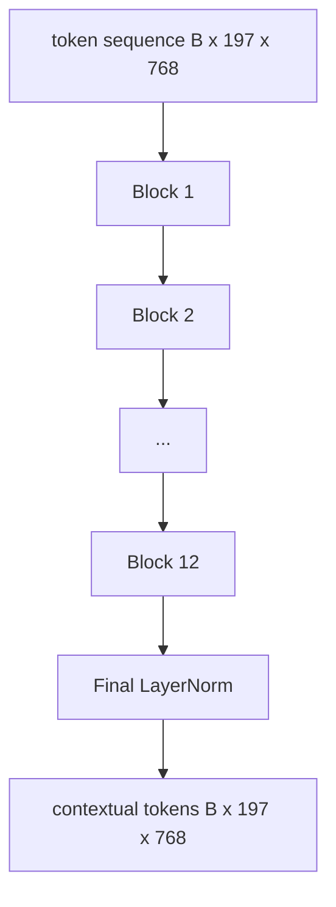
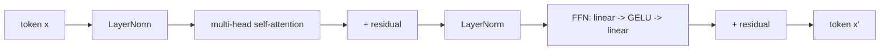

# Encoder Vision Transformer

> Patch saja tidak bisa melihat. Sebuah transformer pre-LN 12 layer dengan 12 attention head mengubah sekuens patch token menjadi sekuens token kontekstual, dengan CLS token yang mem-pool fitur seluruh gambar di hidden state akhirnya. Pelajaran ini adalah ruang mesin dari setiap model vision-language modern.

**Type:** Build
**Languages:** Python
**Prerequisites:** Phase 19 lessons 30-37 (Track B foundations)
**Time:** ~90 minutes

## Tujuan Pembelajaran

- Implementasikan blok transformer pre-LN dengan multi-head self-attention dan sub-layer feed-forward.
- Tumpuk 12 blok dengan 12 kepala untuk membentuk encoder ViT-Base.
- Sambungkan front end patch dari pelajaran 58 ke encoder dan jalankan satu forward pass.
- Verifikasi bahwa CLS token mengagregasi informasi dari setiap patch.

## Masalahnya

Patch embedding menghasilkan sekuens 197 token, yang masing-masing adalah vektor tanpa kesadaran terhadap patch lain mana pun. Gambar kucing membutuhkan setiap patch tahu patch mana yang berisi kumis, mana yang berisi latar belakang, dan mana yang berisi mata. Transformer adalah mekanisme yang membangun kesadaran itu, satu layer attention pada satu waktu. Tanpanya, front end patch hanyalah tokenizer cerdas tanpa pemahaman apa pun.

Resep standarnya dua belas blok dalam, dua belas kepala lebar, dengan penempatan pre-LayerNorm, aktivasi GELU, dan ekspansi feed-forward 4x. Resep itu adalah tulang punggung CLIP ViT-L, SigLIP, DINOv2, keluarga Qwen-VL, InternVL, dan setiap encoder visi open-weight 2025-2026 lainnya. Resepnya cukup stabil sehingga kamu bisa membaca makalah mana pun dan mengasumsikan bentuk blok ini kecuali mereka secara eksplisit menyebutkan sebaliknya.

## Konsepnya





### Pre-LN vs post-LN

Transformer asli menempatkan LayerNorm setelah residual. Pre-LN (LayerNorm sebelum tiap sub-layer) adalah versi yang dipakai setiap model vision-language modern, karena ia melatih secara stabil tanpa trik warm-up learning rate. Bedanya hanya satu baris pada forward pass, dan aliran gradient pada kedalaman 12+ bagai langit dan bumi.

### Multi-head self-attention

Setiap kepala memproyeksikan vektor token ke triplet `(query, key, value)` miliknya sendiri dengan dimensi `head_dim = hidden / num_heads`. Dengan `hidden = 768` dan `heads = 12`, tiap kepala punya `dim = 64`. 12 kepala attend secara paralel, lalu output mereka di-concat kembali ke dimensi 768 dan melewati sebuah proyeksi output. Inti dari multi-head adalah satu kepala bisa belajar "attend ke mata kucing" sementara kepala lain belajar "attend ke gradien latar belakang" tanpa saling mengganggu.

### Kenapa ekspansi feed-forward 4x

FFN berjalan `hidden -> 4 * hidden -> hidden` dengan GELU di tengahnya. Faktor 4 bersifat empiris dan bertahan pada transformer bahasa maupun visi sejak 2017. Lebih kecil (2x) underfit; lebih besar (8x) overfit pada anggaran data tetap. MLP adalah tempat model menyimpan sebagian besar fakta yang dipelajarinya, dan bagian tengah yang lebih lebar itulah tempatnya.

| Component | Parameters at ViT-Base scale |
|-----------|------------------------------|
| qkv projection per block | `3 * 768 * 768 = 1.77M` |
| output projection per block | `768 * 768 = 590K` |
| FFN per block (4x expansion) | `2 * 768 * 4 * 768 = 4.72M` |
| LayerNorm per block | `4 * 768 = 3K` |
| Total per block | about 7.1M |
| 12 blocks | about 85M |
| Plus front end | about 86M total |

ViT-Base adalah encoder berparameter 86M. Itu kecil menurut standar 2026 (SigLIP-So400M 400M, ViT Qwen-VL 675M), tetapi arsitekturnya identik sampai pada width dan depth.

### Causal mask atau tidak?

Vision Transformer bersifat encoder-only dan bidirectional: token `i` boleh attend ke token `j` untuk pasangan mana pun. Tanpa mask. Cross-attention sisi decoder di pelajaran 61 akan memakai causal mask, tetapi di dalam vision encoder, attention sepenuhnya terhubung.

### Apa yang dipelajari CLS token

CLS token berawal sebagai parameter yang dipelajari, tidak memiliki konten patch sendiri, dan mengumpulkan informasi melalui attention di setiap blok. Pada layer akhir, baris CLS adalah ringkasan vektor dari seluruh gambar; head di hilir memproyeksikan vektor tunggal ini menjadi class logits, embedding kontrasitf, atau key cross-attention untuk sebuah decoder teks.

```figure
ch-cls-funnel
```

## Bangun Sendiri

`code/main.py` mengimplementasikan:

- `MultiHeadSelfAttention`, dengan proyeksi `qkv` dan output, matematika attention scaled-dot-product, dan asersi bentuk.
- `FeedForward`, MLP GELU dengan ekspansi 4x.
- `Block`, blok pre-LN yang menggabungkan sub-layer attention dan feed-forward dengan residual.
- `ViT`, tumpukan 12 blok dengan LayerNorm akhir.
- `VisionEncoder`, yang menyambungkan `VisionFrontEnd` dari pelajaran 58 ke tumpukan `ViT` dan mengekspos `forward()` yang mengembalikan sekuens kontekstual dan vektor CLS yang sudah di-pool.
- Sebuah demo yang menjalankan gambar fixture sintetis 224x224 melalui encoder penuh dan mencetak bentuk input, bentuk output, jumlah parameter, dan norm CLS pada setiap layer kedua.

Jalankan:

```bash
python3 code/main.py
```

Output: fixture di-encode menjadi tensor `(1, 197, 768)`. Norm CLS merayap naik seiring layer-layer berkomposisi, lalu menstabil di LayerNorm akhir. Total parameter dilaporkan sekitar 86M.

## Gunakan

Encoder yang didefinisikan di sini, sampai pada width dan depth, adalah tumpukan blok yang sama dengan yang dikirim di dalam setiap VLM open-weight 2025-2026. Perbedaannya hidup di:

- **Width and depth.** ViT-Large adalah `hidden=1024, depth=24, heads=16`; SigLIP So400M adalah `hidden=1152, depth=27, heads=16`. Blok yang sama.
- **Pooling head.** CLS pooling (pelajaran ini) vs average pooling (SigLIP) vs attention pooling (VLM kemudian).
- **Position handling.** Sinusoidal tetap (pelajaran 58) vs learned 1D vs ALiBi vs 2D RoPE. Matematika bloknya tidak berubah.
- **Register tokens.** DINOv2 men-prepend 4 token learned ekstra. Satu baris kode.

Tumpukan blok ini adalah substratnya. Pelajaran berikutnya (60-63) berdiri di atasnya.

## Tes

`code/test_main.py` mencakup:

- satu blok mempertahankan bentuk dan invarian terhadap batch size input
- skor attention berjumlah satu di sepanjang sumbu key (sanity softmax)
- jalur residual tersambung (input nol tetap menghasilkan output bukan nol melalui CLS token)
- satu forward pass bertumpuk 4 layer menghasilkan bentuk yang benar
- gradient mengalir ke patch projection dari output CLS

Jalankan semuanya:

```bash
python3 -m unittest code/test_main.py
```

## Latihan

1. Tambahkan register token (4 vektor learned yang di-prepend setelah CLS) dan jalankan ulang. Bandingkan kehalusan attention map lewat entropi distribusi softmax pada layer terakhir.

2. Tukar pre-LN dengan post-LN dan latih selama satu epoch pada classifier bentuk sintetis. Amati mana yang melatih secara stabil tanpa LR warm-up.

3. Implementasikan causal masking sebagai argumen `attn_mask` sehingga blok yang sama bisa dipakai ulang sebagai blok decoder. Bentuk mask adalah `(seq, seq)`, lower-triangular.

4. Profil satu forward pass pada batch size 1, 8, 64 dengan `torch.profiler`. Layer MLP yang mendominasi wall time, bukan attention.

5. Ganti proyeksi q-k-v satu attention head dengan adapter LoRA ber-rank rendah, bekukan sisanya, dan verifikasi bahwa gradient hanya mengalir ke tempat yang kamu harapkan.

## Istilah Kunci

| Term | What it means |
|------|---------------|
| Pre-LN | LayerNorm applied before each sub-layer instead of after |
| Self-attention | Each token attends to every other token in the same sequence |
| Multi-head | The hidden dim is split across `H` independent attention heads |
| FFN expansion | The feed-forward layer widens to `4 * hidden` before contracting |
| CLS pooling | Use the first token's final hidden state as the image summary |

## Bacaan Lanjutan

- An Image is Worth 16x16 Words (ViT, 2021) untuk resep encodernya.
- DINOv2 (2023) untuk register token dan objective pretraining self-supervised.
- SigLIP (2023) untuk varian average-pooling dan loss kontrasitf sigmoid yang dipakai di pelajaran 62.
