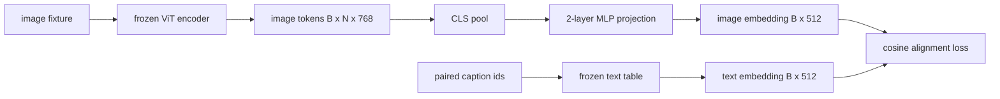

# Projection Layer untuk Modality Alignment

> Sebuah vision encoder menghasilkan image token. Sebuah text decoder mengonsumsi teks token. Keduanya hidup di ruang vektor yang berbeda. Sebuah MLP dua-layer kecil memproyeksikan image token ke ruang text embedding, dan sebuah cosine alignment loss terhadap caption berpasangan menarik kedua ruang itu untuk sepakat. Projection itulah bagian terkecil dari sebuah vision-language model sekaligus bagian yang paling penting untuk transfer.

**Type:** Build
**Languages:** Python
**Prerequisites:** Phase 19 lessons 30-37 (Track B foundations)
**Time:** ~90 minutes

## Tujuan Pembelajaran

- Bangun proyeksi MLP dua-layer yang memetakan fitur gambar ke ruang text embedding.
- Konstruksikan tabel text embedding mock (tanpa tokenizer pre-trained, tanpa korpus nyata).
- Hitung cosine alignment loss antara image token terproyeksi dan embedding caption berpasangan.
- Latih projection sendirian dengan vision encoder beku dan tabel teks beku.

## Masalahnya

Kamu punya sebuah vision encoder (pelajaran 58-59) yang menghasilkan token berdimensi `vision_hidden = 768`. Kamu punya sebuah text decoder yang ingin kamu pasang di atasnya dengan dimensi embedding `text_hidden = 512` (angka lain mana pun sama masuk akalnya). Decoder mengharapkan token berbentuk teks. Image token tidak berbentuk teks: ia hidup dalam basis yang dipelajari encoder selama pretraining khusus-visi, tanpa hubungan apa pun dengan word vector decoder.

Proyeksi MLP dua-layer (linear, GELU, linear) menjembatani kesenjangan itu. Ia cukup kecil (sekitar `768 * 1024 + 1024 * 512 = 1.3M` parameter) untuk dilatih dalam hitungan menit pada satu GPU, dan ia satu-satunya bagian yang harus belajar selama fase alignment. Vision encoder tetap beku. Tabel text embedding tetap beku. Hanya projection-nya yang bergerak. Inilah resep yang dirilis LLaVA pada 2023, yang di-framing ulang oleh BLIP-2 sebagai Q-Former, dan yang sejak itu diadopsi setiap VLM open-weight dalam bentuk tertentu.

## Konsepnya



### Pooling sebelum projection

Vision encoder memancarkan 197 token. Sisi teks hanya punya satu embedding setingkat caption. Untuk menyelaraskannya kamu butuh satu vektor setingkat-gambar per sampel. CLS pooling adalah cara paling sederhana: ambil token pertama dari encoder lalu proyeksikan. Mean pooling di atas semua 197 token adalah opsi lain dan itulah yang dipakai SigLIP. Keduanya mem-pool 197 vektor menjadi satu.

### Kenapa dua layer, bukan satu

Satu linear projection bisa memutar dan menskalakan ulang, tetapi tidak bisa memperbaiki basis jika kedua ruang punya ketidakcocokan kelengkungan. GELU di antara dua linear layer memberi projection satu belokan non-linear, yang secara empiris cukup untuk menyelaraskan fitur ala CLIP ke embedding language model. Projection yang lebih dalam (LLaVA-NeXT memakai GLU; Qwen-VL memakai tumpukan layer attention) adalah ekstensi; MLP dua-layer adalah baseline kanonis dan itulah yang di balik layar dipakai oleh projection head Q-Former BLIP-2.

| Layer | Shape | Parameters |
|-------|-------|------------|
| fc1 | `(vision_hidden, projection_hidden)` | `768 * 1024 + 1024` |
| activation | GELU | 0 |
| fc2 | `(projection_hidden, text_hidden)` | `1024 * 512 + 512` |

Sekitar 1.3M parameter untuk sebuah head `768 -> 1024 -> 512`.

### Cosine alignment loss

Align tidak berarti `image_emb == text_emb`. Align berarti `image_emb` menunjuk ke arah yang sama dengan `text_emb` di ruang gabungan. Cosine loss adalah `1 - cos_sim(image, text)`, berkisar dari 0 (sempurna selaras) hingga 2 (berlawanan). Training mendorong nilai ini menuju nol per pasangan. Pelajaran 62 menggeneralisasikannya ke sebuah batch kontrasitf (InfoNCE) di mana setiap gambar harus lebih dekat ke caption-nya sendiri daripada ke caption lain mana pun dalam batch; pelajaran ini memakai versi per-pair sehingga dinamikanya terlihat.

### Encoder beku adalah triknya

Vision encoder punya 86M parameter. Tabel teks punya beberapa juta lagi. Melatih semuanya dari sebuah korpus mock adalah hal yang mustahil. Membekukan keduanya berarti 1.3M parameter projection adalah satu-satunya yang berubah, dan beberapa ratus langkah pada pasangan sintetis sudah cukup untuk menurunkan loss. Inilah bentuk operasional persis dari setiap VLM berbasis adapter: bagian-bagian yang berat tetap beku, jembatan ringan yang dilatih.

```figure
ch-projection-bridge
```

## Bangun Sendiri

`code/main.py` mengimplementasikan:

- `MLPProjector(in_dim, hidden_dim, out_dim)`, MLP linear dua-layer dengan aktivasi GELU.
- `MockTextEmbedding(vocab_size, dim)`, sebuah tabel embedding beku dengan init deterministik dari seed.
- `make_pair(seed, vocab_size)`, yang mensintesis satu sampel (gambar, caption) berpasangan. Caption adalah sekuens id pendek; embedding caption di-mean-pool di atas embedding token.
- `cosine_alignment_loss(image_emb, text_emb)`, objective `1 - cos_sim` per-pair.
- Sebuah training loop yang menjalankan projection selama 200 langkah di atas 32 pasangan sintetis (diulang), dengan vision encoder dan tabel teks dibekukan, dan mencetak loss setiap 25 langkah.

Jalankan:

```bash
python3 code/main.py
```

Output: laporan training menunjukkan penurunan dari loss awal sekitar 1.07 menjadi sekitar 0.80 dalam 200 langkah, membuktikan bahwa projection sendirian mampu menarik image token mendekati ruang teks. Cosine similarity akhir per pasangan juga dicetak.

## Gunakan

Pola yang sama muncul di setiap VLM open-weight:

- **LLaVA 1.5.** Proyeksi MLP GELU dua-layer dari hidden CLIP-ViT-L ke dimensi embedding LLaMA. Vision encoder beku, LLM beku, latih hanya projection-nya (lalu lepaskan beku LLM di tahap kedua).
- **BLIP-2.** Q-Former membawa 32 query token learned melalui cross-attention terhadap image token, lalu memproyeksikan ke dimensi embedding LLM. Projection head di ujung Q-Former adalah analog dari MLP pelajaran ini.
- **MiniGPT-4.** Satu linear projection dari output Q-Former BLIP-2 ke dimensi embedding Vicuna.
- **Qwen-VL.** Cross-attention adapter dengan beberapa layer, tetapi bagian akhirnya kembali berupa sebuah proyeksi ke dimensi embedding LM.

Bentuknya bervariasi tetapi perannya identik: pool image token, proyeksi ke dimensi text embedding, latih sendirian.

## Tes

`code/test_main.py` mencakup:

- bentuk output projector cocok dengan `out_dim` yang dikonfigurasi
- tabel text embedding beku memiliki nol parameter `requires_grad`
- cosine loss bernilai nol pada vektor identik dan bernilai 2 pada vektor anti-paralel
- gradient projector mengalir setelah satu backward pass
- training loop menurunkan loss antara langkah 0 dan langkah 200

Jalankan semuanya:

```bash
python3 -m unittest code/test_main.py
```

## Latihan

1. Ganti CLS pooling dengan mean pooling di atas 196 patch token dan bandingkan loss akhir setelah 200 langkah. Mean pooling biasanya melatih lebih cepat pada data sintetis; CLS lebih hemat sampel pada gambar alami.

2. Tambahkan suhu scalar yang dipelajari ke cosine loss (`cos / tau`) dan amati apa yang terjadi saat `tau` terlalu kecil (noise gradient) atau terlalu besar (loss mentok di angka tinggi).

3. Tukar MLP dua-layer dengan satu linear layer dan kuantifikasi selisih loss-nya. Non-linearitas lebih penting pada fitur gambar alami dan kurang penting pada yang sintetis.

4. Tambahkan penalti L2 kecil pada bobot projector dan amati bagaimana ia berinteraksi dengan cosine alignment (cosine bersifat scale-invariant, jadi penalti terutama menyusutkan arah yang tidak terpakai).

5. Simpan bobot projector, lalu muat ulang dan jalankan inference tanpa backward pass vision encoder untuk memverifikasi bahwa hanya projector yang dibutuhkan saat deploy.

## Istilah Kunci

| Term | What it means |
|------|---------------|
| Modality alignment | The act of making image and text embeddings comparable in one shared space |
| Projection head | The small module that maps one space to another, usually a 2-layer MLP |
| Cosine similarity | Dot product divided by the product of L2 norms |
| Frozen encoder | The vision (or text) model has all parameters with `requires_grad=False` |
| Mock corpus | Synthetic pairs used so training has no dataset download dependency |

## Bacaan Lanjutan

- Paper LLaVA untuk training dua tahap (proyeksi, lalu lepaskan beku LM).
- Paper BLIP-2 untuk Q-Former sebagai alternatif projection yang bisa dipelajari.
- Laporan teknis Qwen-VL untuk cross-attention adapter sebagai projection head yang lebih dalam.
