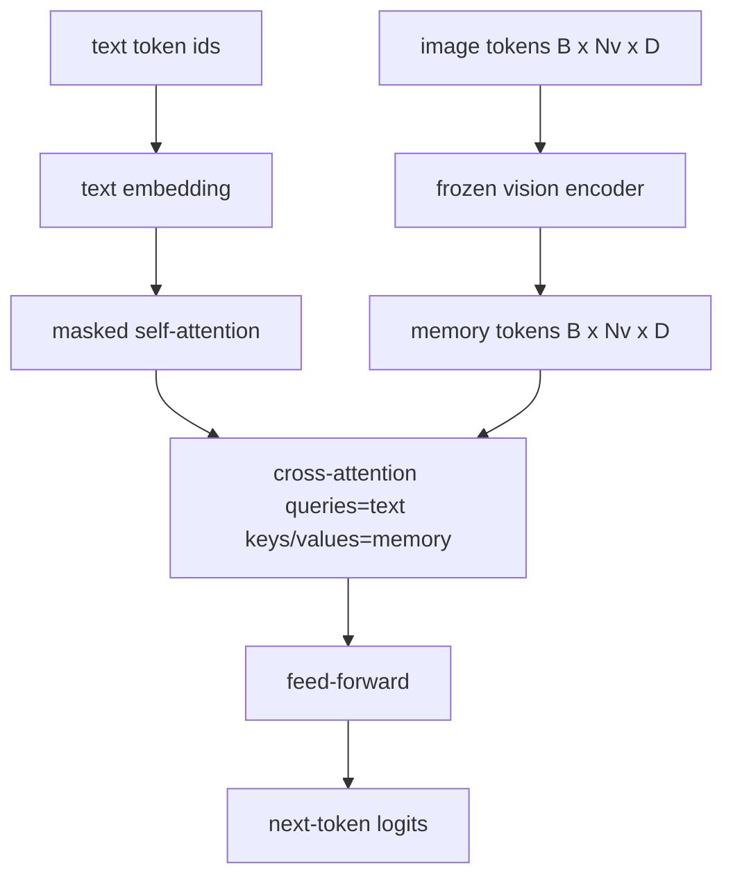
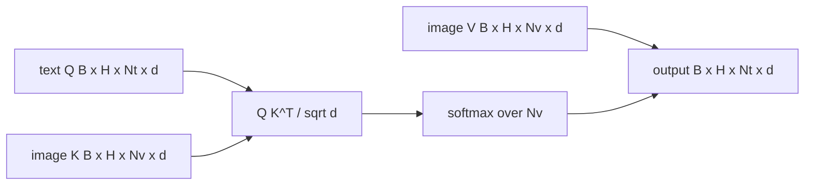

# Fusion Cross-Attention

> Lapisan projection menyelaraskan satu vektor gambar dengan satu vektor caption. Sebuah decoder vision-language yang nyata membutuhkan setiap teks token attend ke setiap patch token, sehingga model bisa mem-ground setiap kata pada sebuah wilayah. Cross-attention adalah cara grounding itu terjadi. Teks yang bertanya; vision yang menjawab. Pelajaran ini membangun blok cross-attention, self-attention teks kausal, dan bentuk-bentuk mask yang menjaga keduanya tetap legal.

**Type:** Build
**Languages:** Python
**Prerequisites:** Phase 19 lessons 30-37 (Track B foundations)
**Time:** ~90 minutes

## Tujuan Pembelajaran

- Implementasikan multi-head cross-attention di mana aliran query adalah teks dan aliran key/value adalah vision.
- Susun sebuah blok decoder: self-attention kausal + cross-attention + feed-forward.
- Dapatkan bentuk mask dengan benar: causal mask untuk self-attention, tanpa mask untuk cross-attention.
- Jalankan satu forward pass dengan teks token berbatch dan sebuah pool gambar token yang tetap.

## Masalahnya

Menggabungkan image token dan teks token menjadi satu sekuens adalah satu opsi fusi (early fusion, jalur yang ditempuh Chameleon dan Emu3). Cross-attention adalah opsi yang lainnya (late fusion, jalur yang diperkenalkan Flamingo dan yang disalin setiap decoder berbentuk Flamingo sejak itu). Dalam late fusion, text decoder berjalan pada token teks-saja dan menjangkau ke dalam aliran gambar melalui cross-attention di setiap layer.

Late fusion punya dua keuntungan. Pertama, aliran teks tetap bersih dan model mempertahankan kemampuan teks-saja. Kedua, aliran gambar dihitung sekali per gambar dan dipakai ulang untuk setiap langkah decode, sehingga generasi tetap murah bahkan untuk caption panjang. Harganya adalah satu sub-layer attention ekstra per blok.

## Konsepnya





### Bentuk mask

Dua attention di dalam sebuah blok decoder membutuhkan mask yang berbeda:

| Attention | Query length | Key length | Mask | Why |
|-----------|--------------|------------|------|-----|
| Self-attention | `Nt` (text) | `Nt` (text) | Causal: lower-triangular `(Nt, Nt)` | Text tokens may not look ahead during autoregression |
| Cross-attention | `Nt` (text) | `Nv` (vision) | No mask | The whole image is visible to every text position |

Pelajaran ini menyertakan satu fungsi validasi bentuk sehingga kesalahan mencampurkan keduanya muncul sebagai sebuah `ValueError` alih-alih kurva loss yang rusak diam-diam.

### Kenapa tanpa mask pada cross-attention

Gambar diamati sepenuhnya sebelum teks apa pun dihasilkan. Token `t` dari caption boleh attend ke patch mana pun dari gambar; tidak ada urutan temporal pada patch gambar. Beberapa varian Flamingo menambahkan pola masking per-sampel saat menyelang-seling beberapa gambar dan segmen teks, tetapi untuk satu gambar plus satu caption, cross-attention melihat semuanya.

### Caching key/value

Image key dan value dihitung sekali di awal decode dan disimpan dalam sebuah cache. Setiap teks token baru memakai cache tanpa perhitungan ulang. Inilah yang membuat captioning cepat saat inference: ViT yang berat berjalan sekali; cross-attention memakai ulang key dan value-nya untuk setiap langkah. Pelajaran ini mengekspos cache-nya dan menguji jalur cache-hit.

### Komposisi blok

Sebuah blok decoder berjalan: pre-LN -> self-attention -> residual -> pre-LN -> cross-attention -> residual -> pre-LN -> feed-forward -> residual. Tiga sub-layer, masing-masing dengan LayerNorm-nya sendiri. Makalah Flamingo menambahkan sebuah gerbang yang dipelajari pada cross-attention sehingga model bisa memilih keluar dari jalur gambar dengan biaya stabilitas training; baseline kanonis (yang dipakai di sini) tidak memiliki gerbang.

```python
class DecoderBlock:
  def forward(self, text_tokens, image_tokens, text_mask, cross_mask):
      text_tokens = text_tokens + self.self_attn(self.ln1(text_tokens),
                                                 mask=text_mask)
      text_tokens = text_tokens + self.cross_attn(self.ln2(text_tokens),
                                                  image_tokens,
                                                  mask=cross_mask)
      text_tokens = text_tokens + self.ffn(self.ln3(text_tokens))
      return text_tokens
```

```figure
ch-crossattn-fan
```

## Bangun Sendiri

`code/main.py` mengimplementasikan:

- `CrossAttention(hidden, heads)`, cross-attention multi-head dengan proyeksi `q` dan `kv` terpisah.
- `CausalSelfAttention(hidden, heads)`, self-attention bermask dari sebuah decoder standar.
- `DecoderBlock`, yang menggabungkan ketiga sub-layer dengan residual pre-LN.
- `VisionLanguageDecoder`, decoder empat layer yang diberi output sebuah vision encoder mock dan sebuah tabel text embedding kecil.
- `causal_mask(length)` yang mengembalikan tensor boolean lower-triangular berbentuk `(length, length)`.
- Sebuah demo yang memberi satu batch dua sekuens teks berpanjang 10 dengan image memory berpanjang 197, dan mencetak bentuk output, bentuk mask self-attention, serta norm output cross-attention per posisi.

Jalankan:

```bash
python3 code/main.py
```

Output: decoder menghasilkan tensor logits `(2, 10, text_vocab)`. Bentuk mask adalah `(10, 10)`. Pemeriksaan reuse KV-cache mengonfirmasi logits yang identik antara jalur yang di-cache dan yang tidak.

## Gunakan

Cross-attention muncul di dua keluarga produksi:

- **Flamingo and IDEFICS.** Sisipkan satu sub-layer cross-attention setiap K blok language model, dengan LM yang dibekukan. Adapter vision-language adalah blok cross-attention plus gerbangnya.
- **BLIP-2.** Q-Former memakai cross-attention dari sebuah set tetap 32 query token ke fitur gambar, lalu memproyeksikan query-nya ke ruang embedding LM.

Bentuk blok di pelajaran ini memetakan langsung ke keduanya. Disiplin mask-nya (kausal pada self, tidak ada pada cross) adalah sama.

## Tes

`code/test_main.py` mencakup:

- causal mask bersifat lower-triangular dan cocok dengan bentuk boolean yang diharapkan
- bentuk output cross-attention adalah `(B, Nt, hidden)` terlepas dari panjang key
- jalur KV-cache cocok dengan jalur tanpa cache dalam toleransi float
- ketidakcocokan bentuk antara aliran teks dan aliran gambar memunculkan `ValueError` yang jelas
- satu forward pass decoder penuh menghasilkan bentuk batch dan sekuens yang benar

Jalankan semuanya:

```bash
python3 -m unittest code/test_main.py
```

## Latihan

1. Tambahkan gerbang tanh yang dipelajari pada residual cross-attention (trik Flamingo) dan verifikasi training konvergen dari gerbang awal yang hampir nol. Gerbang dimulai di 0; model memulihkan perilaku teks-saja sebelum mencampur aliran gambar ke dalamnya.

2. Implementasikan attention berselang-seling di mana decoder yang sama mengonsumsi beberapa gambar plus beberapa segmen teks. Bangun mask cross-attention per-sampel yang mencegah segmen teks 2 attend ke gambar 1.

3. Profil layer cross-attention vs layer self-attention pada `Nt=64, Nv=576` (grid 24x24 pada resolusi lebih tinggi). Biaya cross-attention adalah `Nt * Nv` dan mendominasi pada resolusi gambar yang tinggi.

4. Tambahkan dropout di sisi query pada peta cross-attention dan ukur keragaman caption pada demo (variasi sampel caption meningkat dengan dropout pada peta cross).

5. Tukar layer cross-attention dengan sebuah blok attention ala Q-Former di mana pool query tetap 32 token attend ke fitur gambar sekali per layer.

## Istilah Kunci

| Term | What it means |
|------|---------------|
| Late fusion | Text and vision stay in separate streams; cross-attention bridges them at every block |
| Cross-attention | Q comes from one stream, K and V from another |
| Causal mask | Lower-triangular boolean mask that prevents looking ahead during autoregression |
| KV cache | Image keys and values stored once and reused for every decode step |
| Memory tokens | The frozen image tokens that the decoder reaches into |

## Bacaan Lanjutan

- Flamingo (2022) untuk desain late-fusion kanonis dengan cross-attention bergerbang.
- BLIP-2 (2023) untuk Q-Former, yang merupakan blok cross-attention yang menyamar sebagai sebuah pool query yang dipelajari.
- IDEFICS (2023) untuk reproduksi open-weight dari resep Flamingo.
