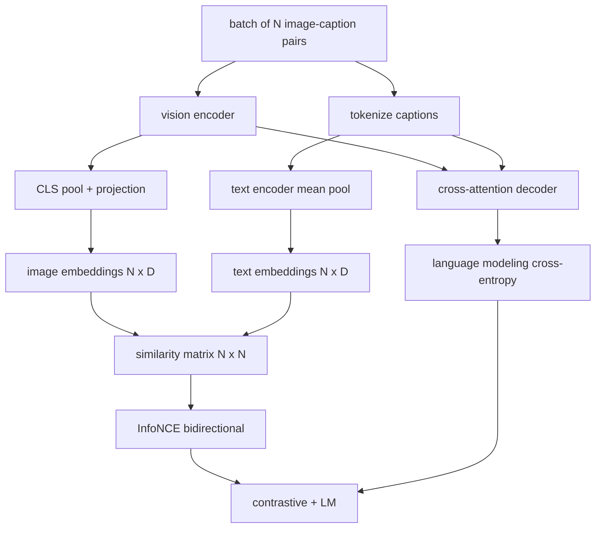

# Pretraining Vision-Language

> Encoder, projection, dan decoder sudah tersambung. Sekarang latih mereka bersama. Dua objective menggerakkan pembelajaran: sebuah loss kontrasitf gambar-teks (InfoNCE) yang menarik pasangan yang cocok bersama di ruang embedding gabungan, dan sebuah loss language modeling yang meminta decoder menulis caption bagi setiap gambar. Digabung, keduanya mengajari jaringan untuk menemukan gambar yang tepat bagi sebuah caption sekaligus menulis caption bagi gambar itu.

**Type:** Build
**Languages:** Python
**Prerequisites:** Phase 19 lessons 30-37 (Track B foundations)
**Time:** ~90 minutes

## Tujuan Pembelajaran

- Implementasikan loss kontrasitf InfoNCE pada satu batch pasangan gambar-caption.
- Gabungkan loss kontrasitf dengan loss language modeling autoregresif.
- Sintesis korpus mock gambar-caption berisi 200 pasangan tanpa unduhan dataset nyata.
- Jalankan demo training loop 50 langkah dan amati kedua loss turun.

## Masalahnya

Sebuah vision-language model membutuhkan dua keterampilan. Ia harus bisa men-rank: diberi sebuah caption, temukan gambar yang tepat di antara banyak gambar. Ia harus bisa menghasilkan: diberi sebuah gambar, tulis sebuah caption. Pretraining model pada satu keterampilan saja memberimu setengah sistem. CLIP jago men-rank tetapi tidak bisa menulis caption. GPT-4V bisa menulis caption tetapi memakai retrieval head terpisah untuk men-rank. Pretraining multi-objective mendapatkan keduanya dalam satu pass.

InfoNCE menangani separuh bagian ranking. Untuk satu batch N pasangan, model memperlakukan N pasangan yang cocok sebagai positif dan `N^2 - N` pasangan yang tidak cocok sebagai negatif, lalu menjalankan sebuah loss cross-entropy di atas matriks kemiripan `(N, N)` yang dihasilkan. Loss LM menangani separuh bagian generasi: prediksi token berikutnya standar yang diberi kondisi gambar. Kedua loss bersifat differentiable dan bisa berbagi bobot encoder, projector, dan decoder.

## Konsepnya



### InfoNCE dalam satu paragraf

Tumpukkan N image embedding sebagai baris dan N text embedding sebagai baris. Normalisasikan keduanya dengan L2. Hitung matriks `N x N` `S = I T^T / tau` di mana `tau` adalah suhu yang dipelajari. Entri diagonal adalah pasangan yang cocok; entri off-diagonal adalah negatif. Terapkan cross-entropy dengan target `argmax` yang berjalan di sepanjang diagonal: baris `i` harus memiliki entri tertinggi di kolom `i`. Lakukan hal yang sama secara simetris di sepanjang kolom. Totalnya adalah rata-rata keduanya. Itulah loss CLIP dalam delapan baris.

### Suhu itu penting

Suhu `tau` mengontrol seberapa tajam softmax-nya. Terlalu kecil (misalnya `tau = 0.01`) dan gradient datang hanya dari negatif tersulit, sehingga training berisik. Terlalu besar dan softmax mendatar sehingga gradient menghilang. CLIP mempelajari `tau` sebagai sebuah parameter; demo di sini melakukan hal yang sama.

### Loss language modeling

Decoder mengonsumsi image memory token melalui cross-attention dan memprediksi teks token berikutnya di setiap posisi. Loss-nya adalah cross-entropy standar dengan target posisi berikutnya. Posisi padding di-mask keluar dari loss.

### Menggabungkan kedua loss

`total = contrastive + lm_weight * lm` di mana `lm_weight` adalah sebuah skalar (seringkali 1.0). Kedua loss berbagi gradient ke encoder dan projection; hanya decoder yang menerima gradient LM-loss. Inilah resep multi-task yang dipakai model-model ala CoCa, BLIP, dan SigLIP, dengan berbagai pembobotan.

| Component | Loss surface | Affects |
|-----------|--------------|---------|
| InfoNCE | Pair ranking in the joint space | Encoder + projection + text head |
| LM | Token prediction conditioned on image | Encoder + projection + decoder |
| Combined | Multi-task | Whole stack |

### Kenapa 50 langkah cukup untuk sebuah demo

Korpus mock adalah set sintetis 200 pasangan dengan gambar acak dan id caption acak. Setelah 50 langkah SGD dengan batch size 16, kedua loss turun terlihat meskipun nilai absolutnya tetap berada di atas yang dicapai sebuah model berdata nyata. Inti demo adalah memastikan plumbing gradient berfungsi dari ujung ke ujung, dan bahwa menambahkan loss LM tidak menstabilkan objective kontrasitf.

```figure
ch-infonce-diagonal
```

## Bangun Sendiri

`code/main.py` mengimplementasikan:

- `MultimodalModel`, yang menggabungkan sebuah encoder ViT kecil, MLP projector, sebuah encoder sisi-teks mini (mean-pool di atas id yang di-embed), dan decoder cross-attention dari pelajaran 61.
- `info_nce_loss(image_emb, text_emb, temperature)`, loss kontrasitf bidirectional ala CLIP.
- `lm_loss(logits, target_ids, padding_id)`, cross-entropy token berikutnya yang di-mask.
- `make_mock_corpus(seed, n_pairs)`, yang mengembalikan 200 pasangan (image, caption_ids) deterministik.
- Sebuah training loop yang menjalankan 50 langkah dengan batch size 16, optimizer Adam, dan sebuah parameter log-temperature yang dipelajari. Kedua loss dicetak setiap 5 langkah.

Jalankan:

```bash
python3 code/main.py
```

Output: loss kontrasitf turun dari sekitar `ln(16) = 2.77` menuju 2.4; loss LM turun dari baseline acak-seragam `ln(512) ≈ 6.24` menuju sekitar 4.7. Kedua penurunan membuktikan gradient sudah tersambung dengan benar. Model nyata dilatih selama jutaan langkah; dinamikanya sama.

## Gunakan

Ini adalah resep loss yang sama yang dikirim dalam:

- **CLIP (2021).** Kontrasitf gambar-teks saja, dengan sebuah probe caption encoder-beku yang terpisah.
- **CoCa (2022).** Kontrasitf gambar-teks plus loss LM image-captioning dalam satu model. Pola persis yang dibangun pelajaran ini.
- **BLIP (2022) and BLIP-2.** Kontrasitf plus LM plus kepala image-text matching. Tiga loss digabung.
- **SigLIP (2023).** Menukar InfoNCE dengan loss pasangan sigmoid; peran kontrasitf sama, bentuk fungsi berbeda.
- **LLaVA family.** Training dua tahap di mana tahap satu adalah alignment (cosine pada sebuah LM beku) dan tahap dua menambahkan loss LM dengan LM yang tidak dibekukan. Pelajaran 60 sesuai dengan tahap satu; pelajaran ini sesuai dengan tahap dua.

## Tes

`code/test_main.py` mencakup:

- loss InfoNCE simetris di sepanjang baris gambar/teks
- loss InfoNCE mengembalikan 0 ketika matriks kemiripan adalah diagonal sempurna dari bilangan positif besar
- loss LM men-mask posisi padding dengan benar
- forward pass model menghasilkan kedua loss tanpa error
- training loop 5 langkah menurunkan loss gabungan

Jalankan semuanya:

```bash
python3 -m unittest code/test_main.py
```

## Latihan

1. Ganti InfoNCE dengan loss pasangan sigmoid ala SigLIP dan bandingkan konvergensinya pada korpus mock.

2. Tambahkan sebuah langkah hard-negative mining: setiap batch kedua, pilih pasangan off-diagonal tersulit dari batch sebelumnya dan tambahkan. Latih dan periksa apakah loss kontrasitf turun lebih cepat.

3. Tambahkan sebuah kepala biner image-text matching di atas embedding gabungan (benar/salah: apakah keduanya cocok?) sebagai loss ketiga, mereplikasi tiga-kepala milik BLIP.

4. Ganti korpus mock dengan sekuens id caption yang ditarik dari sebuah rantai Markov yang matriks transisinya diberi kondisi hash gambar. Loss captioning seharusnya turun lebih jauh karena ada sinyal yang benar-benar bisa dipelajari.

5. Latih model yang sama dengan `lm_weight = 0` dan sekali lagi dengan `lm_weight = 1`. Bandingkan loss kontrasitf; loss LM seharusnya tidak me-regres objective ranking.

## Istilah Kunci

| Term | What it means |
|------|---------------|
| InfoNCE | Noise contrastive estimation: cross-entropy on a similarity matrix |
| Temperature | Scalar that controls how peaked the contrastive softmax is |
| Hard negative | An off-diagonal pair the model finds confusing, useful for sampling |
| LM loss | Standard next-token cross-entropy on the captioning side |
| Joint embedding space | The shared space where image and text vectors live after projection |

## Bacaan Lanjutan

- Paper CLIP untuk resep kontrasitf aslinya.
- Paper CoCa untuk kontrasitf plus captioning dalam satu model.
- Paper SigLIP untuk varian loss pasangan sigmoid dan kenapa ia lebih baik diskalakan.
