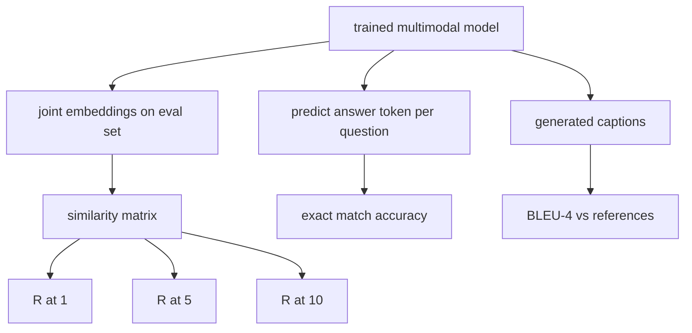

# Evaluasi Multimodal

> Training adalah separuh loop. Separuhnya yang lain adalah pengukuran. Pelajaran ini membangun tiga permukaan evaluasi dari primitif: retrieval gambar-caption yang dilaporkan sebagai R@1, R@5, R@10; visual question answering yang dilaporkan sebagai akurasi exact match; dan image captioning yang dilaporkan sebagai BLEU-4. Setiap metrik adalah sebuah fungsi di atas output model dan sebuah suite evaluasi sintetis yang berjalan dalam hitungan detik.

**Type:** Build
**Languages:** Python
**Prerequisites:** Phase 19 lessons 58-62 (Track E foundations: encoder, transformer, projection, cross-attention fusion, pretraining)
**Time:** ~90 minutes

## Tujuan Pembelajaran

- Hitung Recall@K dari sebuah matriks kemiripan antara embedding gambar dan caption.
- Hitung akurasi VQA exact match dari sebuah model yang memetakan pasangan (image, question) ke sebuah vocabulary jawaban tetap.
- Hitung BLEU-4 dari sekuens token hasil generate dan referensi tanpa pustaka eksternal apa pun.
- Jalankan ketiga evaluasi terhadap sebuah suite sintetis yang dibangun di atas model terlatih dari pelajaran 62.

## Masalahnya

Godaannya adalah menyatakan sebuah model multimodal selesai saat loss training mentok. Loss training mengukur kecocokan pada distribusi training; ia tidak mengukur apakah model mampu men-rank pasangan pada sebuah batch held-out, menjawab sebuah pertanyaan, atau menulis sebuah caption yang bisa diterima manusia. Tiga permukaan evaluasi adalah standar:

- **Retrieval (R@1, R@5, R@10).** Bangun embedding gabungan untuk sebuah query caption; rank setiap gambar di pool evaluasi berdasarkan cosine; laporkan apakah gambar yang cocok mendarat di top 1, top 5, top 10. Bentuk simetris (image-to-text) berjalan dengan cara yang sama.
- **Visual question answering (exact match).** Diberi (gambar, pertanyaan), model mengeluarkan sebuah token jawaban. Exact match adalah satu bit per sampel: apakah jawaban prediksi sama dengan jawaban referensi? Rata-ratakan di seluruh set evaluasi.
- **Captioning (BLEU-4).** Hasilkan sebuah caption. Hitung rata-rata geometrik dari presisi 1-gram hingga 4-gram terhadap caption referensi, lengkap dengan brevity penalty. Multi-reference adalah bentuk standarnya (satu gambar, beberapa caption referensi).

Setiap metrik adalah fungsi yang tipis. Pelajaran ini membangun semuanya dalam kode sehingga matematikanya konkret dan permukaannya tetap berada di bawah kendalimu. Suite benchmark nyata (MS-COCO, VQA v2, GQA, OK-VQA) mencolok ke bentuk fungsi yang sama.

## Konsepnya



### Recall@K dari sebuah matriks kemiripan

Bangun matriks kemiripan cosine `(N, N)` antara embedding gambar dan caption. Untuk setiap baris, sort kolomnya berdasarkan kemiripan menurun. Recall@K adalah fraksi baris di mana indeks kolom diagonal berada di dalam posisi top K. Recall@K simetris (caption-to-image) dihitung di atas matriks yang ditranspos. Kedua angka dilaporkan. Untuk sebuah evaluasi N=100, R@1 = 0.6 berarti 60 dari 100 caption mengambil gambar yang benar sebagai match teratas.

### VQA exact match

Untuk setiap (gambar, pertanyaan, jawaban), encode gambarnya, embed pertanyaannya, fuse melalui decoder, dan baca token berikutnya. Token id prediksi dibandingkan dengan id referensi; benar jika keduanya sama. Rata-ratakan di seluruh set evaluasi. Dataset VQA nyata datang dengan beberapa jawaban yang dianotasi manusia per pertanyaan dan memakai rumus akurasi lunak (1.0 jika setidaknya 3 dari 10 anotator setuju, lalu diskalakan ke bawah); pelajaran ini memakai exact match jawaban tunggal demi kejelasan.

### BLEU-4

```text
BLEU-4 = BP * exp(mean(log p1, log p2, log p3, log p4))
```

Di mana `p_n` adalah presisi n-gram termodifikasi (jumlah hasil generate n-gram yang muncul di referensi mana pun, di-clamp, dibagi total n-gram hasil generate), dan `BP` adalah brevity penalty-nya:

```text
BP = 1                if generated length > reference length
   = exp(1 - r/g)     otherwise, where r is reference length and g is generated
```

Smoothing diperlukan untuk sampel kecil tempat sebagian `p_n` bernilai nol. Implementasinya memakai "method 1" milik Chen dan Cherry (menambah 1 ke pembilang dan penyebut untuk setiap jumlah nol), yang merupakan default paling aman pada rezim count rendah.

### Suite evaluasi sintetis

Sebuah suite evaluasi 50 sampel dibangun di memori dari pola korpus mock yang sama yang dipakai di pelajaran 62, dengan seed yang di-held-out. Tiga daftar menyusun suite-nya:

- `pairs`: 50 pasangan (image, caption_ids) untuk retrieval.
- `vqa`: 50 triplet (image, question_ids, answer_id).
- `caps`: 50 entri (image, [reference_caption_ids, ...]) dengan hingga 3 referensi per gambar.

Suite ini deterministik dari seed-nya dan di-held-out dari korpus training, sehingga metrik dihitung di atas data yang tidak pernah dilihat oleh model. Menyimpan suite ke JSON dibiarkan sebagai sebuah latihan (lihat di bawah).

| Metric | Range | Random baseline (N=50) |
|--------|-------|------------------------|
| R@1 | 0 to 1 | 0.02 (1 / N) |
| R@5 | 0 to 1 | 0.10 |
| R@10 | 0 to 1 | 0.20 |
| VQA EM | 0 to 1 | 1 / vocab |
| BLEU-4 | 0 to 1 | small but nonzero |

Untuk sebuah training run 50 langkah pada data sintetis, metrik memang tidak diharapkan tinggi; yang diharapkan adalah berada di atas baseline acak, dan itulah yang diperiksa oleh demo.

```figure
ch-recall-window
```

## Bangun Sendiri

`code/main.py` mengimplementasikan:

- `recall_at_k(sim_matrix, k)`, yang mengembalikan sebuah float di `[0, 1]` untuk kedua arah.
- `vqa_exact_match(predictions, references)`, yang mengembalikan rata-rata atas kesamaan `int`.
- `bleu4(generated, references, smoothing=True)`, dengan dukungan multi-reference.
- `build_eval_suite(seed, n_samples, vocab_size, max_len)`, yang mengembalikan tiga daftar evaluasi deterministik.
- `evaluate(model, suite)`, yang menjalankan ketiga metrik dan mengembalikan sebuah `dict` berisi angka.
- Sebuah demo yang memuat sebuah model multimodal yang baru diinisialisasi dari pelajaran 62, mengevaluasinya, lalu melatihnya selama 50 langkah dan mengevaluasi lagi, sambil mencetak metrik sebelum/sesudahnya.

Jalankan:

```bash
python3 code/main.py
```

Output: tabel metrik sebelum/sesudah menunjukkan retrieval membaik dari hampir-acak menuju sinyal yang dipelajari model, VQA membaik di atas acak, dan BLEU-4 membaik (struktur sintetis sudah cukup untuk mengangkat presisi 4-gram).

## Gunakan

Setiap metrik memetakan langsung ke sebuah benchmark produksi:

- **Retrieval.** MS-COCO 5K val, Flickr30K, ImageNet zero-shot semuanya adalah masalah R@K pada matriks kemiripan yang sama. Ganti evaluasi sintetis dengan file yang nyata dan signature fungsinya tidak berubah.
- **VQA.** VQA v2, GQA, OK-VQA memakai bentuk exact-match yang sama (dengan soft-acc alih-alih EM jawaban tunggal untuk VQA v2).
- **BLEU-4.** Captioning MS-COCO, NoCaps, captioning Flickr30K semuanya memakai BLEU-4 plus CIDEr dan METEOR. Menambahkan CIDEr hanyalah satu fungsi lagi.

Untuk benchmark yang nyata, tukar `build_eval_suite` dengan sebuah loader nyata dan pertahankan isi fungsi-fungsinya. Matematikanya agnostik terhadap benchmark.

## Tes

`code/test_main.py` mencakup:

- recall@k mengembalikan 1.0 pada matriks kemiripan identitas yang sempurna dan 0.0 pada yang terbalik untuk k < N
- recall@k menghormati batas atas `k <= N`
- bleu4 mengembalikan 1.0 ketika hasil generate persis sama dengan salah satu referensi
- bleu4 mengembalikan 0.0 pada vocabulary yang tidak beririsan
- vqa exact match sama dengan fraksi pasangan yang setara
- build_eval_suite mengembalikan jumlah pasangan, item vqa, dan entri caption yang diharapkan

Jalankan semuanya:

```bash
python3 -m unittest code/test_main.py
```

## Latihan

1. Tambahkan CIDEr ke metrik captioning. CIDEr memakai pembobotan TF-IDF pada n-gram, yang memberi hadiah pada token yang informatif.

2. Implementasikan VQA soft-accuracy: beberapa jawaban manusia per pertanyaan, akurasinya `min(human_count / 3, 1)` jika ada yang cocok. Mereplikasi VQA v2.

3. Tambahkan sebuah varian aman-NaN dari `bleu4` yang menangani sekuens hasil generate kosong tanpa crash.

4. Hitung mean reciprocal rank (MRR) di samping R@K. MRR sensitif terhadap di mana item yang benar mendarat di luar top K; R@K sensitif terhadap apakah ia mendarat di top K.

5. Jalankan evaluasi pada model di lima checkpoint selama training (langkah 0, 10, 20, 30, 40, 50) dan plot kurva pembelajarannya. Konfirmasi bahwa trajektori metrik mengikuti trajektori loss.

## Istilah Kunci

| Term | What it means |
|------|---------------|
| R@K | Fraction of queries where the correct match lands in the top K results |
| Exact match | The simplest VQA scoring: predicted answer equals reference |
| BLEU-4 | Geometric mean of 1- to 4-gram precisions, with brevity penalty |
| Multi-reference | A captioning metric accepts several reference captions per image |
| Held-out | The eval set is sampled from a seed disjoint from the training corpus |

## Bacaan Lanjutan

- Paper VQA v2 untuk rumus soft-accuracy dan statistik dataset.
- Paper CIDEr untuk captioning n-gram berbobot TF-IDF.
- BLEU asli (Papineni et al., 2002) untuk varian smoothing-nya.
- Skrip evaluasi captioning MS-COCO untuk implementasi referensi kanonisnya.
