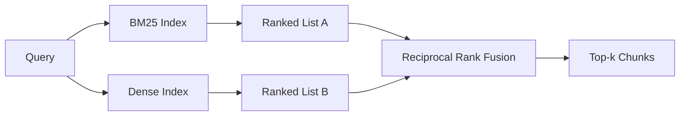

# Hybrid Retrieval dengan BM25 dan Dense Embeddings

> Retrieval leksikal dan semantik gagal pada distribusi query yang berlawanan. Hybrid retrieval dengan reciprocal rank fusion tidak menginterpolasi, ia memilih suara - dan suaranya menang di setiap kelas query.

**Type:** Build
**Languages:** Python
**Prerequisites:** Phase 11 lessons 04 (embeddings), 06 (RAG); Phase 19 Track B foundations (lessons 20-29); Phase 19 lesson 64 (chunking strategies)
**Time:** ~90 minutes

## Tujuan Pembelajaran
- Implementasikan BM25 dari nol dari formulasi Robertson dan Sparck Jones, dengan field weighting, normalisasi panjang dokumen, serta k1 dan b yang bisa diatur.
- Bangun dense retriever di atas mock embedding deterministik agar loop berjalan offline.
- Implementasikan reciprocal rank fusion persis seperti yang dipublikasikan Cormack, Clarke, dan Buettcher pada 2009, dan jelaskan mengapa ia mengalahkan interpolasi berbobot skor.
- Setel konstan RRF k dan bobot per-modality lalu baca trade-off-nya pada korpus fixture kecil.

## Masalahnya

Pencarian leksikal menang ketika query membawa identifier literal yang dimuat korpus secara verbatim. Query untuk `AbortMultipartOnFail` mengembalikan fungsi Go yang tepat lewat BM25 dalam mikrodetik. Query yang sama, ketika di-embed, berada di batas tiga cluster kemiripan dan dense retriever menempatkan file yang salah di urutan pertama.

Pencarian dense menang ketika query diparafrasekan menjauh dari token literal korpus. Pengguna yang bertanya "how do we handle cancelled uploads" tidak pernah mengetik kata abort maupun multipart. BM25 mengembalikan chunk dokumentasi tentang "uploading large files" karena halaman itu memuat kata uploads. Retrieval dense menemukan fungsi abort yang ringkasannya menyebut pembatalan.

Pilihan di antara keduanya bukan sesuatu yang statis. Distribusi query-lah yang menjadi variabelnya. Sistem RAG produksi menangani kedua kelas dari endpoint yang sama, sehingga retrieval harus menanganinya sekaligus. Itulah hybrid retrieval. Langkah merge-alah yang harus benar.

## Konsepnya



### BM25 dalam satu paragraf

BM25 menilai pasangan query-dokumen dengan menjumlahkan, sepanjang term query, faktor inverse document frequency dikalikan faktor term-frequency yang jenuh serta memuat koreksi normalisasi panjang. Dua kenop. `k1` mengontrol saturasi term-frequency; default 1.5 adalah rekomendasi yang dipublikasikan dan sebaiknya kamu tidak menggesernya tanpa benchmark. `b` mengontrol seberapa besar panjang dokumen berarti; default 0.75 berarti dokumen panjang dihukum, tetapi tidak secara linier.

Rumus IDF memakai definisi Robertson dan Sparck Jones yang dihaluskan, yaitu `log((N - df + 0.5) / (df + 0.5) + 1)`. Plus-one di dalam log membuat IDF tetap positif ketika sebuah term muncul di lebih dari separuh korpus. Ini penting di korpus kecil tempat stopwords secara teknis langka.

Field weighting membolehkanmu memberi tahu BM25 bahwa kecocokan pada nama simbol lebih berat daripada kecocokan di badan teks. Implementasinya adalah pengali pada hitungan term saat indexing, bukan saat scoring. Itu menjaga matematikanya identik dan menghindari skor terpisah per field.

### Retrieval dense dalam satu paragraf

Embed setiap chunk menjadi vektor berdimensi tetap dengan sebuah embedding model. Saat query, embed query-nya, urutkan tiap chunk dengan cosine berdasarkan kemiripan, lalu kembalikan top-k. Modelnya adalah variabel yang menentukan kualitas. Algoritma retrieval-nya sendiri hanya dua baris: dot product dan sort.

Pelajaran ini memakai embedding deterministik berbasis hash agar kamu bisa membaca matematika fusion tanpa panggilan jaringan. Hash-nya menjumlahkan offset ber-key token ke dalam vektor berdimensi 96 lalu menormalisasi. Peringkat cosine deterministik antar-lari, dan itu yang dibutuhkan suite test.

### Reciprocal rank fusion, rumus yang dipublikasikan

Dua daftar berperingkat. Untuk setiap kandidat yang muncul di salah satu daftar, jumlahkan kontribusi reciprocal-rank-nya. Paper 2009 memakai `1 / (k + rank)` dengan k sama dengan 60 sebagai default. Urutkan berdasarkan skor total. Itu seluruh algoritmanya.

Konstanta yang dipublikasikan k = 60 bukan sewenang-wenang. Dengan k = 60 kontribusi rank-1 adalah 1 / 61 dan kontribusi rank-10 adalah 1 / 70. Kontribusinya melambat perlahan sehingga kandidat yang dalam tetap memberi suara. k yang lebih kecil membuat hasil teratas mendominasi. k yang lebih besar meratakan kurva kontribusi.

Dua kenop yang bisa diatur di implementasi kita. Konstanta `k`. Sepasang bobot per-modality agar kamu bisa menaikkan BM25 atau dense ketika kamu punya bukti awal bahwa salah satunya lebih baik di korpusmu. Mengalikan kontribusi peringkat dengan bobot adalah implementasi paling sederhana yang berprinsip; ia mempertahankan bentuk dekay peringkat dan tetap bebas-skala.

### Mengapa fusion mengalahkan interpolasi berbobot skor

Skor BM25 tidak terbatas dan tergantung korpus. Kemiripan cosine dibatasi di -1 hingga 1. Kombinasi linier `alpha * bm25 + (1 - alpha) * cosine` menuntut penyetelan alpha per-korpus dan pindah setiap kali kamu mengindeks ulang. Fusion berbasis peringkat tidak. Dua peringkat bisa dibandingkan lintas modality. Baseline RRF yang dipublikasikan mengalahkan interpolasi-skor di setiap track TREC publik sejak 2010.

Ini argumen yang sama seperti yang kamu dengar soal RankFusion vs RRF di dokumentasi Vespa dan Weaviate. Mereka sampai pada kesimpulan yang sama: tetap berbasis peringkat kecuali kamu punya bukti yang sangat kuat untuk menginterpolasi skor.

```figure
rrf-fusion
```

## Bangun Sendiri

`code/main.py` mengimplementasikan:

- `tokenize(text)` - tokenizer regex yang cepat.
- `BM25Index` - berbobot field, dengan `add` dan `search` serta k1, b yang bisa diatur.
- `mock_embed`, `DenseIndex` - embedding deterministik yang sama dengan pelajaran 64 sehingga chunk-nya sebanding.
- `rrf(rankings, k, weights)` - fusion yang dipublikasikan dengan bobot multi-modality.
- `HybridRetriever` - menggabungkan BM25 dan dense.
- Sebuah demo `main()` yang memuat korpus fixture kecil, menjalankan tiga query yang menyasar kekuatan dan kelemahan tiap retriever, lalu mencetak peringkat yang dihasilkan tiap modality plus daftar hasil fusion-nya.

Jalankan:

```bash
python3 code/main.py
```

Baca output demo berdampingan. Query identifier literal mendarat di BM25 rank 1, dense rank 4, RRF rank 1. Query parafrase mendarat di BM25 rank 6, dense rank 1, RRF rank 1. Query ambigu mendarat di BM25 rank 3, dense rank 3, RRF rank 1. Fusion bukan penentu seri; ia adalah sistem yang menang di setiap kelas query.

## Menyetel kenop

| Knob | Default | Move it up when | Move it down when |
|------|---------|----------------|------------------|
| BM25 k1 | 1.5 | Terms repeat in documents and you want frequency to matter more | Documents are short and term repetition is noise |
| BM25 b | 0.75 | Long documents really do say less per word | Document length is uncorrelated with topic |
| RRF k | 60 | Deep candidates should keep voting | The top-1 should dominate |
| BM25 weight | 1.0 | Your corpus contains literal identifiers and queries match them | Your queries are user-paraphrased |
| Dense weight | 1.0 | Queries are paraphrased | Queries are literal |

Setel dengan menjalankan ulang eval harness pelajaran 68 pada set query held-out-mu, bukan lewat intuisi.

## Mode kegagalan yang akan disembunyikan demo

**Token di luar vocabulary.** IDF BM25 dihitung dari korpus, sehingga term yang hanya ada di query berkontribusi nol. Embedding dense menghaluskan sebuah vektor untuk term yang sama. Pada identifier di luar korpus, modality dense mengembalikan tetangga yang terlihat masuk akal tetapi salah. Fusion menyerap ini karena BM25 tidak mengembalikan apa pun dan kontribusi peringkat gugur, tetapi hanya jika kamu de-duplicate berdasarkan dokumen, bukan berdasarkan chunk.

**Dominasi stop-token.** BM25 terhadap kata "the" menghasilkan peringkat seragam di seluruh korpus. Saring stop token di indexer atau terima bahwa term ber-IDF tinggi memang mendominasi secara alami.

**Konten identik lintas modality.** Jika korpusmu cukup kecil sehingga top-1 BM25 juga top-1 dense, RRF memberimu top-1 yang sama dengan tetangga yang sama. Itu perilaku yang benar, bukan kegagalan, tetapi membuat fusion tampak tak terlihat. Tambahkan pasangan query adversarial di eval-mu untuk memverifikasi fusion benar-benar bekerja.

## Gunakan

Pola produksi:

- Index BM25 di dalam proses; bottleneck-nya adalah kamus term-frequency, bukan vektor-nya.
- Index vektor dense di store terpisah (di pelajaran ini kita memakai daftar datar; di produksi kamu akan memakai HNSW).
- Jalankan kedua query secara paralel; fusion adalah merge berwaktu-konstan di atas union-nya.
- Simpan modality dari tiap hit yang diambil agar reranker di hilir bisa melihat modality mana yang memilihnya.

## Rilis

Pelajaran 66 mengambil top-k hasil fusion dari pelajaran ini dan mererank-nya dengan cross-encoder. Pelajaran 68 mengevaluasi seluruh pipeline dengan precision, recall, MRR, dan nDCG. Hybrid retriever di pelajaran ini adalah tahap pertama dari sistem end-to-end di pelajaran 69.

## Latihan

1. Ganti `mock_embed` dengan model asli dari provider-mu. Jalankan ulang demo dan laporkan bagaimana peringkat dense-only berubah pada query parafrase.
2. Tambahkan modality ketiga: ringkasan chunk yang diindeks terpisah dan di-fusion sebagai daftar berperingkat ketiga. Ukur keuntungannya.
3. Sweep RRF k pada 10, 30, 60, 100, 200. Plot kurva recall@k dari pelajaran 68. Laporkan nilai k di mana kurva puncak pada korpusmu.
4. Implementasikan BM25F dengan benar (normalisasi panjang per-field, bukan trik pengali) dan bandingkan pada korpus di mana kecocokan simbol paling berarti.

## Istilah Kunci

| Term | What people say | What it actually means |
|------|-----------------|------------------------|
| BM25 | "Lexical search" | Probabilistic ranking with idf x saturating tf x length normalization |
| RRF | "Rank fusion" | Sum of 1 / (k + rank) across ranked lists; k = 60 default |
| k1 | "TF saturation" | Controls how fast a repeated term stops adding more score |
| b | "Length penalty" | 0 means ignore document length, 1 means full normalization |
| Field weighting | "Symbol boost" | Repeat tokens during indexing to boost matches in that field |
| Rank-based vs score-based fusion | "Why RRF beats linear" | Ranks are comparable across modalities; scores are not |

## Bacaan Lanjutan

- Cormack, Clarke, Buettcher, "Reciprocal Rank Fusion outperforms Condorcet and individual rank learning methods", SIGIR 2009
- Robertson, Walker, Beaulieu, Gatford, Payne, "Okapi at TREC-3" (the original BM25 paper)
- [Vespa: Hybrid Retrieval with BM25 and Embeddings](https://docs.vespa.ai/en/tutorials/hybrid-search.html)
- [Weaviate: Hybrid Search](https://weaviate.io/developers/weaviate/search/hybrid)
- Phase 11 pelajaran 06 - dasar-dasar RAG
- Phase 19 pelajaran 64 - chunker yang outputnya diindeks di sini
- Phase 19 pelajaran 66 - cross-encoder reranker yang mengonsumsi top-k hasil fusion
