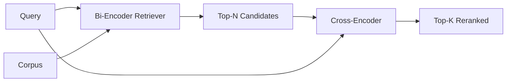

# Cross-Encoder Reranker

> Bi-encoder meng-embed query dan dokumen secara independen. Cross-encoder menggabungkan keduanya dan membaca keduanya sekaligus. Cross-encoder adalah pembaca paling cerdas sekaligus yang paling lambat. Dipakai sebagai tahap kedua atas top-k milik bi-encoder, ia membayar dirinya sendiri.

**Type:** Build
**Languages:** Python
**Prerequisites:** Phase 11 lesson 06 (RAG), Phase 11 lesson 07 (advanced RAG); Phase 19 Track B foundations (lessons 20-29); Phase 19 lesson 65 (hybrid retrieval feeding this stage)
**Time:** ~90 minutes

## Tujuan Pembelajaran
- Membedakan retriever bi-encoder dari reranker cross-encoder lewat bentuk input, jumlah parameter, dan biaya per-query-nya.
- Implementasikan cross-encoder kecil dari nol sebagai sebuah transformer block yang mengonsumsi sekuens (query, dokumen) yang dipadatkan dan memancarkan satu skalar relevansi.
- Rangkai pipeline dua tahap retrieve-then-rerank: ambil top-N dengan retriever murah, rerank N menjadi top-K dengan cross-encoder, kembalikan K.
- Ukur trade-off latensi-vs-kualitas pada korpus fixture kecil dan pilih N yang tepat untuk anggaran latensi tertentu.

## Masalahnya

Bi-encoder memetakan query dan dokumen ke ruang vektor yang sama lalu mengurutkan berdasarkan cosine. Kedua encoding itu tidak pernah saling melihat. Model harus memampatkan segala sesuatu yang berguna tentang sebuah dokumen ke dalam satu vektor, buta terhadap query. Ini cepat - satu embedding per dokumen saat indexing dan satu per query saat query - dan inilah satu-satunya cara mengurutkan pada skala korpus.

Harganya adalah presisi. Dua dokumen yang punya topik keseluruhan sama bisa punya embedding yang nyaris identik bahkan ketika salah satunya menjawab query dan yang lain tidak. Bi-encoder tidak bisa membedakannya.

Cross-encoder memecahkan ini dengan membaca query dan dokumen bersamaan. Model menerima `[query] [SEP] [document]` sebagai satu sekuens, menjalankan attention penuh melintasi sambungan itu, dan menghasilkan satu skalar relevansi. Setiap token dokumen bisa attend ke setiap token query. Model memutuskan skor dengan konteks penuh.

Harganya adalah throughput. Di mana bi-encoder meng-embed sekali dan query selamanya, cross-encoder berjalan sekali per pasangan (query, dokumen). Untuk korpus 10 juta dokumen itu 10 juta forward pass per query. Tidak bisa dijalankan dalam anggaran request.

Solusinya adalah bertahap. Pakai bi-encoder untuk mengambil top-N. Pakai cross-encoder untuk mererank N menjadi top-K. N kecil (50 sampai 200) dan kenaikan kualitas cross-encoder terkonsentrasi di tempat yang penting. Total latensi tetap di anggaran request. Total kualitas adalah kualitas cross-encoder, dibatasi oleh recall bi-encoder pada N.

## Konsepnya



### Bentuk input cross-encoder

Packing standarnya adalah `[CLS] query_tokens [SEP] document_tokens [SEP]`. Output posisi CLS dimasukkan ke satu linear head tunggal yang memancarkan skalar relevansi. Sebagian implementasi memakai mean-pooling alih-alih CLS; selisihnya kecil. Intinya model menghasilkan satu angka per pasangan.

Cross-encoder 22M parameter (kelas bobot `ms-marco-MiniLM-L-6-v2` yang dipublikasikan) adalah titik produksi yang umum. Model yang lebih kecil kehilangan kualitas lebih cepat daripada menghemat latensi. Model yang lebih besar (mis. `bge-reranker-v2-m3` dengan 568M parameter) disimpan untuk reranking offline atau reranking halaman pertama di mana K kecil.

### Mengapa pelajaran ini melatih yang kecil

Cross-encoder yang asli adalah encoder transformer yang di-finetune. Di produksi kamu memuat checkpoint dan menjalankannya. Di pelajaran ini tujuannya adalah menunjukkan bentuk model dan bentuk kurva latensi-kualitas, bukan melatih peranker setara-terbaik. Jadi kita membangun `nn.Module` kecil dengan satu transformer block, multi-head attention (4 head secara default), dan satu regression head. Ia diinisialisasi secara deterministik dari sebuah seed sehingga demo bisa direproduksi tanpa bobot di disk.

Model mainan itu mempelajari bentuk yang benar dari korpus fixture: pasangan query-dokumen yang relevan mendapat skor prediksi lebih tinggi daripada pasangan yang tidak relevan. Pipeline end-to-end mererank output bi-encoder dan top-k hasil rerank berkorelasi dengan label gold.

### Latensi vs kualitas

Pipeline dua tahap punya satu hal yang bisa diatur: N. Sweep N dari 5 ke 100 pada set query held-out dan kamu akan mendapat kurvanya.

| N | Recall@1 of stage 2 | Cross-encoder forward passes per query | Latency |
|---|--------------------|---------------------------------------|---------|
| 5 | 0.62 | 5 | low |
| 20 | 0.81 | 20 | medium |
| 50 | 0.86 | 50 | high |
| 100 | 0.86 | 100 | very high |

Angka di atas menggambarkan bentuknya, bukan pengukuran dari fixture ini. Bentuknya nyata. Selalu ada knee di sekitar 20 sampai 50 kandidat tempat kenaikan rerank jenuh. Lewat dari knee, kamu membayar tanpa guna.

Pilih N dari kurva eval plus anggaran latensi. Cross-encoder tidak bisa menaikkan recall di atas recall bi-encoder pada N, jadi N yang rendah membatasi kualitas, bukan hanya latensi.

```figure
rerank-funnel
```

## Bangun Sendiri

`code/main.py` mengimplementasikan:

- `CrossEncoder` - sebuah `torch.nn.Module` kecil: token embedding, satu transformer block dengan multi-head attention dan feedforward, head mean-pooled yang menghasilkan satu skalar.
- `tokenize_pair(query, document)` - memadatkan dua string itu menjadi satu sekuens id dengan type id yang menandai batasnya, deterministik dan stdlib.
- `train_tiny(pairs)` - satu pass pelatihan terawasi pada daftar triple (query, dokumen, relevansi) yang berlabel manual, sehingga model menghasilkan skor yang masuk akal pada fixture-nya.
- `rerank(query, candidates, top_k)` - antarmuka produksinya.
- `pipeline(query, retriever, top_n, top_k)` - alur dua tahapnya.
- Sebuah demo `main()` yang memuat korpus dari pola pelajaran 65, mengambil top-N, mererank ke top-K, mencetak kedua daftar berdampingan, dan melaporkan latensi tiap tahap.

Jalankan:

```bash
python3 code/main.py
```

Outputnya menunjukkan top-N milik bi-encoder, top-K milik cross-encoder, dan ringkasan pengukuran waktu. Cross-encoder lebih lama per panggilan tetapi tidak berjalan di seluruh korpus. Total dua tahap tetap dalam anggaran sambil memilih jawaban yang diurutkan bi-encoder di posisi kedua atau ketiga.

## Mode kegagalan yang akan disembunyikan demo

**Cross-encoder tidak simetris.** `rerank(q, d)` dan `rerank(d, q)` adalah skor yang berbeda. Selalu masukkan query lebih dulu. Jika kamu tidak sengaja menukar, recall runtuh.

**N terlalu rendah untuk memunculkan bug-nya.** Jika kamu menyetel N = K, cross-encoder tidak bisa mengurutkan ulang; ia hanya bisa menimbang ulang. Kenaikannya tampak nol. Pilih N setidaknya tiga kali K.

**Data training bocor ke eval.** Jika pasangan training berlabel manual menyertakan query eval, rerank-nya tampak ajaib. Pisahkan train dan eval secara ketat, bahkan pada fixture.

**Bobot produksi itu padat.** Cross-encoder 22M parameter berukuran 88MB pada float32. Rencanakan memori model server sebelum menjanjikan p95 di bawah 100ms.

**Batching itu penting.** Cross-encoder yang asli menjalankan N kandidat dalam satu batch. Pelajaran ini melakukan itu di `_batch_encode`, yang membangun tensor id dan type-id yang di-batch dengan `torch.tensor(...)` dan menjalankan satu forward pass. Lewati batching dan latensinya dikalikan dengan N.

## Gunakan

Pola produksi:

- Pin bi-encoder, cross-encoder, dan N sebagai satu paket. Mengganti salah satunya membatalkan eval-nya.
- Cache output reranker berdasarkan hash (query, document_id). Query yang sama terhadap korpus yang stabil akan rerank ke urutan yang sama; cache hit memberimu pemotongan latensi gratis.
- Catat skor cross-encoder rank-1. Query yang skor top-nya di bawah ambang spesifik-korpus adalah hit di luar domain; tampilkan ke LLM sebagai "I am not confident".

## Rilis

Pelajaran 68 mengevaluasi pipeline dua tahap ini end to end. Pelajaran 69 merangkai reranker ini di belakang hybrid retriever dari pelajaran 65 dan di depan generator jawaban. Reranker adalah tahap kedua dari sistem end-to-end.

## Latihan

1. Sweep N dari 5 ke 50 dan plot recall@1 dari output hasil rerank. Temukan knee-nya pada fixture ini.
2. Latih cross-encoder selama sepuluh epoch alih-alih satu. Ukur margin skor antara pasangan positif dan negatif tiap epoch.
3. Ganti mean-pooling dengan head token CLS. Bandingkan konvergensinya pada fixture ini.
4. Tambahkan head cross-encoder kedua yang memprediksi label biner "apakah jawaban ini ada di dokumen". Pakai kedua head saat inference; satu untuk mengurutkan, satu untuk threshold.
5. Ganti bi-encoder mock deterministik dengan milik pelajaran 65 dan rangkai kedua tahapnya. Ukur perubahan top-K dibanding bi-encoder sendirian.

## Istilah Kunci

| Term | What people say | What it actually means |
|------|-----------------|------------------------|
| Bi-encoder | "Vector retriever" | Encodes query and doc independently; cosine ranks them |
| Cross-encoder | "Reranker" | Encodes (query, doc) jointly; outputs one relevance scalar |
| Two-stage pipeline | "Retrieve and rerank" | Cheap retriever returns N, expensive reranker keeps K |
| N (candidate budget) | "Rerank pool" | The number of candidates the cross-encoder scores per query |
| Mean-pooling head | "Mean of last hidden" | Average the encoder's last-layer outputs into one vector |

## Bacaan Lanjutan

- Nogueira, Cho, "Passage Re-ranking with BERT", 2019 - the canonical cross-encoder ranker paper
- Reimers, Gurevych, "Sentence-BERT: Sentence Embeddings using Siamese BERT-Networks", 2019 - on bi-encoders vs cross-encoders
- [SentenceTransformers Cross-Encoders documentation](https://www.sbert.net/examples/applications/cross-encoder/README.html)
- [BGE Reranker v2 model card](https://huggingface.co/BAAI/bge-reranker-v2-m3)
- Phase 19 pelajaran 65 - hybrid retriever yang memberi makan tahap rerank ini
- Phase 19 pelajaran 68 - eval yang mengukur kenaikan yang diberikan rerank ini
