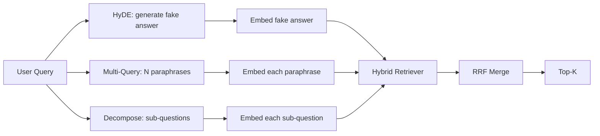

# Query Rewriting: HyDE, Multi-Query, dan Decomposition

> Query yang diketik pengguna bukan query yang diinginkan retrievermu. Rewriting menjembatani gap itu sebelum retrieval, sehingga index melihat sesuatu yang lebih dekat dengan bentuk jawabannya.

**Type:** Build
**Languages:** Python
**Prerequisites:** Phase 11 lessons 04 (embeddings), 06 (RAG); Phase 19 Track B foundations (lessons 20-29); Phase 19 lessons 64 and 65
**Time:** ~90 minutes

## Tujuan Pembelajaran
- Implementasikan Hypothetical Document Embeddings (HyDE): buat jawaban palsu, embed-nya, lalu retrieve terhadap vektor itu alih-alih vektor query.
- Implementasikan multi-query expansion: tulis ulang satu query menjadi N parafrase, retrieve dengan tiap-tiapnya, gabungkan union-nya lewat reciprocal rank fusion.
- Implementasikan query decomposition: pecah pertanyaan kompleks menjadi sub-pertanyaan, retrieve per sub-pertanyaan, gabungkan.
- Bandingkan ketiga rewriter secara langsung pada satu fixture dan jelaskan kapan tiap strategi menang.
- Rangkai mock LLM yang menghasilkan output deterministik sesuai fixture agar loop rewriter-nya berjalan offline.

## Masalahnya

Seorang pengguna mengetik "what does our team do when uploads fail and the budget is gone?". Korpus memuat dokumen yang berbunyi "AbortMultipartOnFail aborts an in-flight S3 multipart upload and decrements the per-bucket retry budget when the upload fails". Query dan dokumennya tidak berbagi frasa nominal. BM25 meleset. Bi-encoder menempatkan dokumen itu di urutan ketiga atau keempat karena vektor query mendarat di wilayah ruang embedding yang lebih memilih dokumen tentang job yang dibatalkan, bukan dokumen tentang upload yang diabort. Rerank dua tahap dari pelajaran 66 masih bisa menyelamatkan jawaban jika ia ada di top-N, tetapi jika ia bahkan tidak sampai ke top-N, reranker tidak pernah melihatnya.

Perbaikannya adalah menulis ulang query sebelum ia menyentuh retriever. Paper 2023 "Precise Zero-Shot Dense Retrieval without Relevance Labels" (Gao et al.) memperkenalkan HyDE: minta sebuah LLM menulis dokumen yang akan menjawab query, embed dokumen hipotetis itu, dan gunakan embedding-nya sebagai vektor retrieval. Dokumen hipotetis itu berada di wilayah ruang embedding yang tepat karena ditulis dengan suara korpus. Vektor query tidak.

Dua teknik sepupu berpasangan dengan HyDE. Multi-query expansion (istilah yang dipakai GraphRAG dari Microsoft) menghasilkan N parafrase dari query lalu retrieve dengan tiap-tiapnya, lalu menggabungkan. Decomposition (dipopulerkan sebagai "subquery decomposition" dalam kerja Stanford DSPy 2024) memecah "what does our team do when uploads fail and the budget is gone" menjadi dua pertanyaan: "what happens when an upload fails" dan "what happens when the retry budget is gone". Dua retrieval, satu hasil gabungan, kedua bagian jawaban bisa dijangkau.

Pelajaran ini mengimplementasikan ketiganya dan menjalankannya terhadap korpus fixture yang sama.

## Konsepnya



### HyDE secara detail

HyDE menggantikan vektor query pengguna dengan vektor dokumen hipotetis buatan LLM. Prompt-nya pendek:

```
You are a domain expert. Write a one-paragraph passage that answers the question
below. Use the same vocabulary and phrasing the documentation in this domain would
use. Do not refuse. Do not say you do not know.

Question: {user_query}

Passage:
```

Jawaban LLM itu salah sebagai jawaban faktual karena LLM tidak tahu korpusmu. Itu tidak masalah. Retriever tidak peduli dengan kebenaran faktual, hanya dengan distribusi token. Paragraf hipotetis memuat kata "abort", "multipart", "bucket", "budget", karena itulah yang akan dikatakan paragraf dokumentasi tentang topik ini. Embed paragraf itu. Vektornya mendarat dekat dengan paragraf yang asli.

Di produksi kamu membatasi dokumen hipotetis ke dua atau tiga kalimat. Hipotetis yang lebih panjang mengumpulkan lebih banyak noise. Yang lebih pendek kehilangan sinyal leksikal yang dibutuhkan HyDE.

### Multi-query expansion secara detail

Hasilkan N parafrase dari query pengguna. Prompt paling sederhananya:

```
Rewrite the following question in {N} different ways. Each rewrite must preserve
the original intent. Number them 1 to {N}. Do not add explanations.
```

Retrieve top-k untuk tiap parafrase. Gabungkan N daftar berperingkat dengan RRF (algoritma yang sama dari pelajaran 65). Murah, paralel, deterministik.

Multi-query menang ketika frasa pengguna hanyalah satu dari banyak cara yang sama-sama sah untuk bertanya, dan salah satu dari rewrite-an akan bertanya dengan lebih baik. Kalah ketika semua rewrite-an sama-sama buruk karena yang asli buruk dengan cara yang sama.

### Decomposition secara detail

Satu retrieval tidak bisa memuaskan pertanyaan berbilah banyak. Decomposition meminta LLM memecah pertanyaan menjadi sub-pertanyaan dan sistemnya retrieve per sub-pertanyaan. Prompt-nya:

```
The following question may require information from multiple distinct topics.
Decompose it into a list of sub-questions. Each sub-question must be answerable
independently. If the question is already atomic, return it unchanged.

Question: {user_query}
```

Retrieve per sub-pertanyaan. Gabungkan. Decomposition adalah alat yang tepat untuk pertanyaan yang memuat konjungsi, perbandingan multi-klausula, atau dua topik yang tidak berhubungan. Alat yang salah untuk pertanyaan atomik; tugas decomposer di sana adalah mengembalikan pertanyaan tunggal itu dan tidak mengarang sub-pertanyaan palsu.

### Mengapa ketiganya ada

Ketiganya saling melengkapi. HyDE menjembatani gap token query-korpus. Multi-query menutupi variasi parafrase. Decomposition menutupi query multi-topik. Sistem produksi menjalankan ketiganya dan memilih strategi per query (sistem end-to-end di pelajaran 69 menunjukkan selektornya).

## Mock LLM-nya

Pelajaran ini berjalan offline. Mock LLM adalah tabel lookup kecil yang di-key pada query pengguna, plus fallback untuk query yang belum pernah ia lihat. Tabel lookup-nya memuat:

- Untuk tiap query fixture: sebuah paragraf hipotetis yang sudah ditulis, tiga parafrase, dan sebuah decomposisi.
- Untuk query yang tidak dikenal: transformasi deterministik - ambil kata konten dari query-nya, perluas lewat peta sinonim, lalu kembalikan hasilnya.

Bentuk mock-lah yang penting, bukan datanya. Di produksi kamu menukar mock dengan panggilan model asli. Retriever-nya tidak berubah.

```figure
cd-hyde-vector
```

## Bangun Sendiri

`code/main.py` mengimplementasikan:

- `MockLLM` - pengganti deterministik yang dijelaskan di atas.
- `HyDERewriter` - memanggil LLM untuk menulis dokumen hipotetis, mengembalikan output rewriter sebagai `RewriteResult` berisi teks hipotetis dan query yang harus dipakai retriever.
- `MultiQueryRewriter` - memanggil LLM untuk N parafrase, mengembalikan daftar query.
- `DecomposeRewriter` - memanggil LLM untuk decomposition, mengembalikan sub-pertanyaan.
- `retrieve_with_rewriter` - menerima sebuah rewriter dan sebuah retriever, menjalankan rewrite-an, lalu meng-fusion hasilnya.
- Sebuah demo yang menjalankan ketiga rewriter pada sebuah fixture dan mencetak strategi mana yang mengembalikan dokumen jawaban gold lebih dulu.

Bentuk retriever-nya dipakai ulang dari pelajaran 65 (hybrid BM25 + dense). Fusion-nya adalah RRF yang sama. Satu-satunya bentuk baru adalah antarmuka rewriter, yang kecil.

Jalankan:

```bash
python3 code/main.py
```

Outputnya adalah peringkat per-strategi dan ringkasan akhir. HyDE menang pada query yang frasanya tidak cocok. Multi-query menang pada query dengan variasi parafrase. Decomposition menang pada query multi-topik. Fallback (tanpa rewriter) kalah di setidaknya satu dari ketiganya.

## Mode kegagalan yang akan disembunyikan demo

**HyDE menghaluskan identifier spesifik-korpus dengan salah.** Model mengarang nama fungsi. Skor BM25 hipotetis pada dokumen yang benar runtuh karena nama karangan itu kini menjadi token berbobot tinggi yang tidak muncul di index. Batasi panjang hipotetis dan turunkan bobot BM25 dalam fusion.

**Semua rewrite-an multi-query konvergen.** Model lemah menghasilkan tiga parafrase yang nyaris identik. N retrieval mengembalikan top-k yang sama. Merge RRF tidak lebih baik daripada satu retrieval. Tambahkan instruksi eksplisit soal keragaman ke prompt rewrite dan deteksi duplikat dengan Jaccard.

**Decomposition terpecah berlebihan.** Decomposer mengubah pertanyaan atomik menjadi sebuah daftar. Semua retrieval mengembalikan dokumen yang sama tetapi dengan peringkat yang turun. Hasil merge-nya lebih buruk dari yang asli. Deteksi ini dengan pass "apakah sub-pertanyaan ini cukup berbeda" sebelum fan-out.

**Latensi bertambah.** HyDE menghabiskan satu panggilan LLM. Multi-query menghabiskan satu panggilan LLM untuk menghasilkan N rewrite, lalu N retrieval. Decomposition menghabiskan satu panggilan LLM untuk decomposition, lalu M retrieval. Retrieval berjalan paralel; panggilan LLM-nya adalah lantainya.

## Gunakan

Pola produksi:

- Pemilihan strategi per-query berdasarkan panjang query: query pendek atomik mendapat multi-query, query kompleks multi-klausula mendapat decomposition, query penuh jargon mendapat HyDE.
- Cache output rewriter berdasarkan hash query. Banyak query berulang.
- Jalankan ketiganya paralel dan fusion-kan ketiga set hasil itu menjadi satu dengan RRF. Biayanya tiga panggilan LLM dan satu fusion; kualitasnya adalah union dari cakupan ketiga strategi.

## Rilis

Pelajaran 69 merangkai tahap rewriter ini sebelum retriever dari pelajaran 65 dan reranker dari pelajaran 66. Pelajaran 68 mengevaluasi kenaikan yang ditambahkan rewriter pada recall retrieval.

## Latihan

1. Implementasikan RAG-Fusion (varian 2024 dari multi-query) di mana parafrase rewriter sengaja dibuat beragam, lalu langkah rerank (pelajaran 66) memilih daftar final.
2. Tambahkan strategi keempat: step-back prompting (mintalah LLM pertanyaan yang lebih umum, retrieve berdasarkan itu, lalu persempit). Bandingkan pada fixture-nya.
3. Latih decomposer untuk mengenali query atomik dengan menambahkan head "apakah pertanyaan ini atomik". Ukur laju over-split sebelum dan sesudahnya.
4. Ganti mock LLM dengan panggilan model asli. Ukur latensi-per-strategi di stack-mu.
5. Tambahkan skor kepercayaan per rewrite. Buang rewrite-an di bawah ambang. Ukur dampaknya pada recall.

## Istilah Kunci

| Term | What people say | What it actually means |
|------|-----------------|------------------------|
| HyDE | "Fake-document retrieval" | LLM writes the answer; embed and retrieve on that instead of the query |
| Multi-query | "Paraphrase expansion" | N rewrites of the query; retrieve N times, merge by RRF |
| Decomposition | "Subquery split" | Multi-topic queries split into sub-questions, retrieved separately |
| Atomic query | "Single-topic" | Cannot be decomposed without inventing fake sub-questions |
| Step-back | "Abstract the query" | Ask the more general question, retrieve, then narrow |

## Bacaan Lanjutan

- Gao, Ma, Lin, Callan, "Precise Zero-Shot Dense Retrieval without Relevance Labels" (HyDE), 2023
- Microsoft Research, "Multi-Query Expansion for Retrieval"
- Stanford DSPy, "Subquery Decomposition for Multi-Hop QA"
- [LlamaIndex query transformations documentation](https://docs.llamaindex.ai/en/stable/optimizing/advanced_retrieval/query_transformations/)
- Phase 11 pelajaran 07 - pola RAG lanjutan
- Phase 19 pelajaran 65 - retriever yang diberi makan rewriter ini
- Phase 19 pelajaran 68 - eval yang mengukur kenaikan dari rewriter
