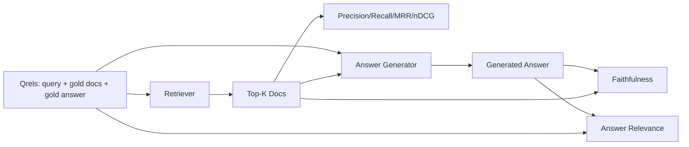

# Evaluasi RAG: Precision, Recall, MRR, nDCG, Faithfulness, Answer Relevance

> Jika kamu tidak bisa menilai retrieval dan jawabanmu secara bersamaan, kamu tidak bisa merilis sistemnya. Keduanya bukan metrik yang sama, dan prompt yang sama gagal pada sumbu yang berbeda.

**Type:** Build
**Languages:** Python
**Prerequisites:** Phase 11 lessons 06 (RAG), 10 (evaluation); Phase 19 Track B foundations (lessons 20-29); Phase 19 lessons 64, 65, 66, 67
**Time:** ~90 minutes

## Tujuan Pembelajaran
- Hitung empat metrik retrieval dari gold qrels: precision@k, recall@k, MRR (mean reciprocal rank), dan nDCG@k.
- Hitung dua metrik tingkat jawaban: faithfulness (setiap klaim berbasis pada konteks yang diambil) dan answer relevance (jawabannya mengangkat pertanyaannya).
- Bangun sebuah file qrels fixture (query, gold doc id, teks jawaban gold) yang dibaca eval end to end.
- Baca nilai metriknya untuk mendiagnosis di mana pipeline gagal: retrieval, ranking, generation, atau grounding.

## Masalahnya

Sistem RAG punya setidaknya empat bagian yang bergerak: chunker, retriever, reranker, generator. Salah satunya bisa menjadi penyebab jawaban yang salah. Tanpa metrik per-tahap, kamu menerbangkan pesawat tanpa pandangan.

Seorang pengguna melaporkan jawaban yang salah. Apakah karena chunker memotong answer span? Apakah karena retriever tidak menyertakan chunk itu di top-k? Apakah karena reranker mendorong chunk yang benar melewati posisi satu? Apakah karena generator mengabaikan chunk itu dan mengarang sesuatu? Kamu tidak bisa tahu dari jawabannya saja. Kamu butuh:

- Metrik retrieval untuk menilai apa yang keluar dari retriever.
- Metrik ranking untuk menilai di mana chunk yang benar berada dalam urutan.
- Faithfulness untuk menilai apakah generator tetap di dalam konteks yang diambil.
- Answer relevance untuk menilai apakah jawabannya mengangkat pertanyaannya sama sekali.

Pelajaran ini membangun keenamnya di atas sebuah file qrels fixture. Eval-nya offline dan deterministik; di produksi kamu menukar mock LLM-as-judge dengan yang asli.

## Konsepnya



### Precision@k

Di antara top-k dokumen yang dikembalikan retriever, berapa bagiannya yang ada di gold set? Jika gold punya tiga dokumen dan top-3 mengembalikan dua di antaranya plus satu yang salah, precision@3 adalah 2 / 3. Pakai precision ketika biaya sebuah chunk yang tidak relevan tinggi (generator membuang token untuknya, atau chunk meracuni jawabannya).

### Recall@k

Di antara dokumen gold, berapa bagiannya yang ada di top-k? Jika gold punya tiga dokumen dan top-5 memuat ketiganya, recall@5 adalah 1.0. Pakai recall ketika biaya sebuah jawaban yang terlewat tinggi (lebih baik kamu melihat satu chunk salah tambahan daripada melewatkan chunk jawaban sepenuhnya).

Di RAG produksi, metrik yang biasanya dikutip orang adalah recall@k. Generation bisa dengan mudah menjatuhkan chunk yang tidak relevan; ia tidak bisa mengarang jawaban dari chunk yang tidak pernah ia lihat.

### MRR (Mean Reciprocal Rank)

Untuk tiap query, temukan posisi dokumen pertama yang relevan dalam daftar berperingkat. Reciprocal rank-nya adalah 1 / posisi. Rata-ratanya ke seluruh set query. MRR adalah ringkasan satu-angka tentang seberapa baik retriever menempatkan jawaban terbaik di posisi teratas.

MRR memberi bobot besar pada posisi-1. Query yang gold doc-nya berada di rank 1 berkontribusi 1.0. Rank 2 berkontribusi 0.5. Rank 10 berkontribusi 0.1. Metrik ini didominasi oleh bagian atas daftar.

### nDCG@k

Normalized Discounted Cumulative Gain. Rumus lengkapnya memberi gain ke tiap dokumen yang diambil (sering 1 untuk relevan, 0 untuk tidak), mendiskon dengan log dari posisi, menjumlahkannya, lalu membaginya dengan DCG ideal (DCG yang kamu dapat jika kamu mengurutkan dengan sempurna). Rentang 0 hingga 1.

nDCG mengakomodasi relevansi berjenjang: gold bisa menyatakan "doc A is 3, doc B is 2, doc C is 1". MRR dan recall@k meratakan semuanya menjadi biner. Pakai nDCG ketika korpus punya beberapa dokumen yang sebagian relevan per query.

### Faithfulness

Untuk tiap klaim dalam jawaban yang dihasilkan, periksa apakah klaim itu didukung oleh konteks yang diambil. Implementasi standarnya memakai prompt LLM-as-judge yang menerima (klaim, konteks) dan mengembalikan yes atau no. Metriknya adalah fraksi klaim yang lulus.

Faithfulness menangkap mode kegagalan generator di mana model mengarang konten. Bahkan jika retriever mengembalikan chunk yang benar, generator yang berhalusinasi itu rusak. Faithfulness juga disebut groundedness, support, attribution.

Pelajaran ini mengimplementasikan faithfulness dengan mock judge deterministik yang memeriksa apakah token dari tiap klaim bertumpang-tindih dengan konteks yang diambil melewati sebuah ambang. Di produksi kamu menukar ke panggilan model asli. Bentuk metriknya sama.

### Answer relevance

Apakah jawabannya benar-benar mengangkat pertanyaannya? Faithfulness bertanya "apakah jawabannya berbasis pada konteks?". Answer relevance bertanya "apakah jawabannya berbasis pada pertanyaannya?". Jawaban yang setia tetapi di luar topik mendapat skor tinggi pada faithfulness dan rendah pada relevance. Jawaban pendek, sesuai topik, yang mengabaikan konteks mendapat skor tinggi pada relevance dan rendah pada faithfulness.

Implementasi standarnya juga memakai LLM-as-judge: berikan (pertanyaan, jawaban) lalu tanyakan apakah jawabannya mengangkat pertanyaannya. Pelajaran ini mengimplementasikan pengganti token-overlap-plus-judge.

## Qrels fixture-nya

```python
{
  "qid": "q1",
  "query": "what is the abort threshold for multipart uploads",
  "gold_doc_ids": ["d1", "d3"],
  "gold_answer_substring": "three failed parts",
  "graded_relevance": {"d1": 3, "d3": 2},
}
```

Tiap query membawa:
- string query-nya,
- satu set gold doc id (untuk precision / recall / MRR),
- satu dict relevance berjenjang (untuk nDCG),
- substring jawaban gold (disimpan sebagai metadata referensi pada tiap qrel; faithfulness di pelajaran ini dihitung dengan menilai klaim yang diekstraksi terhadap konteks yang diambil, bukan terhadap substring ini).

Di produksi kamu melabeli semuanya ini. Pelajaran ini mengirimkan fixture buatan tangan agar eval-nya langsung jalan.

```figure
ci-rag-metric-ladder
```

## Bangun Sendiri

`code/main.py` mengimplementasikan:

- `precision_at_k(retrieved, gold, k)` - definisi harfiahnya.
- `recall_at_k(retrieved, gold, k)` - definisi harfiahnya.
- `mean_reciprocal_rank(retrieved_list_of_lists, gold_list)` - rata-rata atas query-nya.
- `ndcg_at_k(retrieved, graded_relevance, k)` - DCG / IDCG dengan gain biner atau berjenjang.
- `extract_claims(answer)` - memecah jawaban menjadi klaim berbentuk kalimat.
- `faithfulness(claims, context_texts, judge)` - fraksi klaim yang dinilai didukung.
- `answer_relevance(question, answer, judge)` - penilaian apakah jawabannya mengangkat pertanyaannya.
- `MockJudge` - judge token-overlap deterministik agar eval berjalan offline.
- `evaluate_pipeline(pipeline_fn, qrels, ks)` - orkestrator yang menjalankan setiap metrik.
- Sebuah demo yang menjalankan tiga varian pipeline (baseline chunker, hybrid retrieval, hybrid + rerank) terhadap qrels dan mencetak tabel metrik.

Jalankan:

```bash
python3 code/main.py
```

Outputnya menunjukkan precision@k, recall@k, MRR, nDCG@k, faithfulness, dan answer relevance untuk tiap varian dalam satu tabel metrik. Baris hybrid retrieval mengalahkan baseline chunker pada recall; baris rerank mengalahkan hybrid pada MRR.

## Membaca metrik untuk mendiagnosis kegagalan

| Symptom | Likely cause | What to fix |
|---------|-------------|-------------|
| Low recall@k, low precision@k | Chunker cut the answer or retriever cannot find it | Chunker boundaries (lesson 64) or retriever modality (lesson 65) |
| Decent recall@k, low MRR | Right chunk is in top-k but not at position 1 | Reranker (lesson 66) |
| High MRR, low faithfulness | Generator invents content despite right context | Generation prompt; force-cite-or-refuse |
| High faithfulness, low relevance | Answer is grounded but off-topic | Query rewriter (lesson 67) or generation prompt |
| All four high, users still complain | Eval set is unrepresentative | Expand qrels with real user queries |

## Mode kegagalan yang akan disembunyikan demo

**Bias LLM-as-judge.** Sebuah model menilai output-nya sendiri lebih setia daripada kenyataannya. Pakai keluarga model yang berbeda untuk judge daripada untuk generator, atau beri nilai manual pada sebuah sampel.

**Qrels membusuk.** Jawaban gold bergeser seiring korpus berubah. Dokumen yang menjadi gold untuk q1 pada Januari 2024 bukan lagi jawaban yang tepat pada Oktober 2024 karena tim mengganti nama fungsi itu. Jadwalkan review qrels per kuartal.

**Micro-check faithfulness melewatkan klaim makro.** Faithfulness per-kalimat bisa lulus sementara struktur jawaban keseluruhan menyesatkan. Tambahkan tinjauan kualitatif tingkat sampel di atas metrik otomatisnya.

**Recall@k menutupi kegagalan per-query.** Recall rata-rata 90% bisa menyembunyikan fakta bahwa satu kelas query selalu meleset. Iris qrels menurut kelas query (literal, parafrase, multi-topik) dan laporkan per-iris.

## Gunakan

Pola produksi:

- Jalankan eval pada setiap perubahan retriever atau generator. Perlakukan regresi recall@k seperti kegagalan test.
- Simpan jejak metrik per query. Ketika pengguna mengeluh, cari entri qrels yang cocok dan lihat apakah kasusnya akan tertangkap.
- Berkas qrels bertingkat: satu smoke set berisi 20 query yang berjalan di CI; satu regression set berisi 200 yang berjalan tiap malam; satu deep set berisi 2000 yang berjalan tiap minggu.

## Rilis

Pelajaran 69 merangkai seluruh pipeline (chunker, retriever, reranker, generator) dan menjalankan eval ini terhadap sistem end-to-end.

## Latihan

1. Tambahkan metrik retrieval kelima: hit-rate@k. Bandingkan dengan recall@k. Jelaskan kapan keduanya berbeda.
2. Implementasikan faithfulness berjenjang: 0 (tidak didukung), 1 (sebagian didukung), 2 (didukung penuh). Perbarui metriknya sesuai.
3. Ganti mock judge dengan panggilan model asli. Ukur perbedaan pendapat antara mock dan judge yang asli pada fixture-nya.
4. Tambahkan iris kelas query ("literal", "parafrase", "multi-topik"). Laporkan metrik per-iris.
5. Tambahkan metrik "panjang jawaban" dan korelasikan dengan faithfulness. Plot kurvanya.

## Istilah Kunci

| Term | What people say | What it actually means |
|------|-----------------|------------------------|
| Precision@k | "Hit rate over retrieved" | Fraction of top-k that are gold |
| Recall@k | "Hit rate over gold" | Fraction of gold in top-k |
| MRR | "First-hit position" | Mean of 1 / rank of first relevant document |
| nDCG@k | "Graded ranking quality" | DCG over the top-k divided by ideal DCG |
| Faithfulness | "Groundedness" | Fraction of answer claims supported by retrieved context |
| Answer relevance | "Did it address the question?" | Whether the answer matches the question's intent |
| Qrels | "Gold labels" | The labeled set of queries and their gold documents and answers |

## Bacaan Lanjutan

- Buckley, Voorhees, "Evaluating Evaluation Measure Stability", SIGIR 2000 - the canonical paper on ranking metrics
- Jarvelin, Kekalainen, "Cumulated Gain-based Evaluation of IR Techniques" - the nDCG paper
- [Ragas: Automated Evaluation of RAG Pipelines](https://docs.ragas.io)
- [Anthropic, Introducing Contextual Retrieval](https://www.anthropic.com/engineering/contextual-retrieval) - scores retrieval with 1 minus recall@20
- Phase 11 pelajaran 10 - fondasi kerangka evaluasi
- Phase 19 pelajaran 64-67 - komponen yang dievaluasi di sini
- Phase 19 pelajaran 69 - pipeline end-to-end yang dinilai eval ini
