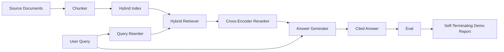

# Sistem RAG End-to-End

> Enam pelajaran komponen. Satu pipeline. Satu loop eval. Satu demo yang berhenti sendiri. Inilah sistem yang kamu rilis.

**Type:** Build
**Languages:** Python
**Prerequisites:** Phase 11 lessons 06 (RAG), 10 (evaluation); Phase 19 Track B foundations (lessons 20-29); Phase 19 lessons 64, 65, 66, 67, 68
**Time:** ~90 minutes

## Tujuan Pembelajaran
- Susun chunker, hybrid retriever, query rewriter, cross-encoder reranker, dan answer generator menjadi satu pipeline end-to-end.
- Implementasikan answer generator yang mencantumkan klaimnya lewat anchor chunk, dengan fallback refuse-on-low-confidence.
- Jalankan eval pelajaran 68 terhadap pipeline yang telah dirangkai dan buktikan bahwa build bertahap menang di setiap metrik dibanding komponen yang sama dalam isolasi.
- Bangun demo CLI yang berhenti sendiri yang mengonsumsi korpus fixture, menjalankan set query yang tetap, lalu keluar dengan kode nol beserta laporan ringkasan.

## Masalahnya

Enam komponen dalam isolasi tidak membuktikan apa pun. Chunker bisa menang pada recall@5 terhadap korpus tetapi kalah pada recall@5 sistemnya karena retriever tidak bisa mengurutkan apa yang dipancarkan chunker. Reranker bisa menaikkan MRR pada kandidat sintetis tetapi gagal pada kandidat bi-encoder yang asli karena recall bi-encoder pada anggaran rerank terlalu rendah. Query rewriter bisa mengangkat gold doc pada satu query tetapi rusak pada query berikutnya karena mock LLM-nya mengembalikan hipotetis yang degeneratif.

Test integrasinya adalah seluruh pipeline yang dijalankan end to end terhadap qrels fixture yang sama, dengan metrik yang sama, dengan satu file orkestrator yang merangkai semuanya. Itulah yang dibangun pelajaran ini. Jika metrik pada pipeline terintegrasi mengalahkan metrik pada demo terisolasi tiap tahap, kamu telah membuktikan sistemnya.

## Konsepnya



### Pilihan perangkaian

Pipeline adalah sebuah graf kecil. Tiap tahap adalah sebuah fungsi dengan tanda tangan yang jelas.

| Stage | Input | Output |
|-------|-------|--------|
| Chunker | Document text | List of Chunk records |
| Retriever | Query string | Top-N Chunk records |
| Rewriter (optional) | Query string | List of rewrites + hypothetical |
| Reranker | Query, candidates | Top-K Chunk records with cross scores |
| Generator | Query, top-K Chunk records | Answer string with citations |

Komposisinya lurus ketika tiap tanda tangan stabil. Kelas `Pipeline` milik pelajaran ini memuat lima tahap serta sebuah method `query` yang menjalankannya berurutan. Tiap tahap bisa ditukar: berikan chunker, retriever, rewriter, reranker, atau generator yang berbeda dan pipeline tetap berjalan.

### Answer generator dengan sitasi

Generator adalah tahap terakhir sekaligus yang paling mudah rusak. Pelajaran ini mengirimkan mock generator deterministik yang:

1. Menerima top-K chunk hasil rerank.
2. Memilih sampai dua chunk yang teksnya punya tumpang-tindih content-token tertinggi dengan query.
3. Memancarkan jawaban berupa konkatan satu-kalimat-dari-tiap-chunk-terpilih, dengan tiap kalimat diikuti anchor `[doc_id:chunk_index]`.
4. Jika tidak ada chunk yang tumpang-tindihnya di atas ambang penolakan, memancarkan "I do not know" tanpa sitasi.

Di produksi kamu menukar mock dengan panggilan LLM asli memakai template prompt:

```
You are answering a question using only the snippets below.
Cite every claim with the anchor in parentheses.
If the snippets do not answer the question, say "I do not know".

Question: {query}

Snippets:
{enumerated chunks with anchors}

Answer:
```

Jalur refuse-on-low-confidence adalah alasan utama skor rank-1 cross-encoder dicatat. Jika skornya berada di bawah ambang korpus, generator menolak. Inilah katup pengaman terhadap jawaban yang berhalusinasi.

### Demo yang berhenti sendiri

Demo menjalankan segalanya end to end. Ia mencetak rincian per-tahap dari satu query, menjalankan eval atas empat qrels fixture, mencetak tabel metrik, lalu keluar dengan status nol jika semua metrik pelajaran 68 memenuhi ambang yang ditetapkan di demo. Jika ada metrik di bawah ambang, demo keluar dengan status non-nol beserta pesan yang menyebut metrik yang gagal.

Inilah bentuk sebuah CI smoke test. Pipeline berjalan offline, cepat, deterministik. Ambang-nya sengaja dibuat ketat pada fixture sehingga regresi di salah satu dari enam pelajaran membuat demo gagal.

```figure
rag-pipeline-flow
```

## Bangun Sendiri

`code/main.py` mengimplementasikan:

- `Chunk` - record yang dibawa melintasi semua tahap (memperluas bentuk pelajaran 64 dengan chunk_index dan source doc_id).
- `Chunker` - memilih strategi dari pelajaran 64 (default recursive split).
- `HybridIndex` - membundel BM25 + dense + RRF dari pelajaran 65.
- `Rewriter` (opsional) - memilih satu dari HyDE, multi-query, decomposition dari pelajaran 67 berdasarkan panjang query dan keberadaan konjungsi.
- `Reranker` - cross-encoder terlatih dari pelajaran 66, dengan set training fixture yang lebih kecil agar konvergen dalam hitungan detik.
- `Generator` - mock generator deterministik dengan sitasi dan refuse-on-low-confidence.
- `Pipeline` - menyusun lima tahap dengan method `query(question)` yang mengembalikan `Result(answer, top_k, latency_ms_per_stage)`.
- `run_demo()` - mengonsumsi korpus, menjalankan tiga query fixture, menjalankan eval, mencetak hasil, menetapkan exit code berdasarkan ambang.

Jalankan:

```bash
python3 code/main.py
```

Outputnya adalah satu jejak query yang dicetak, tabel eval lengkap, dan status lulus/gagal akhir. Mengembalikan exit code 0 pada fixture-nya.

## Mode kegagalan yang akan disembunyikan demo

**Boundary drift pada chunker.** Jika kamu menukar strategi chunker antara pass pelabelan qrels eval dan demo, gold doc id-nya tidak lagi sejalan. Kunci strategi chunker di dalam file qrels. Demo menyertakan header yang menyebut chunkernya.

**Set training reranker bocor ke eval.** 14 triple training di pelajaran 66 memuat query yang menyerupai query eval. Di produksi, pisahkan query eval secara ketat. Query eval di demo sengaja dibuat saling lepas dari set training rerank.

**Mock generator menyembunyikan risiko halusinasi.** Mock tidak bisa berhalusinasi karena ia hanya memancarkan teks dari chunk yang diambil. Pelajaran ini menyorotinya dan menunjuk jalur penggantian produksi ke model yang asli.

**Tanpa streaming.** Pipeline mengembalikan jawaban lengkap di akhir setiap tahap. Sistem produksi akan men-stream output generator. Streaming di luar cakupan; metrik tingkat-jawaban tetap bekerja pada string final apa pun caranya.

**Latensi-nya offline.** Panggilan mock LLM berwaktu konstan. Panggilan LLM yang asli mendominasi. Rencanakan anggaran latensi di cakupan request; pengukuran per-tahap milik pelajaran ini hanya mengukur pekerjaan CPU.

## Gunakan

Pola produksi:

- Rilis file pipeline di bawah satu orkestrator dengan antarmuka tahap yang eksplisit. Hindari menyebarkan perangkaian ke seluruh repo.
- Jalankan eval sebelum setiap merge yang menyentuh sebuah tahap. Jika eval turun, merge itu tidak boleh masuk.
- Simpan jejak metrik per CI run agar kamu bisa menelusuri regresi ke pertukaran sebuah tahap.
- Tambahkan smoke set berisi 20 query (subset dari regression set) yang berjalan dalam waktu di bawah 30 detik; regression set lengkap berjalan tiap malam.

## Rilis

File pipeline di pelajaran ini adalah bentuk yang diasumsikan pelajaran-pelajaran Track F Phase 19 lainnya. Pelajaran berikutnya akan menambahkan otomasi ingestion, re-index inkremental, telemetry, dan layer penyajian di atasnya. Bagian retrieval, rerank, rewrite, dan eval sudah lengkap di sini.

## Latihan

1. Tambahkan selektor strategi per-query di dalam rewriter: heuristik dari pelajaran 67 (panjang, konjungsi, rasio jargon) memilih HyDE, multi-query, atau decomposition.
2. Tambahkan panggilan LLM asli untuk generator di balik sebuah flag env. Default-nya ke mock. Ukur delta latensinya.
3. Perluas demo agar menerima flag `--corpus path` yang memuat korpus asli. Jalankan ulang eval dan pemeriksaan ambangnya.
4. Tambahkan flag `--strategy` ke chunker. Ukur kontribusi tiap strategi terhadap recall end-to-end.
5. Tambahkan antarmuka generator streaming dan berikan ke eval-nya. Pastikan faithfulness dihitung pada string final dan bukan pada prefiks yang di-stream.

## Istilah Kunci

| Term | What people say | What it actually means |
|------|-----------------|------------------------|
| Pipeline | "RAG pipeline" | The composed stages from ingestion to cited answer |
| Citation anchor | "Source link" | The (doc_id, chunk_index) reference attached to each claim |
| Refuse-on-low-confidence | "I do not know" | Generator returns no answer when the reranker top-1 score sits below threshold |
| Smoke set | "CI eval" | The minimal qrels subset that runs in every PR check |
| Stage interface | "Function signature" | The stable input and output type of each pipeline stage |

## Bacaan Lanjutan

- [Anthropic, Building search and retrieval](https://www.anthropic.com/news/contextual-retrieval)
- [Pinterest, MCP internal search](https://medium.com/pinterest-engineering) - arsitektur produksi referensi
- [Ragas: Automated Evaluation of RAG Pipelines](https://docs.ragas.io)
- Phase 11 pelajaran 06 - dasar-dasar RAG
- Phase 19 pelajaran 64-68 - komponen yang disusun di sini
