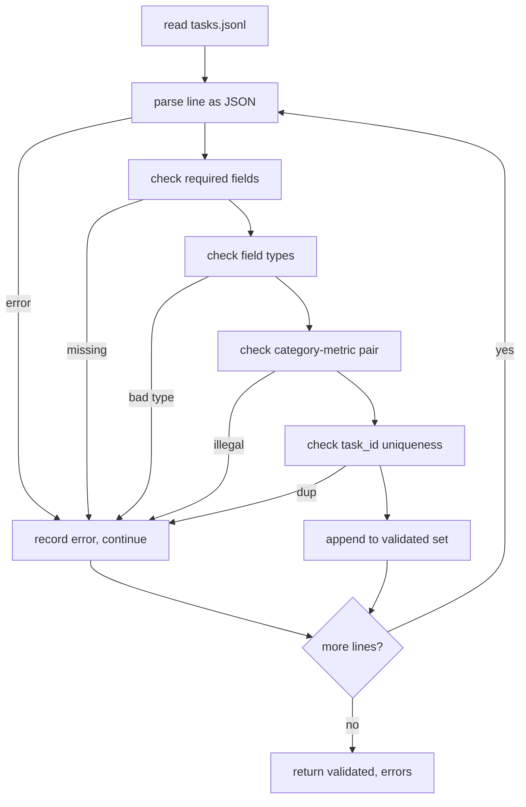

# Format Spesifikasi Tugas

> Sebuah eval harness hanya sebaik kontrak yang dipatuhi tugas-tugasnya. Bekukan bentuk JSONL dan kosakata metrik sebelum kamu menulis satu fungsi skoring pun.

**Type:** Build
**Languages:** Python
**Prerequisites:** Phase 19 Track B foundations
**Time:** ~90 min

## Tujuan pembelajaran

- Definisikan skema catatan tugas JSONL yang mencakup aritmetika, pilihan ganda, eksekusi kode, klasifikasi, dan ringkasan teks bebas dalam satu bentuk.
- Kunci kosakata tertutup dari nama metrik supaya pelajaran selanjutnya (71-73) bisa melakukan dispatch pada satu field saja.
- Spesifikasikan contoh few-shot dan aturan post-processing sebagai bagian dari tugas, bukan runner, supaya prompt yang sama menghasilkan target yang sama di semua model.
- Implementasikan validator ketat yang menolak catatan cacat sebelum sampai ke runner.
- Riliskan set fixture 10 tugas yang menjalankan setiap cabang dari spesifikasi supaya validator punya sesuatu yang nyata untuk diunyah.

```figure
ci-task-spec-gate
```

## Mengapa spesifikasi dibekukan

Kode riset akan menumpuk skrip eval lebih cepat daripada menumpuk tes. Enam bulan kemudian, setiap notebook punya bentuk JSON-nya sendiri, setiap metrik diimplementasikan ulang dua kali, dan tidak ada yang bisa dibandingkan lintas run. Perbaikannya membosankan. Pilih satu skema. Tulis validator. Tolak sisanya. Itulah yang dilakukan pelajaran ini.

Bentuknya meminjam ide dari harness bergaya BIG-bench, HELM, dan lm-eval, tapi nama field-nya milik kita. Setiap field punya satu pemilik. Runner membaca tugas. Metrik membaca target. Langkah post-process menormalkan generasi. Tidak ada field yang bisa diubah di tengah pipeline.

## Bentuk record

Sebuah tugas adalah objek JSON pada satu baris. Harness membaca `tasks.jsonl` dan memvalidasi setiap baris secara independen. Baris yang buruk membatalkan record itu, bukan seluruh run.

```json
{
  "task_id": "arith_001",
  "category": "arithmetic",
  "prompt": "Compute the result. Question: 17 + 24\nAnswer:",
  "targets": ["41"],
  "metric_name": "exact_match",
  "few_shot_examples": [
    {"prompt": "Question: 2 + 2\nAnswer:", "completion": "4"}
  ],
  "post_process": "strip_whitespace",
  "metadata": {"difficulty": "easy"}
}
```

Field yang wajib adalah `task_id`, `category`, `prompt`, `targets`, `metric_name`, `post_process`. `few_shot_examples` dan `metadata` bersifat opsional. Field top-level yang tidak dikenal membuat validasi gagal.

## Aturan field

`task_id` adalah string tanpa whitespace. Validator menegakkan keunikan di seluruh file.

`category` adalah salah satu dari `arithmetic`, `mcq`, `code_exec`, `classification`, `summary`. Kategori membatasi metrik dan pasangan post-process mana yang sah. Tugas `code_exec` harus memakai `metric_name = code_exec` dan tugas `mcq` harus memakai `metric_name = exact_match` terhadap target satu huruf.

`prompt` adalah string tidak kosong. Validator melarang whitespace ekor dan menolak record yang sudah memuat blok few-shot di dalam badan prompt. Rendering few-shot terjadi di runner, bukan di penulis.

`targets` adalah daftar string tidak kosong. Untuk `exact_match`, elemen apa pun yang cocok dihitung menang. Untuk `f1` dan `rouge_l`, target dengan skor tertinggi menang. Untuk `mcq`, daftar berisi tepat satu elemen.

`metric_name` adalah salah satu dari `exact_match`, `f1`, `bleu_4`, `rouge_l`, `accuracy`, `code_exec`. Kosakatanya tertutup. Metrik baru butuh pelajaran baru dan entri baru di sini.

`few_shot_examples` adalah daftar pasangan `{prompt, completion}`. Validator membatasi daftar hingga delapan entri supaya prompt tetap terbatas.

`post_process` adalah salah satu dari `none`, `strip_whitespace`, `lower`, `extract_letter`, `extract_code_block`, `extract_first_line`. Setiap aturan punya satu perilaku deterministik. Validator melarang penggabungan aturan.

## Perilaku validator



Validator mengembalikan dua daftar: record yang tervalidasi dan record error beserta baris yang bermasalah, aturan yang dilanggar, dan field yang bersalah. Runner menolak memulai jika daftar error tidak kosong, kecuali flag `--allow-bad-tasks` diberikan secara eksplisit.

## Rendering few-shot

Runner menggabungkan contoh few-shot di depan prompt dengan pemisah baris kosong. Jalur kode yang sama berjalan untuk setiap model, jadi satu-satunya sumber variasi adalah modelnya sendiri. Penulis menulis contoh sekali, bukan sekali per provider.

```python
def render(task):
    parts = []
    for ex in task.get("few_shot_examples", []):
        parts.append(ex["prompt"] + " " + ex["completion"])
    parts.append(task["prompt"])
    return "\n\n".join(parts)
```

## Aturan post-process

Langkah post-process berjalan setelah generasi, sebelum metrik. Ia deterministik dan stateless.

- `none` mengembalikan string tanpa perubahan.
- `strip_whitespace` memangkas whitespace di awal dan akhir.
- `lower` mengubah string menjadi huruf kecil.
- `extract_letter` mengembalikan karakter pertama yang cocok dengan `[A-E]`, dipakai untuk MCQ.
- `extract_code_block` mengembalikan isi dari blok berpagar triple-backtick pertama, dipakai untuk code-exec.
- `extract_first_line` mengembalikan baris kosong pertama, dipakai untuk klasifikasi ringkasan.

Tugas yang membutuhkan aturan di luar daftar ini masuk ke pelajaran baru.

## Apa yang tidak dilakukan pelajaran ini

Pelajaran ini tidak menilai. Tidak memanggil model. Tidak menjalankan kode. Itu datang di pelajaran 71, 72, dan 75. Pelajaran ini membekukan kontrak yang dipatuhi ketiganya.

Fixture 10 tugas mencakup dua butir aritmetika, dua butir MCQ, dua butir code-exec, dua butir klasifikasi, dan dua butir ringkasan. Validator lulus pada semua 10. Fixture terpisah (`tasks_bad.jsonl`) memicu setiap aturan dan validator mengembalikan tepat sebanyak itu jumlah error.

## Cara membaca kode

`main.py` mendefinisikan `TaskSpec`, `validate_task`, `validate_file`, dan sebuah entry point CLI. Loader fixture adalah `load_fixtures`. Helper render dan post-process bersebelahan dengan validasi supaya runner di pelajaran 75 mengimpor satu modul saja.

Baca `main.py` dari atas ke bawah. Lalu baca `code/tests/test_spec.py`. Tes-tes itu mengunci setiap aturan validasi dan setiap perilaku post-process. Demo di bagian bawah `main.py` memvalidasi fixture yang dibundel dan mencetak ringkasan.

## Melangkah lebih jauh

Suite eval nyata menumbuhkan kategori seperti skema menumbuhkan kolom. Langkah yang waras adalah menolak menambah kategori tanpa juga menambah metrik, aturan post-process, dan setidaknya satu tugas fixture. Perlakukan spesifikasi seperti migrasi database. Setiap perubahan ditinjau, diberi versi, dan disertai tes. Validator di pelajaran ini adalah gerbangnya.
