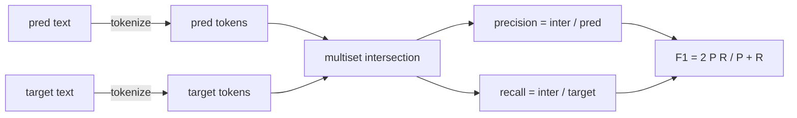
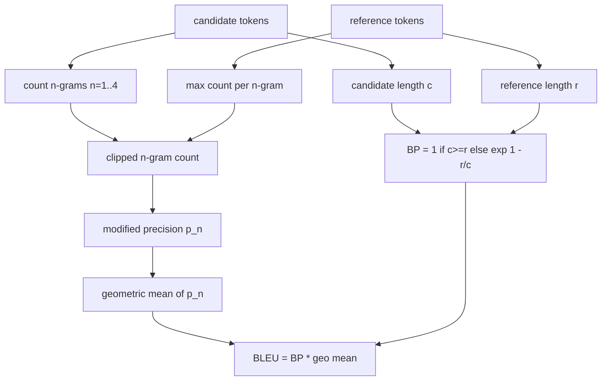

# Metrik Klasikal

> BLEU, ROUGE-L, F1, exact-match, akurasi. Lima metrik yang masih menyumbang sebagian besar angka eval LLM yang dipublikasikan. Implementasikan masing-masing dari prinsip dasar supaya kamu tahu arti angka itu.

**Type:** Build
**Languages:** Python
**Prerequisites:** Phase 19 Track B foundations, lesson 70
**Time:** ~90 min

## Tujuan pembelajaran

- Implementasikan exact-match level token, F1, dan akurasi dengan aturan tokenisasi yang eksplisit.
- Implementasikan BLEU-4 dari nol: presisi n-gram termodifikasi, rata-rata geometrik untuk n dari 1 sampai 4, penalti kebrevitasan.
- Implementasikan ROUGE-L memakai longest common subsequence, dengan kombinasi F-beta dari presisi dan recall.
- Lakukan dispatch pada field metric_name dari pelajaran 70 supaya runner tetap metric-agnostic.
- Kunci perilakunya dengan vektor referensi yang diambil dari contoh yang dikerjakan, bukan dari pustaka pihak ketiga.

```figure
cd-bleu-overlap
```

## Mengapa implementasi ulang

Kamu akan membaca paper yang melaporkan BLEU 28.3 dan paper lain yang melaporkan BLEU 0.283. Kamu akan menemukan skor ROUGE-L yang berbeda sepuluh poin antara dua pustaka karena satu men-truncate ke huruf kecil dan yang lain tidak. Cara tercepat untuk berhenti bingung adalah menulis metrik-metrik itu sendiri, lalu menunjuk ke baris tempat tokenizer ditetapkan dan baris tempat smoothing diterapkan. Setelah itu, membandingkan angka antar paper jadi soal membaca setup metrik, bukan berdebat soal pustaka.

Stdlib plus numpy sudah cukup. BLEU adalah penghitungan dan sebuah clamp. ROUGE-L adalah dynamic programming. F1 adalah irisan set atas token. Bagian tersulit adalah memilih tokenizer dan berkomitmen padanya.

## Tokenisasi

Tokenisernya adalah `re.findall(r"\w+", text.lower())`. Huruf kecil, run alfanumerik, buang tanda baca. Setiap metrik di pelajaran ini memakai tokenizer yang persis sama. Runner tidak boleh memilih. Kalau kamu menukar tokenizer, kamu sedang menjalankan benchmark yang berbeda.

```python
TOKEN_RE = re.compile(r"\w+", re.UNICODE)
def tokenize(text):
    return TOKEN_RE.findall(text.lower())
```

Ini adalah penyederhanaan yang disengaja. Setup produksi akan peduli pada CJK, kontraksi, dan identifier kode. Inti pelajarannya adalah bahwa tokenizer adalah kontrak, bukan sebuah knop.

## Exact match

```python
def exact_match(pred, targets):
    return float(any(pred.strip() == t.strip() for t in targets))
```

Fungsi ini mengembalikan 1.0 atau 0.0 per tugas. Agregat atas sebuah dataset adalah mean-nya. Ini kuda kerja untuk tugas aritmetika, MCQ, dan klasifikasi pendek.

## F1 level token

Siapkan multiset token untuk prediksi dan target. Presisi adalah irisan multiset dibagi multiset prediksi. Recall adalah irisan yang sama dibagi multiset target. F1 adalah rata-rata harmonik. Implementasinya menangani kasus tepi prediksi kosong dan target kosong.



Untuk tugas multi-target, kita ambil F1 terbaik di sepanjang daftar target. Itu cocok dengan perilaku bergaya SQuAD yang banyak dilaporkan di literatur.

## BLEU-4

BLEU adalah metrik kanonis untuk machine translation dan ia masih muncul dalam kerja ringkasan. Formulasi yang kita pakai adalah BLEU-4 level korpus dengan penalti kebrevitasan standar dan smoothing additive-one pada hitungan n-gram termodifikasi supaya satu 4-gram yang hilang tidak menyeret skor ke nol.

Untuk setiap pasangan kandidat-referensi, kita hitung presisi n-gram termodifikasi untuk n sama dengan 1, 2, 3, 4. Presisi termodifikasi memotong jumlah n-gram kandidat dengan jumlah maksimum n-gram tersebut di referensi mana pun, sehingga kandidat tidak bisa menggelembungkan skor dengan mengulang satu frasa. Rata-rata geometrik keempat presisi dibungkus oleh penalti kebrevitasan.



Aturan smoothing adalah yang disebut Lin dan Och sebagai method 1: tambahkan satu ke pembilang dan penyebut setiap presisi n-gram sebelum mengambil log. Ini menghindari `log 0` ketika sebuah referensi tidak punya 4-gram yang cocok dan tetap dekat dengan nilai tanpa smoothing pada kandidat panjang.

## ROUGE-L

ROUGE-L membandingkan longest common subsequence dari sekuens token kandidat dan referensi. LCS menangkap urutan kata tanpa memaksa keberlanjutan, dan itulah alasan ia menjadi metrik ringkasan bawaan. Kita menghitung panjang LCS dengan tabel dynamic-programming standar, lalu menurunkan recall sebagai `lcs / reference length`, presisi sebagai `lcs / candidate length`, dan mengombinasikannya dengan F-beta di mana beta sama dengan satu untuk bentuk F1 simetris.

```python
def lcs_length(a, b):
    n, m = len(a), len(b)
    dp = numpy.zeros((n + 1, m + 1), dtype=int)
    for i in range(n):
        for j in range(m):
            if a[i] == b[j]:
                dp[i+1, j+1] = dp[i, j] + 1
            else:
                dp[i+1, j+1] = max(dp[i+1, j], dp[i, j+1])
    return int(dp[n, m])
```

Tabel numpy membuat implementasinya terbaca; daftar Python murni pun akan bekerja. Tugas yang memilih ROUGE-L membayar biaya O(n m) per tugas. Untuk panjang ringkasan tipikal itu tetap di bawah satu milidetik.

## Akurasi

Untuk tugas klasifikasi multi-target, akurasi direduksi jadi exact-match terhadap satu target ternormalisasi. Kita mengeksposnya sebagai fungsi terpisah supaya dispatcher bisa melakukan dispatch pada `metric_name` tanpa melalui perbandingan string di dalam runner.

## Kontrak dispatch

Satu entry point adalah `score(metric_name, prediction, targets)`. Ia mengembalikan float di `[0, 1]`. Runner tidak bercabang pada nama metrik. Ia meneruskan panggilan dan menulis hasilnya. Inilah permukaan yang akan disambungkan pelajaran 75 ke task spec dari pelajaran 70.

```python
def score(metric_name, pred, targets):
    if metric_name == "exact_match":
        return exact_match(pred, targets)
    if metric_name == "f1":
        return max(f1_score(pred, t) for t in targets)
    if metric_name == "bleu_4":
        return max(bleu4(pred, t) for t in targets)
    if metric_name == "rouge_l":
        return max(rouge_l(pred, t) for t in targets)
    if metric_name == "accuracy":
        return accuracy(pred, targets)
    raise ValueError(f"unknown metric_name: {metric_name}")
```

`code_exec` ditangani di pelajaran 72 dan diselipkan ke dispatcher di sana.

## Apa yang tidak dilakukan pelajaran ini

Pelajaran ini tidak memanggil model. Tidak menormalkan generasi di luar apa yang sudah dilakukan aturan post-process dari pelajaran 70. Tidak menghitung confidence interval. Tidak melakukan BLEURT atau BERTScore (itu butuh sebuah model dan tinggal di pelajaran berbeda). Intinya adalah lantainya: lima metrik, satu tokenizer, satu tabel dispatch.

## Cara membaca kode

`main.py` mendefinisikan setiap metrik sebagai fungsi bebas plus dispatcher. Vektor referensi berada di blok `_reference_examples` di bagian bawah file. Demo menjalankan dispatcher terhadap delapan contoh dan mencetak skor per-metrik. Tes di `code/tests/test_metrics.py` mengunci vektor referensi dan menekan setiap kasus tepi (prediksi kosong, referensi kosong, tanpa token bersama, exact match, pemotongan frasa berulang).

Baca `main.py` dari atas ke bawah. Fungsi-fungsi diurutkan berdasarkan kompleksitas. exact_match dan akurasi masing-masing satu baris. F1 enam baris. BLEU dan ROUGE-L adalah bagian beratnya dan keduanya menyertakan komentar detail tentang aturan smoothing dan rekurensi LCS.

## Melangkah lebih jauh

Metrik klasikal itu necessary, bukan sufficient. Mereka memberi hadiah pada tumpang-pindih permukaan dan melewatkan makna. Perbaikannya adalah melapiskan metrik berbasis model di atasnya (BLEURT, BERTScore, GEval) setelah kamu mempercayai lantai klasikal. Itu pelajaran nanti. Untuk sekarang: buat kelimanya bekerja, kunci dengan tes, dan kamu punya tumpukan metrik yang bisa diaudit, cepat, dan direproduksi.
