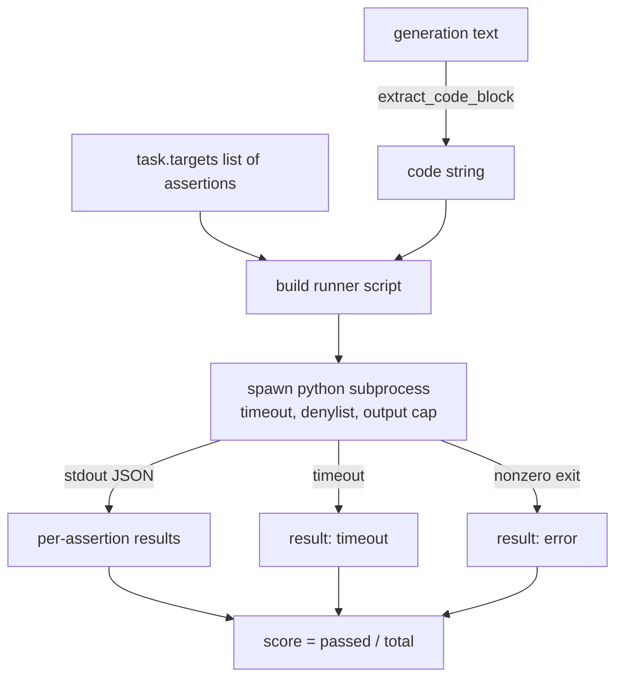
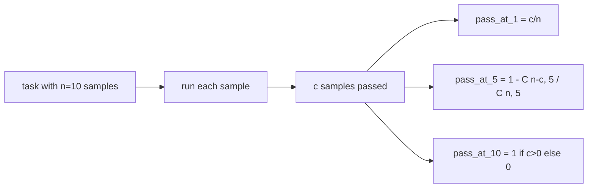

# Metrik Code Exec

> Kode yang dihasilkan itu benar ketika lolos tesnya. Eval harness harus mengekstrak kode, menjalankannya tanpa menjatuhkan host, dan menghitung pass-rate dengan jujur. Pelajaran ini membangun permukaan itu.

**Type:** Build
**Languages:** Python
**Prerequisites:** Phase 19 Track B foundations, lessons 70 and 71
**Time:** ~90 min

## Tujuan pembelajaran

- Ekstrak blok kode dari generasi bebas-formulir dengan cara yang cocok dengan aturan post-process dari pelajaran 70.
- Jalankan kode kandidat di subprocess terisolasi dengan timeout wall-clock, batas output, dan denylist import.
- Skor sebuah tugas sebagai pecahan dari string asersi yang diberikan yang lolos terhadap kandidat.
- Hitung pass-at-k untuk tugas yang menyampelkan beberapa generasi dari satu model.
- Perlakukan crash sandbox, error sintaks, dan timeout sebagai mode gagal kelas-satu dengan exit code berbeda yang bisa di-log runner.

```figure
sandbox-runner
```

## Mengapa subprocess terisolasi

`exec` inline adalah bahaya keamanan dan stabilitas. Sebuah `while True: pass` yang dihasilkan akan memblokir eval selamanya. Sebuah `import shutil; shutil.rmtree('/')` yang dihasilkan sama fatalnya dengan kedengarannya. Perbaikannya adalah men-spawn interpreter Python segar per kandidat, mengoper kodenya lewat stdin, menulis hasil asersi ke stdout, dan membunuh prosesnya jika melewati batas. Proses eval host tetap berjalan.

Eval nyata seperti HumanEval, MBPP, BigCodeBench, dan LiveCodeBench semuanya memakai sandbox subprocess. Sebagian menumpuk Docker di atasnya. Kita berhenti di subprocess karena alasan: ia portabel, ia stdlib, dan ia menangkap mode gagal yang penting untuk eval edukatif. Deployment produksi menambahkan seccomp, isolasi jaringan, dan filesystem read-only. Pelajaran berikutnya tentang hardening berada di luar track ini.

## Bentuk tugas code-exec

Sebuah tugas `code_exec` membawa string asersi di `targets`. Runner mengekstrak blok kode berpagar dari generasi, membangun test harness di sekitarnya, dan menjalankan hasilnya.



Skornya adalah pecahan di `[0, 1]`. Sebuah tugas dengan tiga asersi di mana dua lolos mendapat skor 0.667. Runner mengembalikan bentuk yang sama apa pun yang gagal: crash subprocess dipetakan ke kode error ternormalisasi, bukan traceback Python yang naik ke harness.

## Denylist

Denylist-nya berbasis import. Sebelum menjalankan kode kandidat, skrip runner menulis ulang import modul berbahaya menjadi stub yang melempar `ImportError("denied")`. Daftarnya disengaja konservatif: `os.system`, `subprocess`, `socket`, `requests`, `urllib`, `urllib.request`, `urllib.error`, `urllib.parse`, `ctypes`, `shutil`, `http.client`, `asyncio.subprocess`.

Kita tidak berpura-pura ini kebal peluru. Kode adversarial yang bertekad bisa lolos dari sandbox in-process mana pun di Python. Denylist adalah pengaman cadangan. Timeout wall-clock dan batas output adalah kendali yang menahan beban.

```python
DENIED = {
    "os.system": True,
    "subprocess": True,
    "socket": True,
    "shutil": True,
    "requests": True,
    "urllib": True,
    "ctypes": True,
}
```

Kita membungkus kandidat dengan mendahulukan `import sys` dan guard yang monkey-patch `os.system` agar melempar error. Template lengkapnya ada di `main.py`.

## Timeout wall-clock

Setiap subprocess mendapat anggaran bawaan tiga detik wall-clock. Runner memakai `subprocess.run(..., timeout=t)`. Jika timeout menyala, runner menangkap `TimeoutExpired`, membunuh prosesnya, dan mencatat alasan keluar `timeout` untuk tugas itu. Skor untuk tugas itu nol. Runner lanjut ke berikutnya.

Timeout bisa dikonfigurasi per tugas lewat `task.metadata.timeout_s`. Unit test yang lama berjalan bisa meminta lebih; validator dari pelajaran 70 membatasi nilai hingga tiga puluh detik supaya suite tetap terbatas.

## Batas output

Subprocess bisa membanjiri stdout dan menghabiskan memori host. Runner men-stream stdout ke sebuah buffer dan membunuh child segera setelah total berjalan melewati 256 KB. Hasilnya dicatat sebagai `exit_code = error` dengan string detail `"output overflow"`. Ini muncul dalam praktik ketika sebuah generasi tidak sengaja menulis infinite loop yang mencetak.

## Pass-at-k

Pass-at-k adalah estimator tak-bias yang dipakai HumanEval dan kawan-kawannya. Diberikan `n` sampel independen per tugas dan `c` di antaranya yang lolos, probabilitas bahwa sampel berukuran `k` dari `n` tersebut berisi setidaknya satu solusi yang lolos adalah:

```
pass_at_k(n, c, k) = 1 - C(n - c, k) / C(n, k)
```

Ketika `n - c < k` pembilangnya tidak terdefinisi dan nilainya `1`. Implementasinya menangani kasus tepi itu secara langsung. Kita mengekspos `pass_at_k(n, c, k)` untuk dipakai oleh layer leaderboard di pelajaran 74.



## Exit code

Runner mengembalikan satu dari lima hasil per tugas:

- `pass` ketika semua asersi lolos.
- `assertion_fail` ketika kode berjalan tapi setidaknya satu asersi gagal.
- `syntax_error` ketika kode tidak bisa di-import atau punya SyntaxError.
- `timeout` ketika wall clock kedaluwarsa.
- `error` untuk crash lain apa pun, termasuk hit denylist dan output overflow (overflow muncul dengan detail `"output overflow"`).

Skornya tetap sebuah pecahan. Exit code adalah metadata. Pelajaran selanjutnya bisa memutuskan apakah timeout dihitung nol atau sebagai data hilang.

## Apa yang tidak dilakukan pelajaran ini

Pelajaran ini tidak memberimu sandbox sungguhan. Tidak menjalankan kode tak-terpercaya dari web terbuka. Tidak menangani tugas yang stateful seperti file I/O atau panggilan jaringan. Itu butuh container atau microVM. Inti pelajaran ini adalah kontraknya: subprocess terisolasi, denylist, timeout, batas output, kosakata exit code yang bersih, dan matematika pass-at-k.

## Cara membaca kode

`main.py` mendefinisikan `extract_code`, `run_candidate`, `score_code_exec`, dan `pass_at_k`. Skrip runner subprocess dibangun sebagai string dan dioperkan sebagai `-c` ke interpreter Python segar. Tes di `code/tests/test_exec.py` menjalankan keempat exit code plus pass-at-k terhadap contoh yang dikerjakan bergaya HumanEval.

Baca `main.py` dari atas ke bawah. Template runner adalah bagian yang menahan beban. Tatap loop asersinya sampai kamu bisa memprediksi envelope JSON yang ditulisnya kembali ke proses induk.

## Melangkah lebih jauh

Setelah bentuk subprocess bekerja, kekhawatiran berikutnya adalah portabilitas. Versi Python berbeda menangani SIGKILL secara berbeda di Windows. Perbaikan terbersihnya adalah meletakkan runner di image Docker. Hal berikutnya setelah itu adalah mengganti string asersi dengan berkas unit test sungguhan supaya eval cocok dengan apa yang dilakukan CI produksi. Berhentilah menyebut string asersi sebagai tes saat itu; itu tes mainan dan punya mode gagal mainan.
