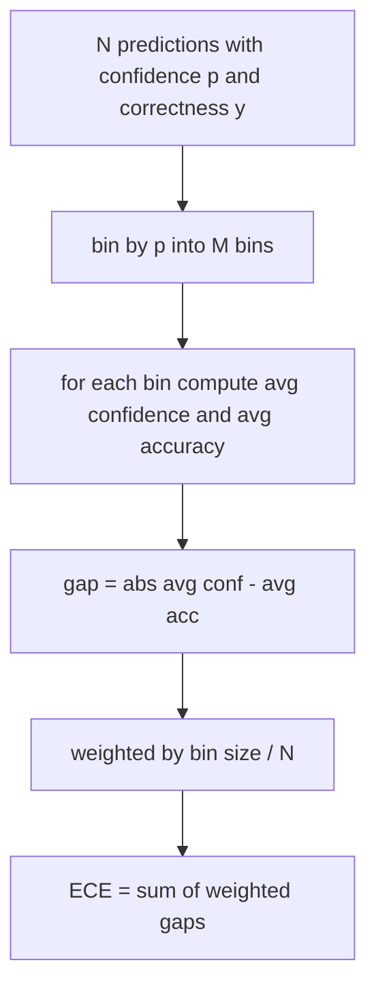
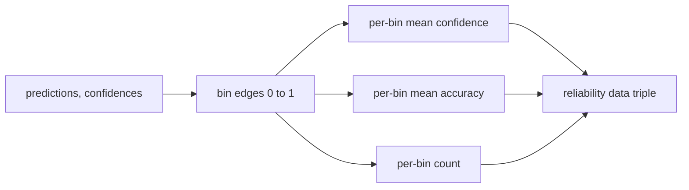

# Perplexity dan Kalibrasi

> Jika modelmu bilang 90 persen percaya diri pada seribu jawaban dan enam ratus di antaranya benar, ia tidak terkalibrasi dengan baik. Kalibrasi adalah separuh dari eval yang bisa dipercaya. Separuhnya lagi adalah perplexity, yang memberitahumu apakah model menganggap teks held-out itu masuk akal sama sekali.

**Type:** Build
**Languages:** Python
**Prerequisites:** Phase 19 Track B foundations, lessons 70 and 71
**Time:** ~90 min

## Tujuan pembelajaran

- Hitung perplexity level token pada korpus held-out dari negative log-probability token yang disediakan model adapter.
- Hitung expected calibration error (ECE) dari classifier atau eval pilihan ganda dari probabilitas prediksi yang sudah di-bin.
- Hitung Brier score (mean squared error terhadap indikator kebenaran) dan jelaskan kapan ia melakukan apa yang tidak dilakukan ECE.
- Bangun data reliability diagram yang dibutuhkan untuk menggambar kurva confidence-versus-accuracy.
- Sambungkan ketiganya ke eval harness supaya runner bisa melampirkan angka `perplexity`, `ece`, dan `brier` ke laporan model.

```figure
cd-reliability-diagram
```

## Apa yang diberitahukan perplexity

Perplexity adalah eksponen dari rata-rata negative log-likelihood per token. Makin rendah makin baik. Perplexity satu berarti model memberi probabilitas satu pada setiap token yang benar-benar muncul. Perplexity sebesar ukuran vocabulary berarti model seragam dan tidak belajar apa pun. Angka nyata jatuh di antaranya: base model kuat tahun 2026 pada WikiText-103 berada di sekitar delapan sampai dua belas. Yang buruk pada teks yang sama duduk di lima puluh ke atas.

Harness tidak menghitung log-probability sendiri. Itu datang dari model adapter. Harness mengagregasi: ia mengambil daftar log-probability per token, daftar jumlah token per sekuens, dan mengembalikan perplexity korpus.

```python
def perplexity(neg_log_probs, token_counts):
    total_nll = sum(neg_log_probs)
    total_tokens = sum(token_counts)
    return math.exp(total_nll / total_tokens)
```

Implementasinya menangani kasus tepi token-nol dan memastikan bahwa negative log-probability tidak negatif. Kesalahan umum adalah melupakan negasi: adapter yang mengembalikan `log p` alih-alih `-log p` menghasilkan perplexity di bawah satu, yang mustahil. Fungsi menangkap itu sebagai pelanggaran kontrak.

## Apa yang diukur ECE

Expected calibration error mengelompokkan prediksi berdasarkan confidence-nya ke dalam jumlah bin tetap, lalu mengukur rata-rata jarak antara confidence dan akurasi di sepanjang bin, ditimbang dengan ukuran bin.



Formulasi standar memakai sepuluh bin lebar-sama pada `[0, 1]`. Implementasinya mendukung jumlah bulat positif apa pun. Kita mengekspos parameter `bins` supaya runner bisa memilih antara konvensi publikasi (10) dan konvensi perbandingan (15).

ECE bias oleh jumlah bin dan ukuran sampel. Dengan sepuluh bin dan seratus prediksi, kamu tidak bisa membedakan ECE 0.02 dari noise acak. Implementasinya mengembalikan jumlah bin yang terisi bersama ECE supaya runner bisa menolak melaporkan satu angka pada sampel yang terlalu sedikit.

## Apa yang dilakukan Brier score tapi tidak dilakukan ECE

ECE hanya peduli pada rata-rata jarak. Sebuah model yang overconfident pada setengah bin dan underconfident pada setengah lainnya bisa punya ECE rendah sambil terkalibrasi buruk secara lokal. Brier score mengukur error kuadrat terhadap hasil yang benar per prediksi, jadi ia menghukum sebaran secara langsung.

Untuk hasil biner, Brier adalah `mean((p_i - y_i)^2)`. Ia terdekomposisi jadi reliability, resolution, dan uncertainty. Kita menghitung skor dan dekomposisinya. Runner melaporkan skalarnya tapi mencatat dekomposisinya untuk dashboard.

```python
def brier(p, y):
    return float(np.mean((p - y) ** 2))
```

## Data reliability diagram

Sebuah reliability diagram menggambar confidence prediksi terhadap akurasi empiris di setiap bin. Diagonalnya adalah kalibrasi sempurna. Fungsi mengembalikan tiga array: rata-rata confidence per bin, rata-rata akurasi per bin, dan jumlah per bin. Kode plotting berada di hilir; pelajaran ini berhenti pada bentuk data.



Tuple yang dikembalikan itulah yang dibutuhkan layer pemanggil untuk menggambar plot atau menghitung varian ECE kustom (adaptive ECE, sweep ECE, dll.). Kita mengembalikan array numpy supaya kode hilir tidak perlu mengonversi.

## Sumber confidence

Harness tidak berasumsi confidence datang dari softmax. Ia menerima angka apa pun di `[0, 1]` per prediksi. Untuk tugas pilihan ganda, confidence alaminya adalah `softmax over option log-likelihoods`. Untuk teks bebas, confidence alaminya adalah probabilitas yang dilaporkan sendiri oleh model atau eksponen dari rata-rata log-likelihood. Eval hanya mengonsumsi angkanya. Asal-usulnya adalah urusan adapter.

## Kasus tepi

- Semua prediksi salah: ECE adalah rata-rata confidence, Brier tinggi, perplexity adalah apa pun yang dianggap model tentang teks itu.
- Semua prediksi benar dengan confidence tinggi: ECE mendekati nol, Brier mendekati nol.
- Prediktor yang sempurna ragu-ragu pada p=0.5: ECE adalah 0.5 dikurangi akurasi, Brier adalah 0.25 dikurangi suku koreksi.
- Input kosong: ECE, Brier, dan reliability mengembalikan `0.0` (atau array berisi nol). Perplexity mengembalikan `NaN` untuk kasus token-nol. Tidak ada satu pun jalur ini yang mengeluarkan peringatan; runner memeriksa nilainya dan memutuskan apakah melaporkan atau melewati.

Kasus-kasus ini sudah dibakar ke dalam tes. Model nyata pada benchmark nyata tidak akan mengenainya, tapi adapter yang bugged atau sampel kecil akan, dan runner seharusnya tidak crash.

## Dispatch

Kalibrasi bukan metrik per-tugas seperti F1. Ia adalah laporan per-model. Runner mengakumulasi pasangan `(confidence, correct)` di sepanjang seluruh eval dan menghitung ECE, Brier, dan data reliability sekali. Perplexity dihitung atas korpus teks held-out, terpisah dari skoring tugas-per-tugas.

Antarmukanya adalah:

```python
report = CalibrationReport.from_predictions(confidences, correct)
report.ece          # float
report.brier        # float
report.reliability  # tuple of three numpy arrays
report.populated_bins  # int
```

`PerplexityResult.from_token_nll(neg_log_probs, token_counts)` mengembalikan perplexity dan rata-rata negative log-likelihood per token.

## Apa yang tidak dilakukan pelajaran ini

Pelajaran ini tidak memanggil model. Tidak mengimplementasikan softmax. Tidak memperkirakan confidence dari output token; itu urusan adapter. Tidak melakukan temperature scaling atau Platt scaling; itu perbaikan post-hoc yang tinggal di pelajaran berbeda. Inti pelajaran ini adalah membuat tiga angka itu (perplexity, ECE, Brier) bisa dipercaya dan direproduksi.

## Cara membaca kode

`main.py` mendefinisikan `perplexity`, `expected_calibration_error`, `brier_score`, `reliability_diagram`, dan dataclass `CalibrationReport` / `PerplexityResult`. Demo berjalan pada prediksi sintetis di mana ground truth-nya diketahui: sebuah model terkalibrasi baik, satu yang overconfident, dan satu yang underconfident. Tes di `code/tests/test_calibration.py` mengunci setiap kasus tepi plus nilai referensi untuk prediktor sintetis.

Baca `main.py` dari atas ke bawah. Urutan fungsinya dari skalar ke vektor ke laporan. Setiap fungsi punya docstring singkat berisi matematika dan kontraknya.

## Melangkah lebih jauh

Kalibrasi adalah sumbu yang paling diabaikan dalam eval yang dipublikasikan. Kebanyakan leaderboard melaporkan satu angka akurasi dan menyebutnya selesai. Sebuah model yang menang di akurasi tapi kalah di Brier adalah deployment produksi yang lebih buruk daripada model yang skor akurasinya beberapa poin lebih rendah tapi secara andal melaporkan ketidakpastiannya. Setelah plumbing kalibrasimu terpasang, tambahkan temperature scaling pada irisan validasi held-out, hitung ulang ECE, dan perhatikan jaraknya menyusut. Itu pelajaran terpisah, tapi lantainya hidup di sini.
