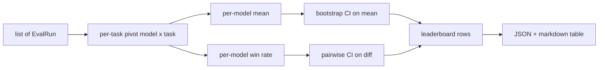
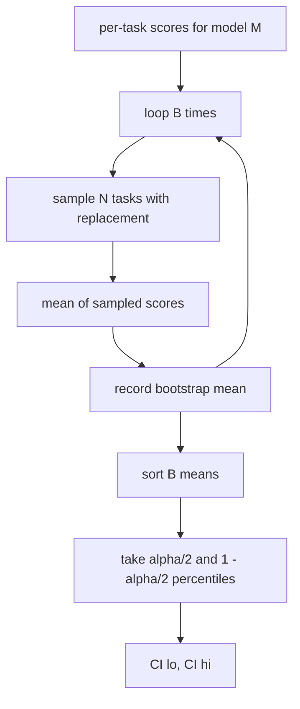

# Agregasi Leaderboard

> Skor per-tugas itu mudah. Peringkat per-model lintas tugas heterogen itu lebih sulit. Signifikansi statistik pada leaderboard seribu-prediksi adalah bagian yang dilewati semua orang. Pelajaran ini tidak melewatkannya.

**Type:** Build
**Languages:** Python
**Prerequisites:** Phase 19 Track B foundations, lessons 70, 71, 73
**Time:** ~90 min

## Tujuan pembelajaran

- Agregasikan skor per-tugas di banyak model dan banyak tugas menjadi satu baris per-model yang rapi.
- Normalkan skor heterogen supaya pass rate dan nilai BLEU tidak terlalu mempengaruhi agregat.
- Peringkatkan model berdasarkan mean dan berdasarkan win-rate, dan jelaskan kapan masing-masing adalah ringkasan yang tepat.
- Hitung confidence interval bootstrap pada skor rata-rata per model dan pada selisih berpasangan.
- Keluarkan leaderboard sebagai laporan JSON dan sebagai tabel markdown yang bisa ditempel runner di pelajaran 75 ke sebuah komentar CI.

```figure
ci-leaderboard-ci
```

## Bentuk input

Agregator mengonsumsi daftar record `EvalRun`:

```python
@dataclass
class EvalRun:
    model_id: str
    task_id: str
    metric_name: str
    score: float          # in [0, 1]
    category: str
```

Runner di pelajaran 75 mengeluarkan satu record per pasangan `(model, task)`. aggregator tidak peduli bagaimana skor itu dihasilkan. Ia mengharapkan normalisasi sudah terjadi: setiap skor berada di `[0, 1]`.

## Keluarannya

Tiga tabel keluar:



Baris leaderboard berisi: `model_id`, `mean_score`, `mean_ci_lo`, `mean_ci_hi`, `win_rate`, `tasks_completed`, dan sebuah peta `categories` opsional untuk mean per-kategori.

## Normalisasi

Jika satu tugas menilai di `[0, 1]` dan lainnya di `[0, 100]`, yang kedua diam-diam mendominasi mean. Aggregator memvalidasi bahwa setiap skor input berada di `[0, 1]` dan menolak run selain itu. Perbaikannya ada di hilir: metrik seharusnya sudah mengembalikan pecahan. Pelajaran 71 sampai 73 menegakkan kontrak itu.

## Mean dan win-rate

Dua skema peringkat melayani tujuan berbeda.

Skor rata-rata adalah rata-rata dari skor per-tugas untuk satu model. Itu angka utama yang dilaporkan leaderboard. Ia sensitif terhadap outlier dan terhadap ketidakseimbangan tugas.

Win-rate menghitung seberapa sering sebuah model mengalahkan model lain pada tugas yang sama. Untuk setiap tugas, model dengan skor tertinggi menang (seri dibagi rata). Win rate sama dengan jumlah menang dibagi jumlah tugas di mana model punya skor. Ia kurang sensitif terhadap outlier dan terhadap perbedaan skala tapi kehilangan informasi.

```python
def win_rate(model_id, runs_by_task, all_models):
    wins, total = 0, 0
    for task_id, runs in runs_by_task.items():
        scores = {r.model_id: r.score for r in runs if r.model_id in all_models}
        if model_id not in scores:
            continue
        total += 1
        best = max(scores.values())
        if scores[model_id] >= best:
            wins += 1
    return wins / total if total else 0.0
```

Harness melaporkan keduanya. Runner di pelajaran 75 memberi peringkat berdasarkan mean secara bawaan; kolom markdown untuk win-rate ada di sana kalau pengguna lebih memilihnya.

## Confidence interval bootstrap

Mean per-model datang dengan confidence interval yang diperkirakan lewat bootstrap resampling atas tugas. Kita resample id tugas dengan pengulangan, hitung mean atas set yang di-resample, ulangi `B` kali, dan ambil interval persentil pada level `alpha`.



Untuk perbandingan berpasangan, kita bootstrap selisih per-tugas `score_A - score_B`, ambil interval persentil, dan laporkan. Pengguna membaca apakah interval-nya mengecualikan nol. Jika ya, selisihnya signifikan pada level alpha. Jika tidak, leaderboard memperlakukan model-model itu sebagai seri.

Helper level rendah (`bootstrap_mean_ci`, `bootstrap_pairwise_diff`) bawaannya `B=1000`; agregator publik (`aggregate`, `pairwise_diffs`) bawaannya `b=500` supaya demo dan tes tetap cepat. Alpha bawaan adalah 0.05. Pelajaran ini mempertahankan bootstrap murni numpy, tanpa scipy.

## Kategori

Jika `EvalRun.category` diisi, aggregator juga melaporkan mean per-kategori. Ini adalah kolom di setiap leaderboard yang bertuliskan `math`, `reasoning`, `code`, `safety`. Ia membuat runner bisa melihat apakah sebuah model bagus secara keseluruhan tapi lemah di kode, yang merupakan informasi yang disembunyikan oleh mean utama.

## Rendering markdown

Leaderboard dirender sebagai tabel markdown:

```text
| Rank | Model | Mean | 95% CI | Win rate | Tasks |
|------|-------|------|--------|----------|-------|
| 1    | gpt   | 0.78 | 0.74-0.82 | 0.62 | 50 |
| 2    | claude| 0.75 | 0.71-0.79 | 0.34 | 50 |
| 3    | random| 0.10 | 0.07-0.13 | 0.04 | 50 |
```

Tabel diurutkan berdasarkan skor rata-rata. CI dirender hingga dua angka desimal. Id model yang panjang dipotong hingga dua puluh karakter.

## Apa yang tidak dilakukan pelajaran ini

Pelajaran ini tidak menjalankan model. Tidak memanggil layer metrik. Tidak mengimplementasikan ECE adaptif atau varian kalibrasi lain; itu pelajaran 73. Tidak mengimplementasikan pembobotan tugas. Setiap tugas dihitung sama di sini. Leaderboard produksi memberi bobot pada tugas; kita meninggalkan hook itu terbuka lewat field `weight` tapi mengabaikannya di aggregator. Tambahkan pembobotan di pelajaran lanjutan kalau kamu membutuhkannya.

## Cara membaca kode

`main.py` mendefinisikan `EvalRun`, `LeaderboardRow`, `aggregate`, `bootstrap_mean_ci`, `bootstrap_pairwise_diff`, dan `render_markdown`. Demo membangun suite sintetis dari tiga model dan dua belas tugas, mengagregasi, dan mencetak leaderboard plus tabel pairwise diff. Tes di `code/tests/test_leaderboard.py` mengunci bootstrap, rendering markdown, kasus tepi win-rate, dan perilaku input kosong.

Baca `main.py` dari atas ke bawah. Bentuk data (EvalRun, LeaderboardRow) datang lebih dulu, aggregator kemudian, bootstrap ketiga, rendering terakhir. Setiap fungsi punya kontrak yang fokus.

## Melangkah lebih jauh

Langkah alaminya adalah signifikansi berpasangan-tugas alih-alih bootstrap tak-berpasangan. Jika model A dan B sama-sama menjalankan seratus tugas yang sama, tes yang tepat adalah paired bootstrap atas selisih tugas-per-tugas, yang memang kita implementasikan. Di luar itu, kamu menginginkan bootstrap hierarkis yang menghormati keluarga tugas (soal matematika tidak independen satu sama lain; sebuah pola kesalahan aritmetika memengaruhi sepuluh di antaranya). Itu lanjutannya. Inti pelajaran ini adalah mendapatkan lantainya dengan benar supaya eval melaporkan angka yang bisa kamu bela.
