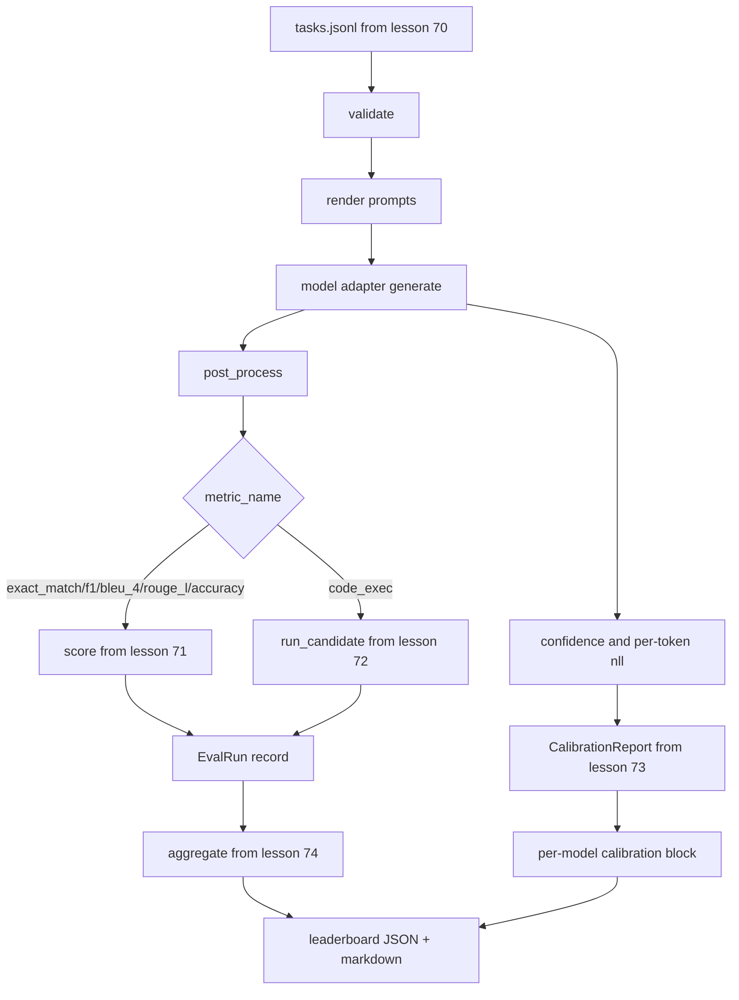

# Eval Runner End-to-End

> Lima pelajaran plumbing, satu pelajaran untuk menyatukannya. Runner membaca task spec dari pelajaran 70, memanggil model lewat adapter, menilai dengan pelajaran 71 dan 72, melampirkan laporan kalibrasi dari pelajaran 73, dan mengeluarkan leaderboard dari pelajaran 74. Demo berhenti sendiri.

**Type:** Build
**Languages:** Python
**Prerequisites:** Phase 19 Track B foundations, lessons 70 through 74
**Time:** ~90 min

## Tujuan pembelajaran

- Definisikan antarmuka `ModelAdapter` yang bisa dipenuhi model apa pun (mock, lokal, API) dengan permukaan metode yang kecil.
- Jalankan eval atas berkas fixture JSONL dengan eksekusi tugas paralel di sepanjang worker pool.
- Komposisikan layer metrik (exact_match, F1, BLEU-4, ROUGE-L, code_exec) dengan layer kalibrasi dalam satu pass.
- Keluarkan record `EvalRun` per-model dan berikan langsung ke aggregator leaderboard.
- Keluarkan baik laporan JSON maupun tabel markdown; berhenti sendiri dengan exit nol pada run bersih, bukan-nol pada kegagalan validasi atau runtime.

```figure
eval-grid
```

## Pipeline-nya



Runner adalah titik integrasi. Setiap pelajaran 70 sampai 74 memiliki satu modul yang dikomposisikan runner. Runner tidak menduplikasi logika apa pun dari modul-modul itu: ia mengimpornya.

## Antarmuka adapter

Adapter adalah sambungan antara runner dan model apa pun. Antarmukanya disengaja kecil.

```python
class ModelAdapter:
    model_id: str

    def generate(self, prompt: str, task: TaskSpec) -> Generation: ...
```

`Generation` adalah sebuah dataclass dengan:

- `text`: output bebas-formulir model
- `confidence`: float di `[0, 1]` yang merepresentasikan probabilitas yang dilaporkan sendiri oleh model untuk jawaban itu
- `token_nll`: jumlah opsional dari negative log-likelihood di sepanjang token yang dihasilkan
- `token_count`: jumlah opsional token yang dihasilkan

Mock adapter di runner menyediakan tiga varian: `RuleBasedAdapter` (deterministik, nyaris sempurna), `NoisyAdapter` (overconfident, sering salah), dan `BiasedAdapter` (baik di satu kategori, buruk di kategori lain). Demo menjalankan ketiganya atas fixture pelajaran 70.

## Eksekusi paralel

Runner memakai `concurrent.futures.ThreadPoolExecutor` untuk menjalankan tugas secara paralel per model. Jumlah worker bawaannya adalah yang lebih kecil dari delapan dan jumlah tugas. Thread sudah cukup karena bottleneck untuk panggilan model nyata adalah I/O jaringan. Jalur code-exec men-spawn subprocess-nya sendiri di dalam tugas dan hanya executor yang menjadwalkan tungguannya.

Untuk tes deterministik, runner mengekspos `run_eval(adapters, tasks, parallel=False)` supaya tes bisa mengunci urutan eksekusi.

## Loop skoring satu-pass

Untuk setiap tugas:

1. Render prompt (prefix few-shot plus badan prompt).
2. Panggil adapter dan catat waktu panggilannya.
3. Post-process generasi sesuai aturan tugasnya.
4. Dispatch ke layer metrik.
5. Bangun record `EvalRun` dengan skor dan metadata metrik.
6. Tambahkan pasangan `(confidence, correct)` ke buffer kalibrasi.

Sinyal `correct` adalah `score >= 1.0` untuk metrik bergaya exact_match (`exact_match`, `accuracy`, `code_exec`) dan `score >= 0.5` untuk metrik berjenjang. Ambang batasnya ada di `_correct_from_score` dan runner tidak mengekspos override publik.

## Agregasi

Setelah setiap tugas punya hasil, runner memanggil `aggregate` dan `pairwise_diffs` dari pelajaran 74 serta `CalibrationReport.from_predictions` dari pelajaran 73. Keluarannya adalah satu envelope JSON:

```json
{
  "leaderboard": [...],
  "pairwise": [...],
  "calibration": {
    "model_id_a": {"ece": 0.04, "brier": 0.10, "populated_bins": 8, ...},
    ...
  },
  "summary": {
    "tasks": 10,
    "models": 3,
    "wall_seconds": 1.2
  }
}
```

Runner juga menulis tabel markdown ke stdout supaya pengguna bisa menempel hasilnya ke sebuah tinjauan PR.

## Demo yang berhenti sendiri

Demo menjalankan tiga mock adapter atas sepuluh tugas fixture dari pelajaran 70. Waktu wall seharusnya di bawah sepuluh detik. Exit code-nya nol pada run bersih.

Kriteria run bersih adalah:

- Setiap tugas tervalidasi di bawah pelajaran 70.
- Setiap tugas dinilai di bawah pelajaran 71 dan 72.
- Laporan kalibrasi teragregasi di bawah pelajaran 73 tanpa error.
- Leaderboard memberi peringkat adapter berbasis-rule secara ketat di atas adapter acak.

Jika salah satunya melanggar, runner keluar dengan exit bukan-nol beserta error terstruktur di envelope JSON.

## Apa yang tidak dilakukan pelajaran ini

Pelajaran ini tidak memanggil model sungguhan. Tidak mengimplementasikan alur API key atau penanganan rate-limit. Tidak mengimplementasikan streaming atau generasi parsial; adapter mengembalikan satu generasi per panggilan. Tidak melakukan retry atau caching. Kekhawatiran itu tinggal di layer adapter; runner metric-agnostic dan provider-agnostic.

## Cara membaca kode

`main.py` adalah integrasinya. Ia mengimpor dari lima modul pelajaran lainnya lewat helper kecil `_load_sibling` yang menyelesaikannya lewat path relatif. Dataclass `Generation`, `EvalReport`, dan `ModelAdapter` didefinisikan secara lokal. Mock adapter berada di bagian bawah file.

Baca `main.py` dari atas ke bawah. Skim import-nya, lalu lihat `run_eval`, lalu `_score_one`, lalu adapter-adapternya. Demo di akhir adalah entry point-nya.

Tes di `code/tests/test_runner.py` mengunci antarmuka adapter, loop satu-pass, ekuivalensi paralel-vs-urut, buffer kalibrasi, dan bentuk envelope JSON.

## Melangkah lebih jauh

Runner ini adalah lantainya. Sebuah sistem eval produksi menambahkan: cache hasil yang di-key oleh `(task_id, model_id, model_version)`, ledger biaya yang melacak dolar dan token per run, lapisan retry yang melakukan backoff saat rate limit, kebijakan sampling untuk tugas pass-at-k, dan format output streaming untuk suite panjang. Masing-masing adalah satu concern yang membungkus runner tanpa mengubah layer metrik atau agregasi. Pemisahan itulah inti dari kontrak ini.

Tambahkan adapter untuk provider sungguhan setelah mock-mockmu bekerja. Pilih yang punya free tier, tulis tiga puluh baris glue, lihat leaderboard menyala. Lalu tambahkan provider kedua dan biarkan harness yang bekerja.
