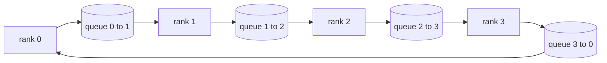

# Collective Ops Dari Nol

> Empat operasi kolektif yang menyatukan distributed training adalah allreduce, broadcast, allgather, dan reduce_scatter. Setiap primitif lain yang ditawarkan framework training hanyalah pembungkus di atas keempatnya. Bangun sekali di atas mesh `multiprocessing.Queue`, verifikasi terhadap implementasi referensi, dan sisa track ini menjadi plumbing.

**Type:** Build
**Languages:** Python
**Prerequisites:** Phase 19 Track C lessons 42-49
**Time:** ~90 min

## Tujuan Pembelajaran

- Implementasikan ring allreduce dalam dua pass (reduce-scatter lalu allgather) dan buktikan volume komunikasi per-rank adalah 2(N-1)/N bytes per elemen.
- Bangun broadcast, allgather, dan reduce_scatter di atas kirim point-to-point melalui `multiprocessing.Queue`.
- Verifikasi setiap primitif terhadap referensi `torch.distributed` gloo pada input yang sama.
- Pertahankan pilihan ring versus tree berdasarkan bentuk klaster, lantai latensi, dan langit-langit bandwidth.

## Masalahnya

Allreduce naif atas N ranks mengirim tensor sebanyak N kali ke sebuah root dan menyiarkan N kali kembali. Bandwidth berskala O(N) per rank, root menjadi bottleneck, dan lantai wall-clock adalah link tercepat kali N. Ring allreduce meratakan itu menjadi 2(N-1) chunk berukuran T/N, sehingga byte per-rank turun ke 2T(N-1)/N tanpa bergantung pada ukuran klaster. Tree allreduce menang pada N kecil dan link latensi tinggi karena kedalaman adalah log2(N) hop, bukan 2(N-1). Pilih topologi yang salah untuk bentuk klaster dan GPU tercepat yang mendikte waktu step.

Setiap framework distributed training yang akan kamu baca di track ini bergantung pada keempat primitif ini. PyTorch DDP menyinkronkan gradient dengan satu allreduce per bucket parameter. ZeRO membagi optimiser state lewat reduce_scatter dan menyiarkan parameter yang diperbarui lewat allgather. FSDP mengubah forward penuh menjadi allgather plus reduce_scatter. Pipeline parallel membutuhkan broadcast untuk aktivasi di seluruh stage group. Jika kamu tidak bisa mengimplementasikan keempat kolektif ini, kamu tidak bisa menalar mengapa training macet, mengapa ketidakcocokan gradient muncul di rank 3, atau mengapa bubble pipeline berlipat ganda saat kamu menukar topologi.

## Konsepnya



### Ring allreduce dalam dua pass

Bagi tensor menjadi N chunk sama besar berindeks 0..N-1. Setiap rank memiliki chunk dengan indeks sama dengan rank-nya. Pass 1, reduce-scatter, berjalan N-1 langkah. Pada langkah s, rank r mengirim chunk (r - s) mod N ke rank (r + 1) mod N dan menerima chunk (r - s - 1) mod N dari rank (r - 1) mod N, mengakumulasikan chunk yang diterima ke salinan lokalnya. Setelah N-1 langkah, rank r memiliki jumlah penuh untuk chunk r. Pass 2, allgather, berjalan N-1 langkah lagi dan memutar chunk yang selesai di sekeliling ring hingga setiap rank memegang jumlah penuh untuk setiap chunk.

| Primitive | Per-rank bytes | Steps | When to use |
|-----------|---------------|-------|-------------|
| Ring allreduce | 2T(N-1)/N | 2(N-1) | Large T, fat-pipe homogeneous cluster |
| Tree allreduce | T log2(N) | 2 log2(N) | Small T or high-latency links |
| Broadcast | T | log2(N) tree | Parameter init, scalar config |
| Allgather | T(N-1)/N | N-1 | Sharded forward, ZeRO unshard |
| Reduce_scatter | T(N-1)/N | N-1 | ZeRO gradient sharding |

### Mesh queue sebagai pengganti NCCL

NCCL berjalan di atas PCIe dan NVLink dengan reduksi yang di-offload ke hardware. Di CPU kamu tidak punya itu. Satu `multiprocessing.Queue` per edge ring memberimu pengiriman point-to-point terurut dengan satu producer dan satu consumer. Reduksi terjadi di user space, jadi kamu membayar overhead Python, tetapi pola wire-nya identik dengan ring allreduce NCCL. Nalarinya soal kebenaran pada versi queue, dan perilaku klaster akan mengikutinya.

### Verifikasi terhadap gloo

Setiap primitif didampingi unit test yang membandingkan output-nya dengan `torch.distributed` yang diinisialisasi dengan backend gloo pada tensor yang sama dan world size yang sama. Jika ring allreduce-mu menyimpang dari gloo lebih dari epsilon float32, tes gagal. Verifikasi terhadap implementasi referensi tidak bisa ditawar; tanpanya primitif itu tampak benar sampai langkah 10000 pada run training nyata.

```figure
ci-ring-allreduce
```

## Bangun Sendiri

`code/main.py` mengimplementasikan:

- Kelas `Mesh` yang merangkai N instance `multiprocessing.Queue` menjadi sebuah ring dan mengekspos `send(dst, tensor)` dan `recv(src)` per rank.
- `ring_allreduce(mesh, rank, world_size, tensor)` yang menjalankan algoritma dua-pass.
- `broadcast(mesh, rank, world_size, tensor, src)` di atas pohon logaritmik.
- `allgather(mesh, rank, world_size, tensor)` menggunakan N-1 rotasi.
- `reduce_scatter(mesh, rank, world_size, tensor)` sebagai separuh pertama allreduce.
- `_gloo_reference(op, world_size, tensor)` yang menjalankan input yang sama melalui `torch.distributed` dengan gloo untuk perbandingan byte-equal.

Jalankan:

```bash
python3 code/main.py
```

Output: tabel verifikasi per-primitif yang membandingkan output queue-mesh dan gloo, diikuti penghitung byte per-rank yang membuktikan skala 2T(N-1)/N.

## Pola produksi di lapangan

Tiga pola memperkeras primitif cukup untuk dirilis.

**Bucket gradient sebelum allreduce.** Sebuah model 1 miliar parameter punya puluhan ribu tensor gradient. Satu allreduce per tensor membayar lantai latensi sebanyak N kali. DDP meng-*bucket* gradient menjadi potongan ~25 MB dan mengeluarkan satu allreduce per bucket; tensor kecil naik di atas punggung yang besar. Tanpa bucketing, overhead latensi mendominasi step.

**Tumpang tindihkan komunikasi dengan komputasi.** Backward menghitung gradient layer demi layer secara terbalik. Saat gradient layer terakhir siap, mulailah allreduce-nya sementara layer berikutnya terus menghitung. PyTorch DDP merangkai ini dengan hook bucket-ready. Tumpang tindih mengurangi separuh waktu komunikasi terlihat ketika jaringan punya slack.

**Pilih ring atau tree berdasarkan ukuran pesan, bukan agama.** NCCL mengirimkan detektor topologi yang memilih ring untuk pesan di atas ~1 MB dan tree di bawahnya. Titik potongnya adalah bandwidth versus latensi: di atas 1 MB, term bandwidth 2T(N-1)/N mendominasi dan ring menang; di bawah 1 MB, jumlah hop log2(N) yang menang. Hard-code satu topologi mengorbankan throughput pada ukuran pesan yang salah.

## Gunakan

Pola produksi:

- **PyTorch DDP.** Memanggil `dist.all_reduce` pada gradient ter-bucket setelah backward. Ukuran bucket bisa diatur; default 25 MB wajar untuk Ethernet 100Gbit.
- **DeepSpeed ZeRO.** Mengeluarkan reduce_scatter untuk membagi gradient dan allgather untuk merekonstruksi parameter penuh sebelum forward. Primitif pelajaran ini persis panggilan yang dilakukan ZeRO.
- **FSDP.** Forward dimulai dengan allgather untuk meng-*unshard* layer, menghitung, lalu mereduksi dengan reduce_scatter dan membuang unshard-nya. Primitif yang sama, jadwal berbeda.

## Rilis

Gunakan primitif queue-mesh di pelajaran 77-81. Pelajaran 77 merangkai allreduce ke dalam DDP. Pelajaran 78 merangkai reduce_scatter ke dalam ZeRO. Pelajaran 79 merangkai broadcast ke dalam aktivasi pipeline. Pelajaran 81 menyusun keempatnya menjadi demo ujung-ke-ujung.

## Latihan

1. Tambahkan varian tree allreduce dan beralih antara ring dan tree berdasarkan ukuran pesan. Ukur titik potongnya.
2. Tambahkan `recv_timeout_ms` sehingga rank yang macet memunculkan error deadline alih-alih menggantung selamanya.
3. Ganti `multiprocessing.Queue` dengan socket TCP untuk keempat primitif. Tes yang sama, wire sungguhan.
4. Tambahkan hook instrumentasi bandwidth agar penghitung byte per-rank logging ke JSONL.
5. Bandingkan waktu wall-clock ring versus tree pada 4 ranks untuk tensor berukuran 1KB, 1MB, 16MB. Pertahankan titik potongnya secara empiris.

## Istilah Kunci

| Term | What people say | What it actually means |
|------|----------------|------------------------|
| Allreduce | "Sum across ranks" | After the call every rank holds the same reduced tensor |
| Ring | "The fast topology" | N-1 chunks of size T/N flow around the cycle twice |
| Tree | "The log topology" | Reduction follows a binary tree; depth is log2(N) hops |
| Allgather | "Concatenate shards" | Every rank ends with every other rank's shard |
| Reduce_scatter | "Split the sum" | Each rank ends with the sum of one chunk only |
| Bucket | "Fuse small tensors" | Coalesce N small allreduces into one large one |

## Bacaan Lanjutan

- [PyTorch Distributed: NCCL collectives](https://pytorch.org/docs/stable/distributed.html#collective-functions)
- [Horovod ring allreduce paper](https://arxiv.org/abs/1802.05799)
- [NCCL topology and algorithm selection](https://docs.nvidia.com/deeplearning/nccl/user-guide/docs/index.html)
- [Patarasuk and Yuan, Bandwidth optimal allreduce algorithms](https://www.cs.fsu.edu/~xyuan/paper/09jpdc.pdf)
- Phase 10 pelajaran 05 - gambaran umum distributed training
- Phase 19 pelajaran 77 - DDP yang dirangkai di atas primitif ini
