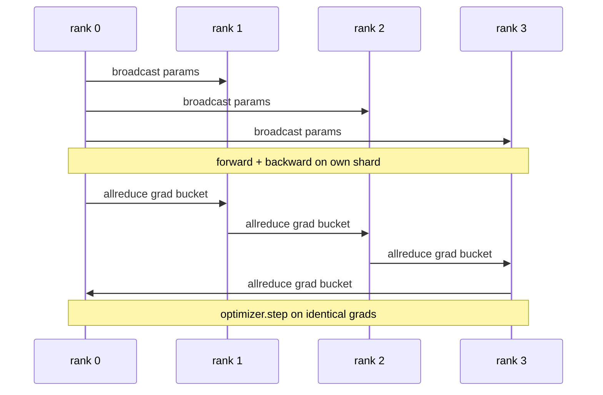

# Data Parallel DDP Dari Nol

> DistributedDataParallel adalah sebuah hook di atas allreduce. Bungkus sebuah model, siarkan parameter awal dari rank 0 supaya semua rank mulai identik, pasang backward hook pada setiap parameter yang mengeluarkan allreduce gradient, dan sisanya adalah gradient descent. Seluruh polanya 200 baris.

**Type:** Build
**Languages:** Python
**Prerequisites:** Phase 19 Track C lessons 42-49
**Time:** ~90 min

## Tujuan Pembelajaran

- Rangkai pembungkus berbentuk `DistributedDataParallel` yang menyiarkan parameter awal dan melakukan allreduce gradient setelah backward.
- Spawn N rank CPU dengan `torch.multiprocessing.spawn` di atas backend gloo dengan rendezvous berbasis file.
- Buktikan kebenaran sinkronisasi gradient dengan melatih model yang sama pada data yang sama secara sekuensial dan menunjukkan kesetaraan parameter per-step.
- Pertahankan penggunaan bucket (fusi gradient) dan overlap (komunikasi selama backward) sebagai dua perubahan yang mengubah DDP yang berfungsi menjadi DDP produksi.

## Masalahnya

Sebuah model 1 miliar parameter dengan 12 GB aktivasi tidak muat di satu GPU konsumen. Bahkan ketika muat, training memakan berminggu-minggu. Data parallel memecah batch di N ranks, setiap rank menghitung forward dan backward pada shard-nya, dan pada setiap step gradient semua rank dijumlahkan supaya ke-N salinan tetap identik. Gradient hasil penjumlahan itulah yang menjadi pijakan optimiser.

Tanpa sinkronisasi gradient, N replika menyimpang mulai step 2. Model itu bukan lagi "satu model yang dilatih pada lebih banyak data", melainkan N model terpisah yang kebetulan berbagi bobot awal. Dengan sinkronisasi gradient yang buruk (satu allreduce per parameter, tanpa overlap, tanpa bucketing), jaringan menjadi bottleneck dan GPU menganggur menunggu wire. Keterampilan DDP adalah membuat sinkronisasi gradient nyaris gratis relatif terhadap komputasi. DDP PyTorch kanonis mencapainya dengan meng-*bucket* gradient, menumpang tindih allreduce dengan backward layer berikutnya, dan memakai NCCL di atas NVLink. Kita bisa melakukan ketiganya di CPU dengan gloo dan mempelajari pelajaran yang sama.

## Konsepnya



### Tiga operasi yang dibutuhkan DDP

| Stage | Collective | Why |
|-------|-----------|-----|
| Init | broadcast from rank 0 | Every rank starts with the same parameters |
| After backward | allreduce of each grad | The mean gradient is what the optimiser steps on |
| Sometimes | broadcast of buffers | Batchnorm running stats stay synchronised |

### Mengapa mean dan bukan jumlah

Allreduce-SUM dibagi world_size menghasilkan gradient rata-rata. Rata-rata tidak berubah terhadap world_size: learning rate yang di-tune pada satu rank bekerja pada empat rank karena magnitudo gradient per-step tidak berubah. Allreduce-SUM tanpa pembagian memaksa kamu menyetel ulang learning rate setiap kali mengubah ukuran klaster. DDP membungkus SUM lalu membaginya; lakukan hal yang sama di pelajaran ini.

### Mengapa bucket gradient

Sebuah transformer punya ribuan tensor parameter. Satu allreduce per tensor membayar lantai latensi gloo ribuan kali. DDP mengelompokkan gradient menjadi bucket ~25 MB dan mengeluarkan satu allreduce per bucket. Total byte yang bergerak di wire sama tetapi latensinya diamortisasi di seluruh bucket. Untuk model kecil pelajaran ini kita mengelompokkan semuanya ke satu bucket; strukturnya yang terbawa.

### Mengapa mematok seed

Setiap rank harus memanggil `torch.manual_seed(seed + rank)` untuk pengacakan tetapi `torch.manual_seed(seed)` untuk inisialisasi parameter. Satu seed bersama berarti setiap rank melihat urutan batch yang sama (menggagalkan data parallel); seed khusus-rank untuk parameter berarti parameter awal berbeda pada epsilon float dan sinkronisasi gradient tidak lagi membuat replika identik. Dapatkan pola seed yang benar atau tes kesetaraan parameter gagal pada step 1.

```figure
ci-ddp-grad-sync
```

## Bangun Sendiri

`code/main.py` mengimplementasikan:

- `MiniMLP`: MLP 3-layer yang cukup kecil untuk konvergen dalam hitungan detik, cukup besar untuk mengekspos wiring-nya.
- `DistributedDataParallel(model, world_size)`: menyiarkan params pada waktu konstruksi, mengembalikan pembungkus yang `sync_grads` membagi gradient hasil akumulasi allreduce-sum dengan world_size.
- `worker(rank, world_size, ...)`: loop training lengkap dengan inisialisasi `torch.distributed` di atas gloo, forward, backward, sync, step.
- `_reference_single_process_loop(...)`: melatih model yang sama pada data yang sama secara sekuensial pada satu rank, dipakai tes untuk kesetaraan parameter byte-equal setiap step.

Jalankan:

```bash
python3 code/main.py
```

Output: tabel training per-step yang membandingkan loss single-process dan checksum parameter dengan run DDP pada 4 ranks. Kedua jalur menghasilkan kurva loss identik hingga epsilon float, membuktikan sinkronisasi gradient benar.

## Pola produksi di lapangan

Tiga pola memperkeras DDP cukup untuk dirilis.

**Temukan parameter yang tidak terpakai.** Beberapa jalur forward melewati parameter secara kondisional (early exit, router mixture-of-experts). Parameter yang dilewati tidak punya gradient, tetapi hook bucket-ready DDP tetap menunggunya dan allreduce-nya deadlock. `find_unused_parameters=True` memberi tahu DDP untuk melihat parameter mana yang menerima gradient sebelum mereduksi. Biayanya satu walk graph per step, jadi matikan kecuali forward-mu bercabang.

**Optimasi static graph.** Ketika forward stabil di seluruh step, `static_graph=True` memungkinkan DDP menghitung jadwal bucket di muka. Optimasi ini penting pada skala besar: menghitung di muka menghemat beberapa ms per step yang berlipat ganda di 10000 step.

**Akumulasi gradient butuh kehati-hatian.** Mengakumulasikan gradient di K microbatch tanpa menyinkronkan setiap microbatch adalah kemenangan throughput 10x. DDP mengekspos `no_sync()` sebagai context manager yang menjeda allreduce pasca-backward. Lupakan managernya dan kamu allreduce K kali percuma; throughput-nya jatuh ke dasar.

## Gunakan

Pola produksi:

- **PyTorch DDP.** Implementasi kanonis. `torch.nn.parallel.DistributedDataParallel(model)` merangkai bucketing, overlap, dan konteks no_sync.
- **HuggingFace Accelerate.** Menambahkan launcher yang menangani env vars `torchrun` dan pembungkus model. DDP yang sama di balik layar.
- **Megatron-LM data parallel.** Menggabungkan DDP dengan tensor parallel untuk model besar; bagian data-parallel-nya adalah pola allreduce-setelah-backward yang sama.

## Rilis

Pelajaran 78 (pembagian ZeRO) mengganti allreduce per-parameter dengan reduce_scatter sehingga setiap rank hanya menyimpan shard dari optimiser state-nya. Pelajaran 81 menyusun DDP dengan ZeRO menjadi demo ujung-ke-ujung.

## Latihan

1. Tambahkan gradient bucket berukuran dapat dikonfigurasi dan ukur speedup versus allreduce-per-parameter pada model yang lebih dalam.
2. Implementasikan `no_sync()` sebagai context manager dan verifikasi akumulasi gradient cocok dengan baseline single-process di K microbatch.
3. Tambahkan mode `find_unused_parameters` di mana forward sesekali melewatkan salah satu layer MLP; tanpa flag itu run seharusnya deadlock.
4. Ganti gloo dengan sinkronisasi berbasis `torch.distributed.barrier()` saja untuk merasakan perbedaan antara sinkronisasi berbasis allreduce dan berbasis barrier.
5. Ukur overhead sinkronisasi gradient sebagai pecahan dari waktu step untuk batch size 1, 16, 256 dan jelaskan skalanya.

## Istilah Kunci

| Term | What people say | What it actually means |
|------|----------------|------------------------|
| DDP | "Data parallel" | Wrapper that broadcasts params and allreduces grads each step |
| Bucket | "Fuse grads" | Group N small allreduces into one large one |
| Overlap | "Hide comm" | Issue allreduce while later layers still computing backward |
| no_sync | "Accumulate" | Skip the post-backward allreduce for gradient accumulation |
| find_unused | "Branchy forward" | Detect parameters with no grad before reducing |

## Bacaan Lanjutan

- [PyTorch DistributedDataParallel docs](https://pytorch.org/docs/stable/generated/torch.nn.parallel.DistributedDataParallel.html)
- [PyTorch DDP internals tutorial](https://pytorch.org/tutorials/intermediate/ddp_tutorial.html)
- [Li et al, PyTorch Distributed: Experiences on Accelerating Data Parallel Training](https://arxiv.org/abs/2006.15704)
- Phase 19 pelajaran 76 - kolektif yang menjadi dasar DDP
- Phase 19 pelajaran 78 - pembagian ZeRO mengganti allreduce per-param dengan reduce_scatter
