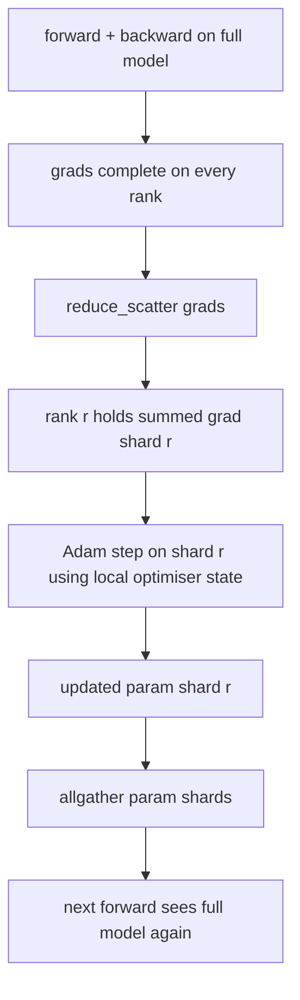

# Pembagian Optimizer State ZeRO

> Adam menyimpan dua estimasi momen per parameter, keduanya dalam float32. Sebuah model 7 miliar parameter membawa 56 GB optimiser state. ZeRO stage 1 membaginya ke N ranks; setiap rank memiliki 1/N dari optimiser. Setelah step lokal, shard parameter yang diperbarui disiarkan kembali, setiap rank merekonstruksi model penuh, dan step berikutnya dimulai. Kemenangannya adalah penurunan memori linear pada alokasi tunggal terbesar dalam tumpukan training.

**Type:** Build
**Languages:** Python
**Prerequisites:** Phase 19 Track C lessons 42-49
**Time:** ~90 min

## Tujuan Pembelajaran

- Bagi optimiser state (momen pertama, momen kedua, salinan master fp32) ke N ranks sehingga setiap rank memiliki 1/N.
- Pakai reduce_scatter untuk mengirim setiap rank hanya jumlah gradient shard-nya, lalu allgather untuk menyiarkan kembali shard parameter yang diperbarui.
- Hitung tabel penghematan memori untuk stage 1, stage 2, stage 3 terhadap DDP vanilla.
- Pertahankan pilihan stage 1 versus stage 2 versus stage 3 berdasarkan ukuran model dan anggaran bandwidth.

## Masalahnya

DDP vanilla mereplikasikan semuanya: parameter, gradient, dan optimiser state hadir penuh di setiap rank. Untuk sebuah model 7 miliar parameter dalam fp16 itu berarti 14 GB parameter, 14 GB gradient, dan 28 GB optimiser state per rank. Optimiser state adalah term terbesar dan paling mudah dibagi karena hanya disentuh selama step, bukan selama forward atau backward.

ZeRO stage 1 membagi optimiser state. Setiap rank memegang 1/N dari momen Adam. Setelah backward, alih-alih melakukan allreduce pada gradient penuh dan melangkah secara lokal, ZeRO melakukan reduce_scatter sehingga setiap rank menerima hanya gradient berjumlah dari shard-nya. Rank menerapkan langkah optimiser pada shard salinan master-nya. Shard parameter yang diperbarui lalu di-allgather kembali sehingga setiap rank memiliki model penuh untuk forward berikutnya. Memori optimiser turun sebesar N. Lalu lintas wire per step sama dengan DDP: satu reduce_scatter plus satu allgather setara dengan satu allreduce dari sisi bandwidth. Memori menang, throughput bertahan.

## Konsepnya



### Tahapan ZeRO

| Stage | What is sharded | Memory per rank | Comm per step |
|-------|----------------|------------------|---------------|
| DDP | nothing | params + grads + optim | 1x allreduce |
| ZeRO-1 | optimiser state | params + grads + optim/N | 1x reduce_scatter + 1x allgather |
| ZeRO-2 | optim + grads | params + grads/N + optim/N | 1x reduce_scatter + 1x allgather |
| ZeRO-3 | optim + grads + params | params/N + grads/N + optim/N | 1x allgather per layer + 1x reduce_scatter per layer |

Stage 1 adalah kemenangan termurah karena optimiser state mendominasi anggaran. Stage 2 membutuhkan logika akumulasi gradient-shard tetapi bandwidth-nya sama. Stage 3 (FSDP) membayar komunikasi per-layer pada setiap forward dan backward, mendapatkan penurunan memori shard-parameter. Pelajaran ini mengimplementasikan stage 1 secara penuh.

### Matematika memori, angka nyata

Untuk sebuah model dengan P parameter yang dilatih dengan Adam dalam presisi campuran:

| Term | Vanilla | ZeRO-1 | Why |
|------|---------|--------|-----|
| fp16 params | 2P bytes | 2P bytes | needed for forward |
| fp16 grads | 2P bytes | 2P bytes | needed for backward |
| fp32 master copy | 4P bytes | 4P/N bytes | only the optim uses it |
| fp32 first moment | 4P bytes | 4P/N bytes | only the optim uses it |
| fp32 second moment | 4P bytes | 4P/N bytes | only the optim uses it |
| Total | 16P bytes | 4P + 12P/N bytes |   |

Pada N=8: vanilla 16P, ZeRO-1 5.5P, penurunan 65%. Pada N=64: vanilla 16P, ZeRO-1 4.19P, penurunan 74%.

### Mengapa reduce_scatter mengalahkan allreduce-lalu-shard

Allreduce memberi setiap rank gradient berjumlah penuh. Jika kamu hanya membutuhkan shard r, bagian (N-1)/N dari gradient yang sudah direduksi terbuang percuma di rank r. Reduce_scatter mengirim tepat shard yang dimiliki setiap rank; byte per-rank sama dengan allreduce (karena allreduce adalah reduce_scatter + allgather) tetapi separuh keduanya kemudian digantikan oleh allgather shard-parameter. Wire bersih identik dengan DDP, memori terbagi.

```figure
cd-zero-shard
```

## Bangun Sendiri

`code/main.py` mengimplementasikan:

- `flatten_params(module)` dan `unflatten_into(module, flat)` yang membungkus parameter model ke dalam satu tensor kontigu dan membongkarnya kembali. Tata letak flat itulah yang membuat pembagian per-rank menjadi potongan sederhana.
- `ZeroOptimizer(model, world_size, rank, lr)` yang memiliki shard rank dari salinan master dan momen Adam.
- `step()` yang menjalankan reduce_scatter pada gradient flat, menerapkan Adam pada shard rank, dan meng-allgather kembali parameter yang diperbarui.
- Demo yang melatih MLP 3-layer selama 20 step dan mencetak anggaran memori per-step di samping baseline DDP vanilla.

Jalankan:

```bash
python3 code/main.py
```

Output: loss per-step dan tabel memori yang menunjukkan ZeRO-1 memegang 1/N dari optimiser state di setiap rank versus salinan penuh DDP.

## Pola produksi di lapangan

Tiga pola memperkeras ZeRO cukup untuk dirilis.

**Checkpoint ter-shard itu penting.** Optimiser state ZeRO-1 terbagi di seluruh ranks; checkpoint harus mencatat rank mana memiliki apa. Pelajaran 80 membangun manifes checkpoint ter-shard yang melanjutkan kembali run ZeRO pada world size yang sama. Tanpanya, state tersimpan tidak terbaca saat restart.

**Presisi campuran adalah intinya.** ZeRO adalah teknik presisi campuran; salinan master fp32-lah yang dibagi. Menjalankan ZeRO tanpa presisi campuran membayar pajak memori pada master fp32 tanpa kemenangan forward fp16 yang sepadan. Run produksi selalu memasangkan ZeRO dengan autocast atau bobot bf16.

**Stage 1 adalah kemenangan nyaris gratis.** Komunikasinya identik dengan DDP dari sisi bandwidth. Penghematan memorinya linear dalam N. Satu-satunya biaya adalah pembukuan untuk shard optimiser. Tumpukan produksi default ke stage 1 kecuali memori shard-parameter juga menjadi masalah; kalau tidak, stage 2 atau 3 menukar komunikasi dengan memori.

## Gunakan

Pola produksi:

- **DeepSpeed ZeRO.** Implementasi referensi. `deepspeed_config.json` memilih stage 1/2/3 dan ukuran partisi.
- **PyTorch FSDP.** Padanan asli PyTorch. `ShardingStrategy.SHARD_GRAD_OP` adalah ZeRO-2; `FULL_SHARD` adalah ZeRO-3.
- **HuggingFace Accelerate.** Membungkus DeepSpeed dan FSDP di bawah satu config yang seragam.

## Rilis

Pelajaran 79 (pipeline parallel) adalah sumbu pembagian yang ortogonal: alih-alih membagi optimiser state di seluruh model yang sama, pipeline membagi layers ke seluruh ranks. Pelajaran 81 menyusun DDP + ZeRO pada demo ujung-ke-ujung.

## Latihan

1. Perluas ke ZeRO-2 dengan membagi gradient: setiap rank hanya menyimpan gradient untuk shard-nya, dicapai dengan men-zero-kan porsi non-shard setelah backward.
2. Tambahkan profiler memori yang mencetak penggunaan byte fp32 sebenarnya di rank 0 versus prediksi rumus.
3. Ukur waktu wall-clock per-step DDP vanilla versus ZeRO-1 dan uraikan menjadi forward, backward, komunikasi.
4. Implementasikan pemotongan gradient di bawah ZeRO-1: norm L2 harus dihitung di seluruh shards melalui allreduce dari norm kuadrat lokal.
5. Implementasikan "ZeRO naif" dengan allreduce alih-alih reduce_scatter, ukur perbedaan waktu wire. Pertahankan pilihan reduce_scatter dengan angka.

## Istilah Kunci

| Term | What people say | What it actually means |
|------|----------------|------------------------|
| ZeRO-1 | "Shard the optimiser" | Each rank holds 1/N of fp32 master + Adam moments |
| ZeRO-2 | "Shard grads too" | Each rank also drops the non-shard gradients after reduce_scatter |
| ZeRO-3 | "Shard params" | Each rank holds 1/N of fp16 params; allgather per layer in forward |
| Master copy | "fp32 weights" | The high-precision parameter copy the optimiser updates |
| Reduce_scatter | "Split the sum" | Deliver each rank only its shard's summed gradient |

## Bacaan Lanjutan

- [Rajbhandari et al, ZeRO: Memory Optimizations Toward Training Trillion Parameter Models](https://arxiv.org/abs/1910.02054)
- [DeepSpeed ZeRO documentation](https://www.deepspeed.ai/tutorials/zero/)
- [PyTorch FSDP documentation](https://pytorch.org/docs/stable/fsdp.html)
- Phase 19 pelajaran 76 - reduce_scatter dan allgather yang menjadi pijakan pelajaran ini
- Phase 19 pelajaran 80 - checkpoint ter-shard yang harus dipakai state ZeRO
