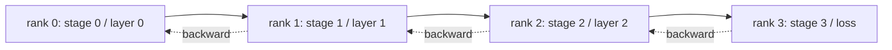

# Pipeline Parallel dan Analisis Bubble

> Tensor parallelism memecah perkalian matriks di seluruh ranks. Pipeline parallelism memecah model di seluruh ranks, satu stage per rank. Microbatch mengalir melalui pipeline. Waktu kosong di awal dan akhir adalah bubble; meminimalkannya adalah seluruh keterampilannya.

**Type:** Build
**Languages:** Python
**Prerequisites:** Phase 19 Track C lessons 42-49
**Time:** ~90 min

## Tujuan Pembelajaran

- Pecah model sekuensial menjadi N stages dan simulasi pipeline forward di N ranks.
- Jadwalkan M microbatch melalui pipeline menggunakan jadwal GPipe (forward-only fill, lalu backward) dan hitung fraksi bubble.
- Bandingkan bubble dengan jadwal 1F1B berselang-seling yang dipakai di Megatron-LM dan PipeDream.
- Pertahankan penugasan stage: komputasi yang sama per stage lebih penting daripada jumlah parameter yang sama per stage.

## Masalahnya

Sebuah model 70 miliar parameter dalam fp16 membutuhkan 140 GB hanya untuk parameter. Tidak ada GPU konsumen yang memegangnya. ZeRO-3 membagi parameter ke seluruh ranks tetapi tetap membutuhkan setiap rank meng-allgather layer penuh pada setiap langkah forward, membayar hop log(N) per layer. Pipeline parallel mengambil rute berbeda: potong model menjadi N stages dan letakkan satu stage di setiap rank. Forward layer 1 selesai di rank 0 dan menyerahkan tensor aktivasi ke rank 1; rank 1 menjalankan layer 2 dan menyerahkan ke rank 2; dan seterusnya. Backward mengalir terbalik. Memori turun linear karena setiap rank hanya memegang satu stage; komputasi sekuensial, dan itulah masalah bubble-nya.

Bubble adalah waktu menganggur di awal pipeline (menunggu microbatch pertama mencapai stage terakhir) dan di akhir (menunggu microbatch terakhir mengalir kembali). Dengan M microbatch dan N stages, fraksi bubble per-stage adalah (N-1)/(M+N-1). Pada M=8, N=4 itu 27%. Pada M=64, N=4 itu 4,5%. Bubble menyusut ketika kamu punya banyak microbatch per step, yang berarti ukuran batch per-microbatch kecil, yang merupakan kendala yang menggerakkan desain microbatch.

## Konsepnya



### Jadwal GPipe

Isi pipeline ke depan dengan semua M microbatch sebelum memulai backward apa pun; lalu kuras backward secara terbalik. Aktivasi dari setiap microbatch harus ditahan sampai backward-nya, jadi memori tumbuh linear dengan M. Forward memakan M+N-1 siklus, backward memakan M+N-1 siklus lagi. Kerja berguna per-stage adalah 2M siklus; bubble per-stage adalah 2(N-1) siklus. Fraksi bubble adalah (N-1)/(M+N-1) ketika setiap forward dan backward memakan satu satuan waktu. Memilih M jauh lebih besar dari N menyembunyikan bubble.

### Jadwal 1F1B

Selang-seling: begitu forward sebuah microbatch mencapai stage terakhir, mulai backward-nya dan biarkan mengalir kembali. Jadwal berselang-seling satu forward dan satu backward per stage. Bubble masih N-1 tetapi memori aktivasi dibatasi oleh kedalaman pipeline, bukan jumlah microbatch. Pipeline produksi memakai 1F1B (Megatron, PipeDream). Pelajaran ini mengimplementasikan GPipe dulu karena lebih sederhana, dan 1F1B sebagai latihan.

### Mengapa komputasi yang sama per stage itu penting

Jika stage 0 memakan 50 ms dan stage 1 memakan 100 ms, setiap siklus dibatasi oleh stage 1. Stage lainnya menganggur 50 ms per siklus menunggu stage 1 melepas. Jumlah parameter yang sama adalah sumbu yang salah: komputasi sebuah transformer didominasi attention plus MLP per layer, dan layer embedding punya banyak parameter tetapi sedikit komputasi. Penugasan stage harus menyamakan FLOPs per stage, bukan bobot per stage.

### Microbatch versus batch

Sebuah pipeline menjalankan M microbatch berukuran B masing-masing. Batch size efektif adalah M*B. Gradient di akhir sebuah langkah pipeline adalah gradient pada gabungan M*B contoh. Fraksi bubble bergantung pada M; optimiser melihat M*B. Meng-tune M berarti menukar bubble (lebih rendah dengan M tinggi) dengan memori per-microbatch (memori aktivasi lebih tinggi dengan M tinggi untuk GPipe).

```figure
cd-pipeline-bubble
```

## Bangun Sendiri

`code/main.py` mengimplementasikan:

- `PipelineStage`: `nn.Module` kecil yang memegang parameter satu stage dan mengekspos `forward(activation)`.
- `Pipeline(stages, num_microbatches)`: mengorkestrasi jadwal GPipe pada stage yang disimulasikan memakai wall-clock simulasi per stage.
- `bubble_fraction(num_stages, num_microbatches)`: bentuk tertutup (N-1)/(M+N-1).
- Demo 4-stage yang mencetak trace per-microbatch dan fraksi bubble terukur.

Jalankan:

```bash
python3 code/main.py
```

Output: bagan Gantt stage-per-microbatch dan persentase bubble terhadap prediksi bentuk tertutup.

## Pola produksi di lapangan

Tiga pola memperkeras pipeline parallel cukup untuk dirilis.

**Activation checkpointing berpasangan dengan pipeline.** Dengan M microbatch dalam penerbangan di GPipe, memori aktivasi adalah M kali satu microbatch. Activation checkpointing menghitung ulang forward pada waktu backward, menukar komputasi dengan memori; kombinasinya itulah yang membuat pipeline layak untuk sekuens panjang.

**Keseimbangan stage diukur, bukan diasumsikan.** Tim produksi menjalankan satu pass profiling yang mengukur komputasi per-layer sebenarnya (FLOPs dan wall-clock) pada target hardware, lalu mempartisi berdasarkan pengukuran itu. Flag `--num-layers-per-stage` Megatron-LM menerima sebuah daftar untuk mengizinkan jumlah layer yang tidak rata ketika stages punya biaya per-layer berbeda.

**Jadwal send-recv harus menghindari deadlock.** Pipeline yang menyuruh setiap stage mengirim sebelum menerima deadlock di wire. Perbaikan standarnya adalah berselang-seling: stage rank genap mengirim dulu lalu recv, stage rank ganjil recv dulu lalu mengirim. Pelajaran ini menjadwalkan ranks secara eksplisit supaya polanya terlihat.

## Gunakan

Pola produksi:

- **Megatron-LM.** Referensi untuk pipeline parallel pada skala besar. Memakai 1F1B dan mendukung kombinasi tensor + pipeline + data parallel.
- **DeepSpeed Pipeline.** Terintegrasi dengan ZeRO; ZeRO-1 + pipeline adalah kombinasi umum untuk model open terbesar.
- **PyTorch Pipe.** Pembungkus pipeline asli PyTorch, dibangun di atas `torch.distributed.pipeline.sync.Pipe`.

## Rilis

Pelajaran 80 menyimpan shard parameter per-stage di checkpoint ter-shard. Pelajaran 81 menyusun DDP + ZeRO + pipeline pada demo ujung-ke-ujung (dalam semangatnya; demo mempertahankan pipeline yang disimulasikan demi waktu jalan).

## Latihan

1. Implementasikan 1F1B dan verifikasi fraksi bubble cocok dengan GPipe tetapi memori aktivasi terbatas.
2. Profil waktu stage nyata pada model yang lebih dalam dan seimbangkan kembali stages berdasarkan wall-clock terukur.
3. Tambahkan akumulasi gradient di seluruh microbatch pipeline dan periksa bahwa gradient-nya sama dengan gradient dari forward full-batch yang setara.
4. Pasangkan pipeline dengan activation checkpointing dan ukur penurunan memori versus biaya komputasi.
5. Gabungkan pipeline dengan DDP (setiap pipeline rank direplikasi di seluruh sebuah grup data-parallel) dan nalar jadwal 2D-nya.

## Istilah Kunci

| Term | What people say | What it actually means |
|------|----------------|------------------------|
| Pipeline | "Model parallel along depth" | One stage per rank, activations flow stage to stage |
| Bubble | "Pipeline idle time" | (N-1) steps at start + end where some stages have no work |
| Microbatch | "Slice of the batch" | One forward/backward unit; bubble shrinks as M grows |
| GPipe | "Fill then drain" | All M forwards before any backward; high activation memory |
| 1F1B | "Interleaved schedule" | One forward one backward per stage; bounded activation memory |

## Bacaan Lanjutan

- [Huang et al, GPipe: Efficient Training of Giant Neural Networks](https://arxiv.org/abs/1811.06965)
- [Narayanan et al, PipeDream: Generalized Pipeline Parallelism for DNN Training](https://arxiv.org/abs/1806.03377)
- [Megatron-LM pipeline parallel docs](https://github.com/NVIDIA/Megatron-LM)
- Phase 19 pelajaran 76 - primitif send/recv yang dipakai jadwal ini
- Phase 19 pelajaran 78 - ZeRO ortogonal terhadap pipeline dan sering dikombinasikan
