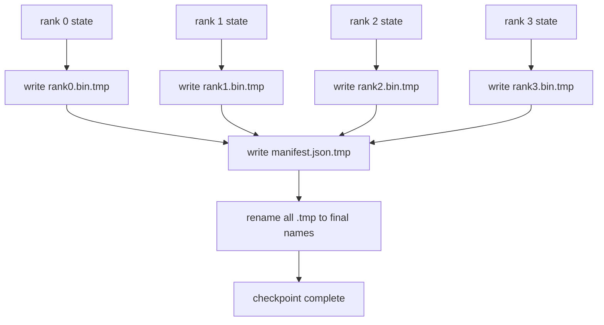

# Checkpoint Ter-Shard dan Resume Atomik

> Sebuah pekerjaan training 70 miliar parameter dijeda oleh kegagalan node setiap beberapa jam. Format checkpoint menentukan apakah kamu kehilangan 30 menit atau 30 jam. Sebuah checkpoint ter-shard menulis shard setiap rank secara paralel dan mencatat kepemilikan dalam sebuah manifes. Resume memuat shard setiap rank dari filenya sendiri, merekonstruksi state pada world size yang sama, dan optimiser melangkah seolah tidak terjadi apa-apa. Tulis atomik mencegah checkpoint setengah-jadi meracuni resume berikutnya.

**Type:** Build
**Languages:** Python
**Prerequisites:** Phase 19 Track C lessons 42-49
**Time:** ~90 min

## Tujuan Pembelajaran

- Simpan checkpoint multi-rank sebagai file shard per-rank plus sebuah manifes yang mencatat rank mana memiliki apa.
- Gunakan pola tulis atomik (tulis ke path temp lalu rename) supaya crash di tengah penulisan tidak pernah menghasilkan checkpoint setengah-jadi.
- Resume dari manifes, memverifikasi state byte-equal untuk parameter fp16 maupun optimiser state ZeRO di setiap rank.
- Pertahankan skema manifes terhadap tiga mode kegagalan: perubahan world-size, ketidakcocokan jumlah shard, dan tulis sebagian.

## Masalahnya

Sebuah checkpoint vanilla membaca semua parameter dan optimiser state ke rank 0, mengumpulkan, dan menulis satu file. Untuk model 70 miliar itu 1,1 TB state melalui satu port jaringan rank. Penulisan memblokir setiap rank lain karena mereka menganggur menunggu pengumpulan. Bandwidth IO adalah link jaringan GPU tunggal tercepat, bukan agregat. Di klaster nyata langkah kumpul-lalu-tulis bisa memakan waktu lebih lama dari jam training sebelumnya, yang berarti pekerjaan itu menghasilkan kurang dari satu checkpoint per hari training.

Checkpoint ter-shard membalik polanya: setiap rank menulis shard-nya sendiri ke filenya sendiri secara paralel. Manifes mencatat rank mana memiliki shard mana supaya resume bisa menempatkan setiap shard kembali ke asalnya. Bandwidth tulis agregat berskala dengan klaster. Checkpoint 1 TB yang memakan 4 jam melalui satu rank memakan 4 menit melalui 64 ranks. Ditambah manifes memberimu kontrak untuk resume yang tidak kompatibel: perubahan world-size bisa dideteksi, tulis sebagian bisa dideteksi, dan jalur pemuatan bisa gagal dengan keras alih-alih diam-diam memakai data basi.

## Konsepnya



### Skema manifes

```json
{
  "world_size": 4,
  "step": 1234,
  "wall_clock_seconds": 4521,
  "shards": [
    {"rank": 0, "path": "rank0.bin", "sha256": "...", "param_shard_offset": 0, "param_shard_numel": 65536},
    {"rank": 1, "path": "rank1.bin", "sha256": "...", "param_shard_offset": 65536, "param_shard_numel": 65536}
  ],
  "schema_version": 1
}
```

Tiga field menopang beban. `world_size` membuat resume pada ukuran berbeda gagal dengan keras alih-alih diam-diam korup. `sha256` per shard menangkap tulis sebagian atau korup. `param_shard_offset` dan `param_shard_numel` per shard memungkinkan loader merekonstruksi tensor parameter flat pada posisi yang benar.

### Tulis atomik

Pola standar: tulis setiap shard ke `<name>.tmp`, tulis manifes ke `manifest.json.tmp`, fsync masing-masing, lalu rename. Rename POSIX dalam filesystem yang sama bersifat atomik; file baru hadir sepenuhnya atau file lama yang tetap. Crash sebelum rename terakhir membiarkan checkpoint sebelumnya sebagai yang aktif. Tanpa tulis atomik, crash bisa meninggalkan shard sebagian dengan manifes yang hadir dan menunjuk kepadanya, dan pemuatan mengkorupsi optimiser state saat resume.

### Tiga mode kegagalan yang harus dipertahankan skema terhadapnya

| Failure | Symptom | Defence |
|---------|---------|---------|
| World-size change | resume on N=8 with manifest from N=4 | world_size mismatch in manifest, fail loudly |
| Shard count mismatch | resume sees fewer rank*.bin files than shards in manifest | enumerate shards, verify every one exists |
| Partial write | shard file truncated mid-flush | sha256 verification on load |

Setiap pertahanan menolak pemuatan yang buruk lebih awal; alternatifnya adalah korupsi diam-diam yang muncul 100 step kemudian ketika loss menjadi NaN.

### Mengapa file per-rank, bukan satu file besar

Penulisan konkuren ke satu file via `O_APPEND` bekerja di POSIX untuk tulis sejajar byte, tetapi dalam praktiknya offset di dalam satu shard membentang di wilayah berukuran MB dan penguncian mendominasinya. File per-rank tidak punya kontensi dan diuntungkan dari striping ketika filesystem dasarnya paralel (Lustre, GPFS). Tumpukan produksi (DeepSpeed, FSDP, NeMo) semuanya memakai file per-rank karena alasan itu.

```figure
ci-sharded-checkpoint
```

## Bangun Sendiri

`code/main.py` mengimplementasikan:

- Dataclass `ShardManifest` dengan skema di atas plus `to_json`/`from_json`.
- `save_sharded(state_dict_per_rank, dir, step)` yang menulis state biner setiap rank ke filenya sendiri memakai pola temp-lalu-rename atomik, lalu menulis manifes.
- `load_sharded(dir, expected_world_size)` yang membaca manifes, memverifikasi sha256 setiap shard, dan mengembalikan state dict per-rank.
- Tes round-trip: bangun state per-rank, simpan, muat, assert byte-equal.

Jalankan:

```bash
python3 code/main.py
```

Output: 4 file shard plus manifes ditulis, lalu dimuat ulang dengan verifikasi byte-equal.

## Pola produksi di lapangan

Tiga pola memperkeras checkpoint cukup untuk dirilis.

**Tulis asinkron.** Tumpukan produksi mengeluarkan penulisan checkpoint di thread atau proses terpisah sehingga training berlanjut. Penghalangnya ada di checkpoint berikutnya: jangan mulai penyimpanan berikutnya sampai yang sebelumnya selesai. Flag `async_io` DeepSpeed melakukan persis ini. Pelajaran ini mempertahankan penulisan sinkron supaya langkah-langkahnya terlihat.

**Disk lokal cepat dulu, lalu unggah asinkron.** Tulis ke NVMe lokal (cepat) lalu unggah-asinkron ke S3 atau GCS. Pola dua-lapis mempertahankan checkpoint di dalam klaster tetap cepat untuk resume sambil mengirim salinan tahan-lama keluar klaster untuk arsip. Manifes membawa path lokal; sebuah manifes unggahan membawa path remote.

**Rotasi itu penting.** Run produksi menyimpan K checkpoint terakhir (biasanya 3-5) dan merotasi yang paling lama. Tanpa rotasi, disk terisi di tengah run dan checkpoint berikutnya gagal. Dengan rotasi, penyimpanan berikutnya menghapus yang paling lama dulu, membebaskan anggaran.

## Gunakan

Pola produksi:

- **Pencatatan checkpoint DeepSpeed.** `deepspeed.save_checkpoint(tag=step)` menulis file per-rank dan sebuah file `latest` yang menunjuk ke tag aktif.
- **Pencatatan checkpoint PyTorch FSDP.** `torch.distributed.checkpoint` menyimpan state ter-shard dengan sebuah `Planner` yang menentukan tata letak per-rank.
- **NeMo.** Membungkus DeepSpeed dan FSDP dengan API `save_to_checkpoint` yang seragam yang menambah metadata.

## Rilis

Pelajaran 81 menyimpan checkpoint ter-shard dari run DDP+ZeRO ujung-ke-ujung dan memuatnya ulang pada world size yang sama untuk membuktikan kontrak resume berlaku.

## Latihan

1. Tambahkan tulis asinkron: mulai penyimpanan di sebuah thread dan biarkan training berlanjut. Blokir penyimpanan berikutnya sampai yang sebelumnya selesai.
2. Tambahkan rotasi `last_5_steps`: simpan 5 checkpoint terbaru, hapus yang paling lama sebelum menyimpan yang baru.
3. Tambahkan jalur verifikasi cepat CRC-saja untuk pemuatan-ulang inner-loop (rotasi memutar sebuah checkpoint menjadi yang aktif baru tanpa sha256 penuh).
4. Tambahkan pemuatan lintas-world-size: rebalance shard dari N=4 ke N=8 dengan membaca manifes, menggabungkan, dan membagi ulang.
5. Tambahkan unggahan ke S3 palsu (sebuah direktori kedua) dan tulis manifes unggahannya. Pertahankan kebijakan penyimpanan dua-lapis.

## Istilah Kunci

| Term | What people say | What it actually means |
|------|----------------|------------------------|
| Sharded checkpoint | "Per-rank save" | Each rank writes its own shard file in parallel |
| Manifest | "Index" | JSON file recording shard paths, offsets, and sha256 |
| Atomic write | "tmp then rename" | Write to .tmp then POSIX rename so a crash leaves the previous file live |
| Partial write | "Truncated shard" | A crash during write produces a corrupt shard; sha256 catches it |
| Rotation | "Keep last K" | Delete oldest checkpoint before writing new one to bound disk usage |

## Bacaan Lanjutan

- [DeepSpeed checkpointing](https://deepspeed.readthedocs.io/en/latest/model-checkpointing.html)
- [PyTorch torch.distributed.checkpoint](https://pytorch.org/docs/stable/distributed.checkpoint.html)
- [POSIX rename atomicity](https://pubs.opengroup.org/onlinepubs/9699919799/functions/rename.html)
- Phase 19 pelajaran 78 - state ZeRO yang dibentuk checkpoint ini untuk disimpan
- Phase 19 pelajaran 81 - demo ujung-ke-ujung melakukan round-trip pada state tersimpan
