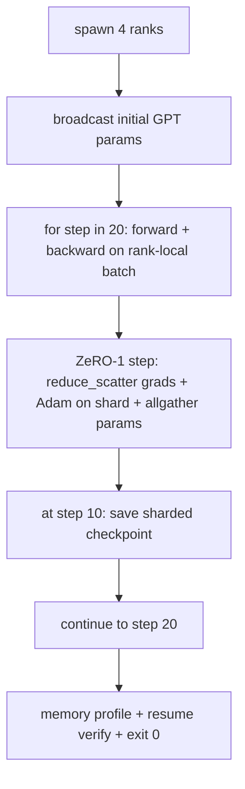

# Training Distributed Ujung-ke-Ujung

> Pelajaran 76 sampai 80 masing-masing membangun satu bagian. Ini perakitannya: sebuah GPT kecil yang dilatih di 4 ranks yang disimulasikan dengan DDP untuk sinkronisasi gradient, ZeRO-1 untuk pembagian optimiser state, dan sebuah checkpoint ter-shard di tanda separuh jalan. Demo menjalankan 20 step, berhenti sendiri, mencetak kurva loss plus profil memori, dan menulis checkpoint yang bisa dilanjutkan kembali.

**Type:** Build
**Languages:** Python
**Prerequisites:** Phase 19 Track C lessons 42-49
**Time:** ~90 min

## Tujuan Pembelajaran

- Susun DDP (pelajaran 77) plus ZeRO-1 (pelajaran 78) plus checkpoint ter-shard (pelajaran 80) menjadi satu loop training.
- Latih sebuah model bahasa transformer 2-layer pada korpus sintetis kecil selama 20 step di 4 ranks yang disimulasikan.
- Cetak tabel loss per-step, profil memori per-rank, dan sebuah manifes checkpoint yang memuat-ulang byte-equal pada world size yang sama.
- Pertahankan komposisinya: setiap bagian bisa diuji secara independen di pelajaran-pelajaran sebelumnya dan pelajaran ini membuktikan bahwa komposisinya benar.

## Masalahnya

Sebuah capstone adalah bukti bahwa bagian-bagiannya cocok satu sama lain. Pelajaran 76 mengimplementasikan kolektif. Pelajaran 77 membungkusnya menjadi DDP. Pelajaran 78 membagi optimiser state dengan reduce_scatter. Pelajaran 79 menganalisis pipeline. Pelajaran 80 menyimpan checkpoint ter-shard. Setiap pelajaran berdiri sendiri dengan tesnya masing-masing. Sebuah run training nyata memakai setiap primitif sekaligus; jika komposisinya salah, loss menyimpang, checkpoint menolak untuk dilanjutkan, atau memori per-rank tumbuh ketika seharusnya menyusut.

Pelajaran ini menjalankan demo ujung-ke-ujung dan memverifikasi empat invarian: (a) loss menurun monoton di seluruh 20 step dalam noise float, (b) setiap rank memegang norm parameter yang sama pada setiap step, (c) memori optimiser per-rank sama dengan rumus ZeRO-1 12P/N bytes, dan (d) checkpoint pada step 10 memuat-ulang byte-equal saat restart. Demo berhenti sendiri: 20 step, satu perintah, exit 0.

## Konsepnya



### GPT mini-nya

Modelnya sengaja kecil: 2 blok transformer, embed dim 32, 4 kepala attention, vocab 64, panjang sekuens 16, batch 4. Beberapa ribu parameter. Cukup besar untuk menjalankan setiap keputusan wiring (multi-head attention menjalankan jalur mask standar; LayerNorm punya bobot untuk disinkronkan; LM head adalah proyeksi linear terpisah kembali ke vocab). Cukup kecil sehingga 20 step pada 4 rank CPU selesai dalam hitungan detik.

### Aturan komposisi

| Lesson piece | What it owns | What it leaves to the loop |
|--------------|--------------|----------------------------|
| DDP broadcast | Initial parameter sync | One call at construct time |
| ZeRO-1 step | Gradient sync, master copy update, parameter broadcast | One call per step replacing optimiser.step |
| Sharded checkpoint | Persist per-rank state, manifest with sha256 | Called on rank 0 with state collected via allgather |
| Training loop | Forward, backward, loss logging | Calls the three above in order |

Loop tidak tahu apa-nya reduce_scatter atau file rendezvous. Modul ZeRO dan checkpoint mengekspos antarmuka sempit yang dirangkai loop.

### Mengapa sebuah GPT kecil dan bukan hanya MLP

MLP dari pelajaran 77 sudah cukup untuk memverifikasi sinkronisasi gradient. Sebuah GPT kecil menambah tiga hal: sebuah LM head terpisah di atas vocab (di pelajaran ini, tidak terikat demi kejelasan; GPT penuh biasanya mengikat head ke token embedding), softmax+cross-entropy sebagai loss (lebih banyak kasus tepi numeris daripada MSE), dan sebuah forward asimetris (embedding lalu attention lalu MLP per layer). Bertahan dengan MLP untuk capstone-nya akan menyembunyikan apakah komposisinya menangani LayerNorm atau bentuk grad layer embedding dengan benar.

### Berhenti sendiri berarti exit 0

Loop menjalankan 20 step tetap lalu keluar. Tidak ada `while True`, tidak ada intervensi manusia, tidak ada resume dari state eksternal. Sebuah capstone yang bisa kamu tinggalkan berjalan tanpa pengawasan dan menemukan log lengkap ketika selesai adalah capstone yang membuktikan sistemnya dirangkai dengan benar. Jika ada bagian yang deadlock, demo tidak pernah kembali dan rig tes menangkapnya.

```figure
ci-distributed-assembly
```

## Bangun Sendiri

`code/main.py` mengimplementasikan:

- `MiniGPT`: transformer 2-layer dengan self-attention bermask dan sebuah LM head terpisah.
- `make_corpus(seed, total_tokens)`: data prediksi-token-berikutnya yang deterministik.
- `_train_worker`: di-spawn per rank; menyiarkan params init, menjalankan loop, memanggil langkah ZeRO, menulis checkpoint ter-shard pada step 10.
- `verify_resume`: setelah run utama, memuat-ulang checkpoint step-10 di dalam proses dan meng-assert bahwa shard master tersimpan cocok dengan snapshot in-memory byte-demi-byte.
- `main`: mengorkestrasi seluruh demo, mencetak tabel loss, profil memori, dan hasil verifikasi.

Jalankan:

```bash
python3 code/main.py
```

Output: tabel loss 20 baris, profil memori per-rank 4 baris, sebuah manifes checkpoint, dan baris "RESUME VERIFIED" saat berhasil.

## Pola produksi di lapangan

Tiga pola menyelesaikan komposisinya untuk run nyata.

**Checkpoint setiap K menit, bukan setiap K step.** Waktu step bervariasi dengan panjang sekuens dan jumlah microbatch. Jadwal checkpoint 10-menit menangkap komputasi yang sama tanpa peduli ukuran model. Pelajaran ini memakai langkah berbasis step demi kesederhanaan; produksi memakai berbasis wall-clock.

**Deteksi divergensi sedini mungkin.** Run produksi menambahkan penjaga NaN setelah backward dan detektor lonjakan loss; jika loss melompat lebih dari 2x dalam satu step, mundur ke checkpoint sebelumnya alih-alih membiarkan optimiser berjalan ke state yang degeneratif. Kurva loss pelajaran ini mulus sehingga penjaga tidak terpakai tetapi hook-nya tetap ada.

**Agregasikan profil memori di seluruh ranks.** Memori per-rank berbeda antar-rank pada run nyata (rank dengan stage pipeline terbesar memegang lebih banyak aktivasi). Logging produksi mencatat maks di seluruh ranks plus rata-ratanya; pelajaran mencetak per-rank untuk menunjukkan rumusnya cocok.

## Gunakan

Pola produksi:

- **DeepSpeed.** Menggabungkan DDP + ZeRO + pipeline + activation checkpointing di bawah satu config. Komposisi pelajaran ini adalah bentuk DeepSpeed dalam miniatur.
- **PyTorch FSDP.** Padanan aslinya. `FullyShardedDataParallel` dengan `ShardingStrategy.SHARD_GRAD_OP` adalah ZeRO-2.
- **NeMo dan Megatron-LM.** Menambahkan tensor parallel untuk model terbesar; kalau tidak, komposisinya berbentuk sama.

## Rilis

Track penuh berakhir di sini. Keenam pelajaran bersama-sama adalah subsistem distributed-training yang akan dibangun sebuah tim nyata sebelum mengadopsi DeepSpeed; abstraksinya sudah dibuktikan terhadap gloo dan mode-mode kegagalannya sudah dijalankan. Phase 17 (infrastruktur dan produksi) adalah tempat membawa ini ke klaster nyata.

## Latihan

1. Tambahkan pembagian tensor-parallel dari kepala attention dan verifikasi loss cocok dengan baseline single-rank. Dua ranks: separuh kepala per rank, allreduce dari output attention.
2. Tambahkan akumulasi gradient di 4 microbatch dan buktikan gradient-nya sama dengan gradient satu batch besar.
3. Tambahkan jalur resume-dari-step-10 yang benar-benar melanjutkan training ke step 20 dan menghasilkan loss akhir yang sama dengan run aslinya.
4. Tambahkan ekspor metrik (loss, grad norm, waktu step) ke JSONL supaya run bisa divisualisasikan setelahnya.
5. Tambahkan penjaga NaN yang mundur ke checkpoint sebelumnya pada lonjakan loss, dan paksa sebuah lonjakan dengan pengali LR satu-step untuk menjalankan rollback-nya.

## Istilah Kunci

| Term | What people say | What it actually means |
|------|----------------|------------------------|
| End-to-end | "Wire it all up" | One run composes every piece, not a unit test per piece |
| Memory profile | "GB per rank" | Bytes held on each rank for params, grads, optimiser state |
| Resume contract | "Save and load" | Per-rank state byte-equal after a checkpoint round-trip |
| Self-terminating | "Bounded run" | Fixed step count, exit 0 on completion, no human in the loop |

## Bacaan Lanjutan

- [DeepSpeed end-to-end training tutorial](https://www.deepspeed.ai/getting-started/)
- [PyTorch FSDP advanced tutorial](https://pytorch.org/tutorials/intermediate/FSDP_advanced_tutorial.html)
- [Megatron-LM training script reference](https://github.com/NVIDIA/Megatron-LM)
- Phase 19 pelajaran 76-80 - setiap bagian yang disusun pelajaran ini
- Phase 17 - memindahkan komposisinya ke klaster nyata
