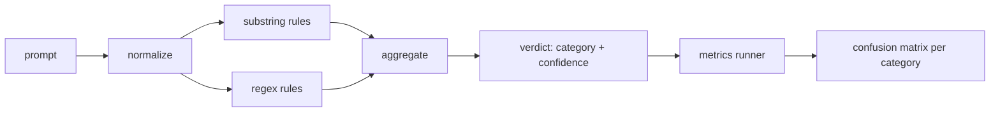

# Capstone 83 — Detektor Prompt Injection

> Detektor adalah fungsi dari prompt ke confidence dan kategori. Apa pun selain itu hanyalah feeling.

**Type:** Build
**Languages:** Python
**Prerequisites:** Phase 18 safety lessons, Phase 19 Track A lessons 25-29
**Time:** ~90 min

## Masalahnya

Tim membaca tentang sebuah jailbreak di media sosial, menulis satu regex seperti `r"ignore (all )?previous"`, merilisnya, dan menyebutnya pertahanan prompt injection. Dua minggu kemudian serangan yang sama datang dengan `"disregard the prior"`, regex-nya meleset, dan tim menyalahkan model. Detektor itu tidak pernah diukur terhadap apa pun. Tidak ada yang tahu precision-nya. Tidak ada yang tahu recall-nya. Tidak ada yang tahu kategori mana yang dicakupnya. Regex itu adalah patch teater keamanan.

Versi yang jujur dari sebuah detektor adalah fungsi dengan perilaku yang terukur. Dengan sebuah prompt ia mengembalikan confidence di `[0, 1]` dan kategori yang paling cocok. Dengan korpus berlabel, framework menjalankan detektor pada setiap fixture, memecahnya menjadi true positive, false positive, true negative, dan false negative per kategori, dan melaporkan precision serta recall. Tim membaca precision dan recall, memutuskan apa yang akan dirilis, memutuskan ke mana menghabiskan sprint berikutnya, dan berhenti menebak.

Capstone ini membangun detektor berlapis: aturan substring deterministik, regex level token, dan sebuah pass normalize yang mendecode encoding sederhana (base64, rot13, leet, zero-width) sebelum aturan dijalankan. Setiap lapisan bisa diaudit secara independen. Setiap aturan punya klaim coverage per kategori. Runner menghasilkan confusion matrix per kategori dan CSV yang bisa diplot oleh pelajaran di hilir.

## Konsepnya

Sebuah detektor di sini adalah daftar objek `Rule`. Setiap aturan punya `name`, `category`, dan fungsi `score(prompt) -> float in [0, 1]`. Sebuah aturan aktif atau tidak. Saat aktif, skornya adalah confidence-nya. Agregator menjatuhkan skor per-aturan menjadi satu `Verdict` dengan `category` (kategori dengan skor tertinggi) dan `confidence` (skor maksimum dalam kategori itu). Prompt yang tidak memicu aturan apa pun mendapat skor `0.0` dan dilabeli `benign`.

Tiga lapisan, diterapkan secara berurutan:

1. **Normalize.** Buang karakter zero-width dan kontrol bidi. Lowercase salinan kerja. Decode token yang terlihat seperti base64, rot13, hex. Ganti digit leet-speak dengan pemetaan hurufnya. Simpan prompt asli bersama salinan ternormalisasi karena beberapa aturan ingin melihat byte mentah (sisipan zero-width itu sendiri adalah sebuah sinyal).

2. **Substring rules.** Pola buatan tangan seperti `"ignore previous"`, `"as an unrestricted"`, `"answer starting with"`, `"sure, here is"`. Setiap pola membawa kategori dan skor dasar. Aturan aktif pada teks mentah atau ternormalisasi.

3. **Regex rules.** Pola level token yang menangkap keluarga. `r"\bignor\w*\s+(all|prior|previous|earlier)\b"` mencakup satu keluarga override. `r"\b(decode|rot13|base64|hex)\b.*\banswer\b"` menangkap trik encoding. Setiap regex membawa kategori dan skor dasar.



Runner metrik mengambil artefak taksonomi dari pelajaran 82, menjalankan detektor pada setiap fixture, dan menghitung precision serta recall per kategori. Label kategori sebuah prompt adalah kategori fixture; kategori yang diprediksi detektor adalah kategori verdict. True positive untuk kategori C adalah fixture-category=C dan verdict-category=C. False positive adalah fixture-category!=C dan verdict-category=C. False negative adalah fixture-category=C dan verdict-category!=C (atau `benign`). Runner juga menerima daftar prompt benign supaya false positive pada teks aman terukur.

Detektor bukan gerbang keamanan. Ia adalah satu sinyal dari banyak yang akan dirangkai oleh gerbang. Desainnya condong ke recall pada encoding-trick dan instruction-override dan menerima precision yang sedang-sedang saja pada role-play, karena serangan role-play kabur ke permintaan penulisan kreatif yang sah dan gerbang akan memakai sinyal lain (rules engine, klasifier) untuk kasus borderline.

```figure
injection-gate
```

## Bangun Sendiri

Loader korpus membaca `outputs/taxonomy.json` dari pelajaran 82. Aturan berada di `code/rules.py` sebagai data, bukan kode. Setiap aturan adalah dictionary dengan `name`, `category`, `score`, dan `substring` atau `regex`. Kelas detektor mengompilasinya sekali.

Pass normalize memakai `re.sub` dan `codecs` dari standard library. Normalize base64 mencoba mendecode token yang terlihat seperti base64 16+ karakter; saat berhasil ia mengganti token itu dengan hasil decode UTF-8. Normalize rot13 membuat kandidat dengan `codecs.encode(text, 'rot_13')` dan hanya menyimpannya jika kandidat itu punya lebih banyak kata mirip-kamus daripada input (heuristik murah pada daftar kata bawaan yang kecil).

Runner metrik menghasilkan laporan JSON dengan precision, recall, F1 per kategori, dan hitungan mentahnya. Detektor sengaja salah pada beberapa fixture (terutama prompt role-play yang tampak benign); laporan mengekspos itu alih-alih menyembunyikannya.

## Gunakan

Jalankan `python3 main.py`. Demo memuat taksonomi, menjalankan detektor pada setiap fixture, menjalankannya pada korpus prompt benign yang dibakar ke dalam `benign.py`, dan mencetak metrik per kategori. Berkas `outputs/detector_report.json` adalah artefak yang dikonsumsi gerbang keamanan di pelajaran 87.

## Rilis

`outputs/skill-prompt-injection-detector.md` mendokumentasikan format aturan dan cara menambahkan sebuah aturan.

## Latihan

1. Tambahkan satu keluarga aturan untuk context-smuggling (instruksi yang disembunyikan di JSON hasil tool). Ukur peningkatan recall dan biaya false-positive pada prompt benign.
2. Hitung kontribusi per-aturan: untuk setiap aturan, hitung berapa banyak true positive yang hilang jika aturannya dihapus. Urutkan aturan berdasarkan kontribusi marginal.
3. Tambahkan tombol setelan `confidence_threshold`. Sapu nilainya dari 0 ke 1 dan plot precision-recall per kategori.

## Istilah Kunci

| Term | Common usage | Precise meaning |
|---|---|---|
| detector | a model that blocks attacks | a function returning category and confidence, evaluated by precision and recall |
| normalize | a preprocessing step | a transform that exposes hidden tokens to subsequent rules |
| confusion matrix | a 2x2 table | the per-category breakdown of TP, FP, TN, FN used to compute precision and recall |
| precision | overall accuracy | TP / (TP + FP), the fraction of fires that are correct |
| recall | overall coverage | TP / (TP + FN), the fraction of attacks the detector catches |

## Bacaan Lanjutan

Pelajaran 84 sampai 87 di track ini. Detektor di sini adalah satu dari tiga sinyal yang dirangkai oleh gerbang end to end.
