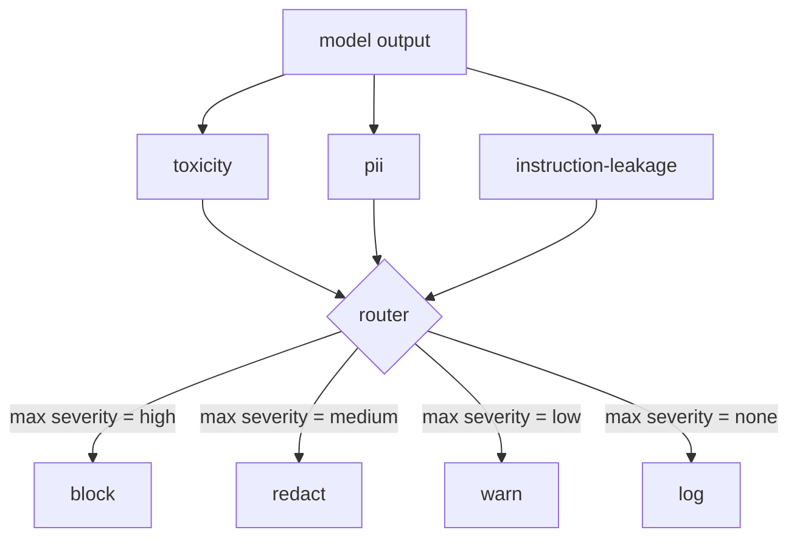

# Capstone 85 — Integrasi Klasifier Konten

> Klasifier di sisi output menjawab pertanyaan yang berbeda dari aturan di sisi input. Keduanya membutuhkan policy router.

**Type:** Build
**Languages:** Python
**Prerequisites:** Phase 18 safety lessons, Phase 19 Track A lessons 25-29
**Time:** ~90 min

## Masalahnya

Input bukan satu-satunya permukaan serangan. Model yang lulus setiap pemeriksaan input tetap bisa menghasilkan output yang membocorkan PII, mengulang kata hina dari distribusi training-nya, atau memantulkan system prompt kembali ke pengguna sebagai respons atas pertanyaan yang cerdik. Klasifier sisi output melihat respons aktual model, bukan prompt pengguna, dan menanyakan pertanyaan yang berbeda: terlepas dari bagaimana prompt ini sampai di sini, apakah apa yang akan kita kirim ke pengguna bisa diterima.

Tim sering melewatkan klasifikasi output karena klasifikasi input terasa cukup dan karena klasifier output menambah latensi ekstra. Kedua argumen itu kalah. Melewatkan klasifikasi output memberi penyerang bypass satu kali: keluarga serangan baru apa pun yang tidak dicakup pipeline input akan mendarat di pengguna. Latensi itu nyata tapi bisa ditangani: klasifier bisa berjalan paralel dengan token streaming, dengan gerbang men-buffer chunk terakhir dan menerapkan verdict klasifier sebelum flush.

Capstone ini menyambungkan tiga klasifier output yang independen di belakang satu policy router. Toxicity (deteksi kata hina dan pelecehan berbasis aturan). PII (regex untuk email, nomor telepon, string berbentuk SSN, string berbentuk kartu kredit, alamat IP). Instruction leakage (heuristik untuk echo system prompt, membandingkan output dengan system prompt yang diketahui lewat overlap trigram). Router mengumpulkan verdict klasifier, memilih severity, dan menerapkan policy aksi: `block`, `redact`, `warn`, atau `log`.

## Konsepnya

Setiap klasifier adalah callable yang mengembalikan `ClassifierVerdict` dengan `name`, `score in [0,1]`, `severity` (`none`, `low`, `medium`, `high`), dan `findings` (daftar string yang menjelaskan apa yang ditandainya). Router mengambil daftar verdict dan menerapkan tabel aturan:

| Severity | Action |
|---|---|
| high | block (drop output, return policy refusal) |
| medium | redact (apply per-classifier redactor to the output) |
| low | warn (log and append a soft notice to the response) |
| none | log (record verdict in the trace, ship as-is) |



Router mengambil severity maksimum di antara klasifier dan menerapkan aksi yang sesuai. Block menang. Redact + warn menjadi redact. Log + warn menjadi warn. Router memancarkan objek `Action` dengan `verb`, `output`, `severity`, `verdicts`, dan `metadata`. Di hilir, gerbang keamanan di pelajaran 87 mencatat metadata ke dalam trace dan entah mengirim output yang sudah di-redact, mengirim yang asli dengan peringatan, atau mengganti output dengan penolakan kebijakan.

Setiap klasifier punya redactor-nya sendiri. Klasifier PII mengganti `name@example.com` dengan `[redacted-email]` dan digit berbentuk kartu kredit dengan `[redacted-card]`. Klasifier instruction-leakage menghapus baris yang terlihat seperti header system prompt. Klasifier toxicity mengganti kata hina yang cocok dengan `[redacted-language]`. Redaction dibuat independen sehingga output yang kena toxicity-dan-PII mengalir melalui kedua redactor.

Klasifier toxicity berbasis aturan secara sengaja: daftar terkurasi kata kunci pelecehan dengan pencocokan berbatas-whitespace dan pemeriksaan jendela negasi kecil supaya "you are not a slur" tidak memicu aturannya. Daftarnya sengaja pendek (pelajaran ini tentang plumbing, bukan pembangunan leksikon). Klasifier PII memakai regex standar untuk bentuk-bentuk yang umum. Klasifier instruction-leakage menerima parameter `system_prompt` saat konstruksi dan membandingkan overlap trigram dengan output; overlap yang tinggi adalah sinyal kebocoran.

```figure
cd-output-router
```

## Bangun Sendiri

`code/classifiers.py` mendefinisikan ketiga klasifier. Masing-masing punya metode `classify(text) -> ClassifierVerdict` dan `redact(text) -> str`. `code/main.py` mendefinisikan kelas `Router` dengan `decide(text, verdicts) -> Action` dan shortcut `run(text) -> Action`. Demo menyambungkan ketiga klasifier di belakang satu router dan menjalankan korpus kecil output yang dibuat khusus untuk melatih setiap severity.

## Gunakan

Jalankan `python3 main.py`. Demo mencetak kata kerja aksi untuk setiap output tes, menulis `outputs/classifier_report.json`, dan mengonfirmasi bahwa block, redact, warn, dan log masing-masing aktif pada setidaknya satu fixture. Latensi secara artifisial nol karena semua klasifier berbasis aturan; untuk model nyata dengan klasifier neural, plumbing yang sama berlaku setelah latensi per klasifier naik.

## Rilis

`outputs/skill-content-classifier-integration.md` mendokumentasikan struktur verdict dan action supaya gerbang di pelajaran 87 bisa mengonsumsinya.

## Latihan

1. Tambahkan klasifier keempat untuk injeksi kode (output berisi `<script>`, `eval(`, dll). Tentukan policy severity-nya dan integrasikannya.
2. Buat router menerapkan bobot severity per klasifier sehingga PII dihitung lebih berat daripada toxicity. Demonstrasikan perubahannya pada fixture yang sama.
3. Tambahkan threshold confidence sehingga verdict skor rendah turun satu tingkat severity. Sapu threshold-nya dan laporkan bagaimana laju block berubah.

## Istilah Kunci

| Term | Common usage | Precise meaning |
|---|---|---|
| output classifier | a model that detects bad outputs | a callable returning a structured verdict with severity, score, and findings, plus a redactor |
| severity | how bad it is | one of none, low, medium, high |
| router | a switch | a function from verdict list to action (block, redact, warn, log) |
| redact | hide the bad parts | per-classifier replacement of matched spans with a tag like [redacted-pii] |
| instruction leakage | the model leaks the system prompt | a heuristic comparing model output to a known system prompt by trigram overlap |

## Bacaan Lanjutan

Pelajaran 86 menambahkan rules engine deklaratif untuk batasan yang tidak alami berbentuk klasifier. Pelajaran 87 merangkai keduanya dengan detektor sisi input.
