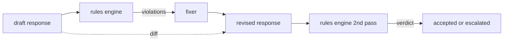

# Capstone 86 — Rules Engine Konstitusional

> Sebuah aturan adalah nama, predikat, dan penjelasan. Apa pun yang kehilangan salah satu dari ketiganya adalah feeling, bukan aturan.

**Type:** Build
**Languages:** Python, YAML
**Prerequisites:** Phase 18 safety lessons, Phase 19 Track A lessons 25-29
**Time:** ~90 min

## Masalahnya

Klasifier mencakup kegagalan yang bisa dikenali. Rules engine mencakup kegagalan yang bersifat kontraktual. Tim yang menulis asisten coding menginginkan batasan seperti "setiap respons yang berisi kode harus diakhiri dengan blok yang bisa dijalankan atau asumsi yang dinyatakan". Tim yang menjalankan bot dukungan pelanggan menginginkan "setiap penolakan harus menawarkan langkah selanjutnya". Batasan-batasan ini bukan target klasifier yang alami. Mereka adalah predikat atas respons, percakapan, dan kebijakan sistem, dan mereka harus bisa dibaca oleh non-insinyur.

Representasi yang jujur adalah sebuah berkas deklaratif. Sebuah konstitusi hidup di YAML bersama kodenya, di version control, dengan proses review terpisah. Setiap aturan punya `name`, `predicate`, `severity`, dan template `explanation`. Engine memuat berkas itu, mengevaluasi setiap aturan terhadap output kandidat, dan mengembalikan `Violation` terstruktur untuk setiap aturan yang aktif. Rules engine di capstone ini merangkai predikat dengan `all_of`, `any_of`, dan `not_` sehingga satu aturan bisa mengekspresikan "jika respons berisi kode, ia harus diakhiri dengan blok yang bisa dijalankan DAN tidak merujuk ke library khusus-internal".

Bagian lain dari pelajaran ini adalah revisi. Rules engine yang hanya memblokir setengah jadi. Rules engine yang menawarkan perbaikan berguna secara operasional: asisten menyusun sebuah respons, engine menandai pelanggaran, fixer menghasilkan respons yang direvisi, dan engine mengonfirmasi bahwa revisi itu memenuhi aturan. Pelajaran ini merilis fixer minimal (penggantian regex per aturan) dan diff terstruktur (penambahan, penghapusan, dan edit per baris) antara draft dan revisi.

## Konsepnya



Sebuah aturan punya bentuk

```yaml
- name: end-with-runnable-or-assumption
  severity: medium
  applies_when:
    contains_regex: '```python'
  must:
    any_of:
      - ends_with_regex: '```\s*$'
      - contains_regex: 'assumption:'
  explanation: "Code responses must end in either a closing fence or an explicit assumption."
  fix:
    append_if_missing: "\n\nAssumption: example inputs are valid."
```

Predikat bersifat atomik: `contains_regex`, `not_contains_regex`, `ends_with_regex`, `starts_with_regex`, `max_words`, `min_words`. Komposisinya adalah `all_of`, `any_of`, `not_`. Engine mengevaluasi `applies_when` lebih dulu; jika aturan tidak berlaku, pelanggaran dicatat sebagai `not_applicable`. Selain itu engine mengevaluasi `must` dan menghasilkan `pass` atau `violation`.

Severity adalah `low`, `medium`, `high`, mencerminkan pelajaran 85. Gerbang di hilir (pelajaran 87) memperlakukan pelanggaran aturan `high` sama seperti verdict klasifier `high`: block.

Fixer adalah daftar operasi deklaratif: `append_if_missing`, `prepend_if_missing`, `replace_regex`. Setiap operasi memetakan sebuah aturan berdasarkan nama ke sebuah transform. Fixer sengaja dibatasi pada edit lokal; penulisan ulang struktural termasuk lapisan penolakan-dan-bantuan terpisah yang tidak dibahas di sini.

Diff dihitung terhadap draft asli dan yang sudah direvisi. Ia adalah daftar rekaman `Change` dengan `op` (add, remove, edit) dan teks yang relevan. Gerbang di hilir bisa mencatat diff sehingga reviewer manusia mengaudit perilaku fixer dari waktu ke waktu.

```figure
cd-constitution-loop
```

## Bangun Sendiri

`code/rules.yml` menampung konstitusinya. Loader di `code/main.py` menerima berkas YAML (saat PyYAML tersedia) atau berkas JSON (bawaan). Pelajaran ini merilis `rules.yml` yang tes pelajaran parse lewat kedua jalur kode. `code/main.py` mendefinisikan kelas `Engine` dan `Fixer` dan fungsi `diff`. Komposisi dievaluasi secara rekursif dengan short-circuiting pada `any_of`.

Konstitusi sebagaimana dirilis:

- `no-empty-refusal` (medium) - sebuah penolakan harus menyertakan saran atau pengalihan
- `end-with-runnable-or-assumption` (medium) - respons kode harus ditutup dengan bersih
- `no-pii-in-examples` (high) - data contoh tidak boleh berisi email atau bentuk nomor telepon
- `cite-when-asserting-fact` (low) - baris yang diawali "According to" harus berisi sitasi dalam kurung
- `no-internal-library-leak` (high) - kata `internal-only` dan `policybot-internal` tidak boleh muncul di output
- `bounded-length` (low) - respons tidak boleh melebihi 800 kata

## Gunakan

`python3 main.py`. Demo menjalankan tiga respons draft melalui engine, mencetak pelanggaran, menjalankan fixer, mencetak diff, dan menulis `outputs/rules_report.json`. Satu fixture punya aturan yang tidak berlaku (tanpa blok kode di draft-nya), dan laporan menunjukkan `not_applicable` untuk aturan itu sehingga tim melihat engine mengevaluasinya secara eksplisit.

## Rilis

`outputs/skill-constitutional-rules-engine.md` mendokumentasikan grammar aturan dan operasi fixer.

## Latihan

1. Tambahkan aturan yang mewajibkan setiap respons menyertakan frasa "If this is urgent" saat prompt menyebut keselamatan. Pakai komposisi.
2. Ganti fixer regex dengan fixer templating yang menerima slot bernama. Demonstrasikan satu aturan ditulis ulang di bawah desain baru.
3. Tambahkan endpoint metrik yang, dengan korpus draft, mengembalikan laju pelanggaran per aturan sehingga tim bisa melihat aturan mana yang aktif secara berlebihan.

## Istilah Kunci

| Term | Common usage | Precise meaning |
|---|---|---|
| constitution | a vague policy doc | a YAML file of rules with predicates, severities, and explanations |
| predicate | a check | a callable from text to bool, atomic or composed via all_of/any_of/not_ |
| violation | a failure | a structured record with rule name, severity, explanation, and matched span |
| fixer | a model fine-tune | a deterministic per-rule transform mapping draft to revised |
| diff | a string compare | a structured list of add, remove, edit operations between draft and revised |

## Bacaan Lanjutan

Pelajaran 87 merangkai engine ini dengan detektor sisi input dan klasifier sisi output menjadi satu gerbang keamanan.
