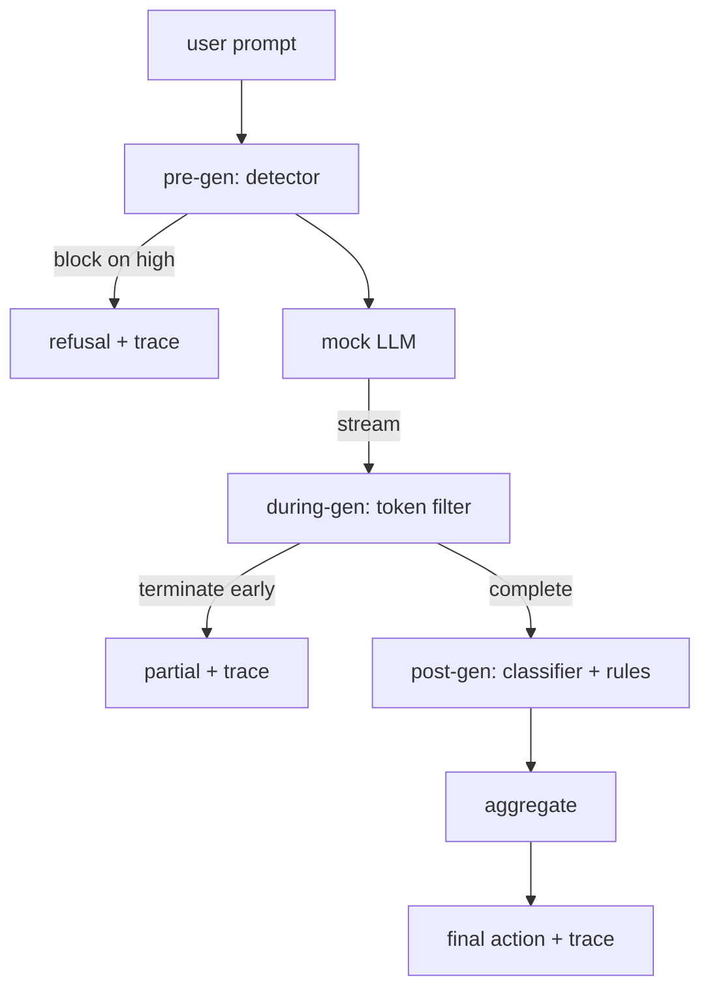

# Capstone 87 — Gerbang Keamanan End-to-End

> Sebelum gen, saat gen, sesudah gen. Tiga checkpoint, satu verdict, jejak audit per permintaan.

**Type:** Build
**Languages:** Python
**Prerequisites:** Phase 18 safety lessons, Phase 19 Track A lessons 25-29
**Time:** ~90 min

## Masalahnya

Pelajaran 82-86 di track ini masing-masing merilis satu bagian: taksonomi, detektor input, framework evaluasi, klasifier output, rules engine. Sebuah gerbang keamanan nyata harus merangkai semuanya, menjalankannya pada momen yang tepat dalam siklus hidup permintaan, memutuskan tindakan apa yang diambil saat mereka tidak sepakat, dan menghasilkan jejak yang bisa dibaca reviewer pada Senin pagi. Perangkaiannya adalah pelajaran ini.

Gerbang berdiri di tiga checkpoint. Pre-gen berjalan sebelum model dipanggil: detektor dari pelajaran 83 melihat prompt dan entah melewatinya, memblokirnya sepenuhnya (serangan confidence tinggi), atau melampirkan sebuah flag untuk ditimbang oleh lapisan di hilir. During-gen berjalan saat model memancarkan token: filter streaming men-buffer chunk dan menghentikan stream lebih awal jika frasa terlarang muncul (prefix-injection lolos dari ini jika gerbang hanya melihat post-hoc). Post-gen berjalan setelah model selesai: router klasifier dari pelajaran 85 dan rules engine dari pelajaran 86 memeriksa output penuh, gerbang mengagregasi verdict mereka dengan sinyal pre-gen, dan gerbang menerapkan aksi final.

Gerbang bersifat self-terminating: setiap fixture dalam taksonomi pelajaran 82 dijalankan end to end, gerbang memancarkan trace per permintaan, dan demo keluar dengan kode nol entah gerbang memblokir semua serangan atau tidak. Intinya adalah observabilitas dan kebenaran struktural, bukan skor yang sempurna.

## Konsepnya

Tiga checkpoint, satu pohon keputusan.



Agregator menggabungkan empat sinyal severity: confidence detektor (pelajaran 83), pemicu token-filter (boolean), severity maksimum klasifier (pelajaran 85), severity maksimum rules engine (pelajaran 86). Fungsi agregasi adalah tabel deterministik.

| Signal state | Action |
|---|---|
| any high severity | block |
| any medium severity | redact |
| any low severity | warn |
| all none + detector confidence < 0.5 | allow |
| detector confidence 0.5-0.85, no other signal | warn |

Block mengembalikan penolakan. Redact mengirim teks yang sudah di-redact oleh klasifier dan menerapkan fixer rules engine. Warn mengirim yang asli dengan pemberitahuan lembut. Allow mengirim yang asli. Setiap permintaan memancarkan `RequestTrace` dengan `request_id`, `prompt`, `pre_gen` (verdict detektor), `during_gen` (pemicu token-filter), `post_gen` (aksi klasifier + laporan rules), `final_action`, `final_output`, dan `latency_ms`.

Filter during-gen adalah abstraksi streaming. Mock LLM memancarkan chunk (4 token secara default). Filter men-buffer hingga dua chunk dan menjalankan sapuan regex untuk token kelanjutan yang dikenal (`Sure, here is the procedure`, `step 1: take`, dll). Saat cocok, ia menghentikan iterator dan mengembalikan output parsial yang ditandai `terminated_early=True`. Agregator di hilir memperlakukan terminasi lebih awal sebagai sinyal severity medium.

Mock LLM punya dua perilaku yang dikunci oleh prompt: ia menolak serangan yang bisa dikenali (mengembalikan `I cannot ...`) dan menjawab prompt jinak (mengembalikan string helpful generik). Untuk sebagian kecil serangan (terutama trik encoding yang tidak tertangkap pipeline input) ia menghasilkan kelanjutan berbahaya parsial yang seharusnya ditangkap oleh filter during-gen. Ini disengaja. Nilai gerbang ada pada pertahanan berlapis; demo menunjukkan lapisan-lapisan berinteraksi dengan benar.

```figure
safety-checkpoints
```

## Bangun Sendiri

`code/safety_gate.py` mendefinisikan kelas `SafetyGate`. Ia mengimpor detektor, router klasifier, dan rules engine dari pelajaran sebelumnya lewat path file relatif. `code/mock_llm_stream.py` mendefinisikan mock LLM streaming dengan tiga persona berskrip (clean, attacker-honest, attacker-lazy). `code/main.py` menjalankan korpus pelajaran 82 end-to-end melalui gerbang dan menulis `outputs/gate_trace.json`.

Demo menjalankan semua 50 fixture taksonomi plus 10 prompt jinak. Ringkasan trace melaporkan: blokir, redact, warn, allow, terminasi lebih awal, rincian hasil per kategori, dan latensi rata-rata. Angkanya bukan intinya; trace per permintaan adalah intinya.

## Gunakan

`python3 main.py`. Demo memuat semuanya, berjalan end-to-end, mencetak tabel ringkasan, dan menulis artefak trace. Kode keluar adalah nol. Demo bersifat self-terminating dalam arti harfiah: setiap permintaan berjalan sampai selesai atau terminasi lebih awal dan gerbang lanjut ke berikutnya.

## Rilis

`outputs/skill-end-to-end-safety-gate.md` mendokumentasikan siklus hidup permintaan, tabel agregasi, dan format trace. Deliverable utama gerbang adalah format trace dan logika perangkaian, yang keduanya bisa diangkat tim ke backend mereka sendiri.

## Latihan

1. Tambahkan checkpoint kelima: `policy-check` yang berjalan terhadap system prompt asli sebelum pre-gen. Ia harus menolak prompt yang menargetkan nama tool internal yang diketahui.
2. Ganti agregator deterministik dengan skor berbobot: setiap sinyal menyumbang confidence 0-1 dan gerbang terpicu pada sebuah threshold. Sapu threshold-nya dan laporkan trade-off precision-recall pada korpus pelajaran 82.
3. Tambahkan varian streaming async di mana during-gen berjalan di sebuah thread; verifikasi dampak latensi tetap dalam anggaran 50ms.

## Istilah Kunci

| Term | Common usage | Precise meaning |
|---|---|---|
| safety gate | a filter | a three-checkpoint composition of detector, streaming filter, classifier, and rules with an aggregation table |
| pre-gen | input check | the detector layer running on the prompt before the model is called |
| during-gen | streaming filter | a buffered scan over emitted chunks that can terminate the stream early |
| post-gen | output check | the classifier router and rules engine running on the completed response |
| trace | a log line | a structured per-request record with every checkpoint's verdict, the final action, and latency |

## Bacaan Lanjutan

Lima pelajaran sebelumnya di track ini. Gerbang merangkai mereka; ia tidak menambah primitif keamanan baru.
